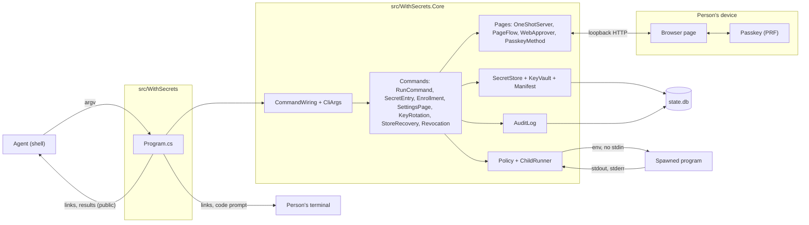
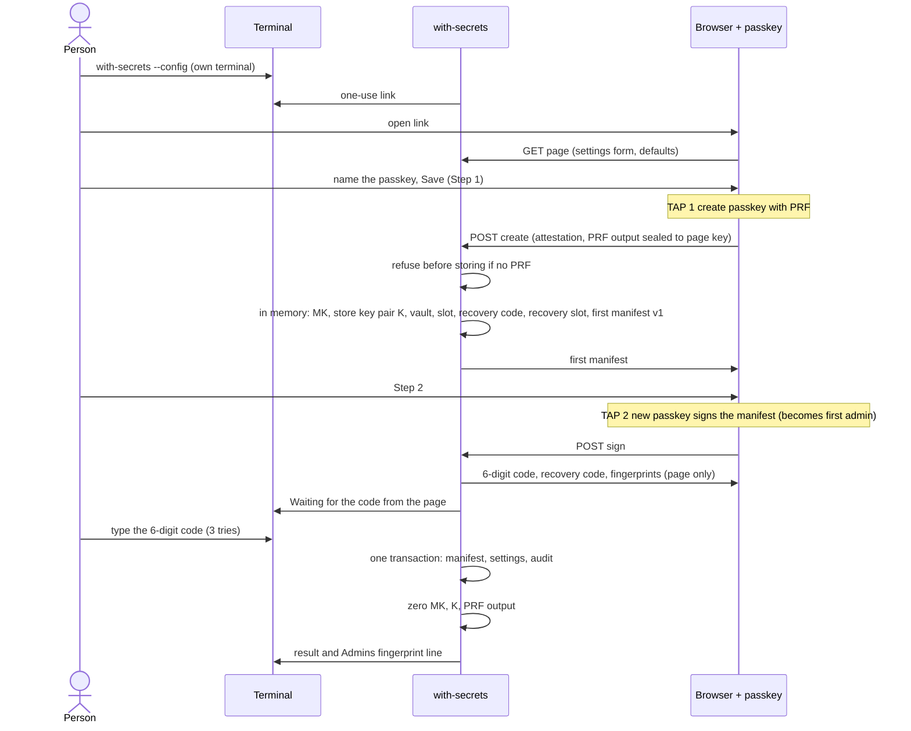
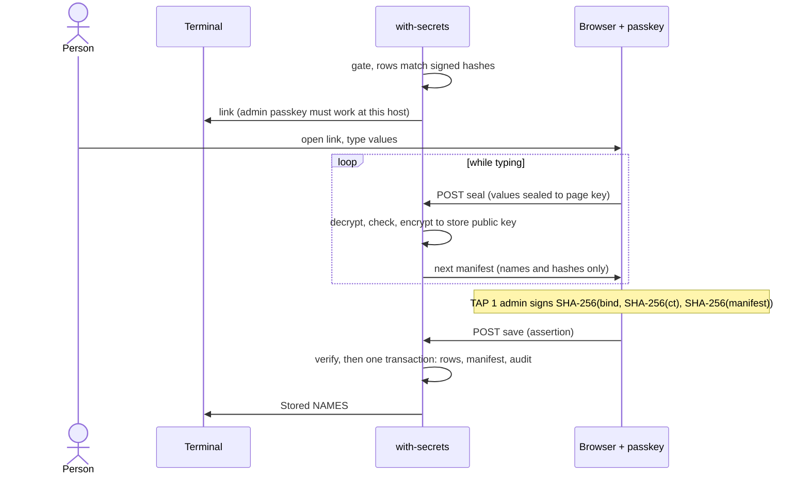
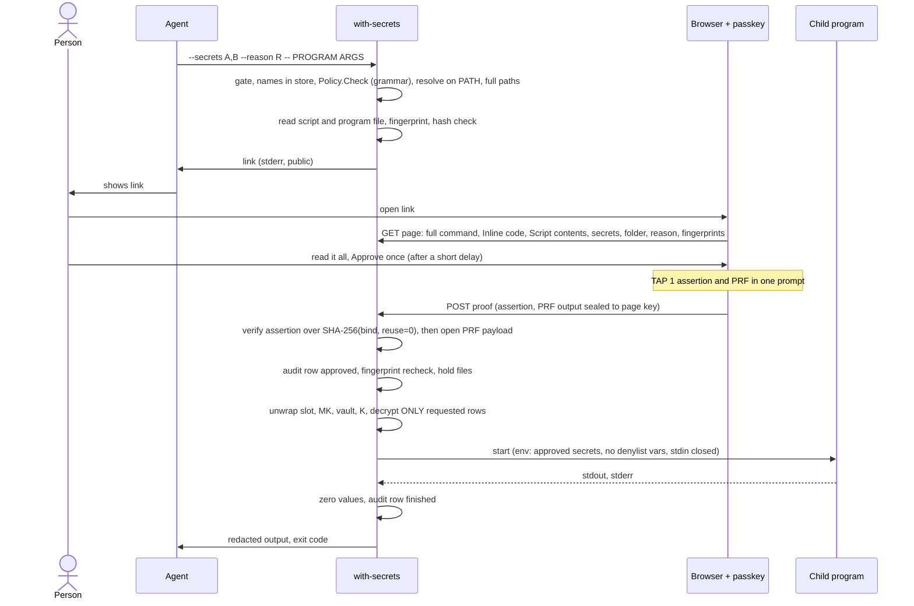
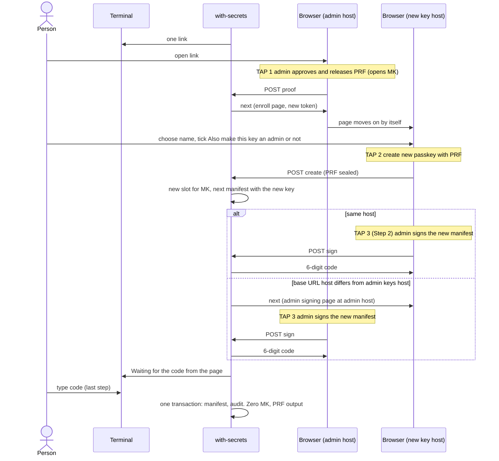
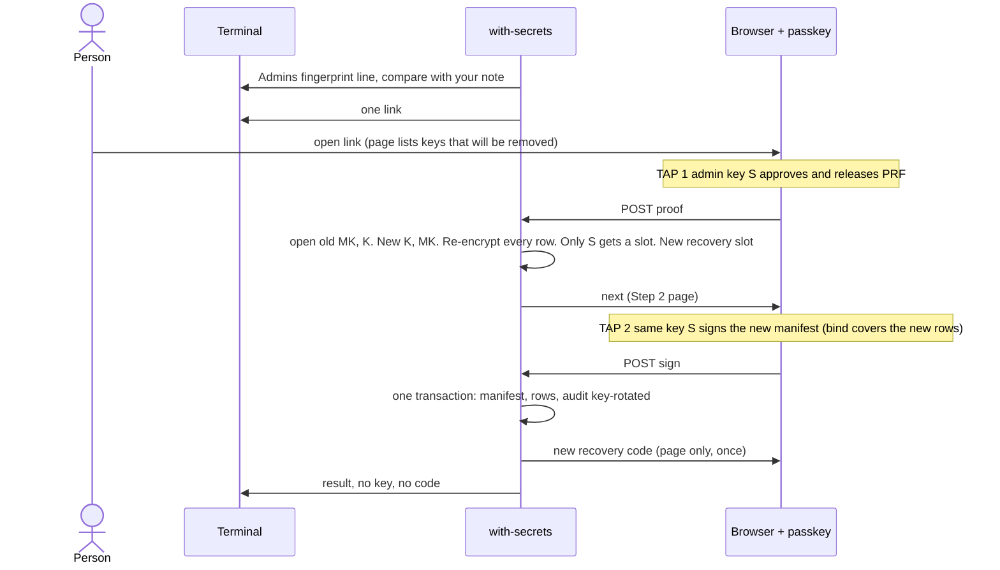
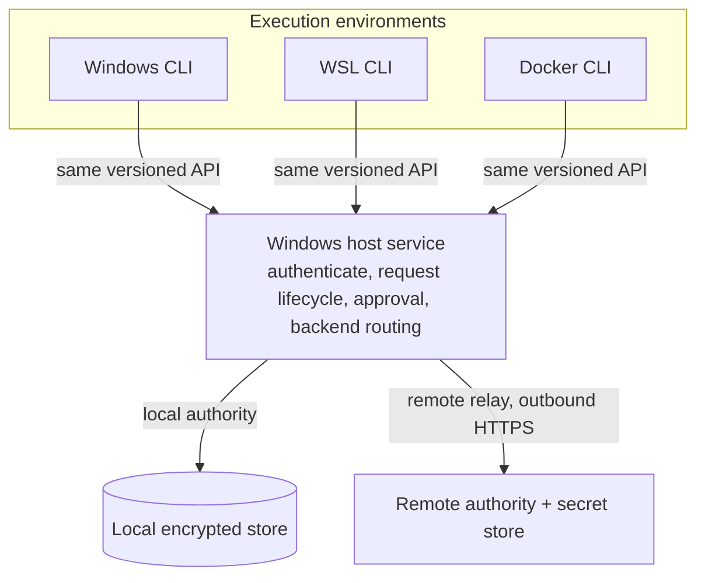

# with-secrets: architecture

Source of truth is the code (`src/WithSecrets.Core`, `src/WithSecrets`), then `README.md`. This page links to the README for limits instead of repeating them.

## 1. What it is

- A CLI that runs a program with secrets in its environment. An AI agent starts it, a person approves it.
- The agent names secrets and gives a reason. It never sees a value, a key or a recovery code.
- The person approves on a one-use web page with a passkey (WebAuthn). The same tap releases the secret store key (WebAuthn PRF).
- Everything is in one SQLite file, `state.db` (signed manifest, Dotenvx ciphertext rows, audit chain). No key is stored on the machine.
- Terminal output is public (the agent reads it). Values and the recovery code appear only in the browser.

## 2. Components

- `CommandWiring.cs` lives in Core, not in the exe. `Program.cs` parses, opens `state.db`, runs the gate, then dispatches.
- Every page of one command shares one `OneShotServer` (`PageFlow`), so one port and one link per command.

## 3. Communications

| From -> to | Transport | What is sent | What protects it |
| --- | --- | --- | --- |
| Agent -> CLI | argv, process start | secret names, reason, program, args | Policy checks before any page; names are not secret |
| CLI -> Agent / terminal | stdout, stderr | one-use link, names, admin fingerprint line, redacted child output, exit code | **Public by design.** Never values, keys, recovery code |
| Person -> CLI | terminal stdin | the 6-digit confirmation code (first `--config`, `--enroll`, new store of `--recover`) | Read only after the last tap, 3 tries, prompt is the last line (`TerminalPrompt`) |
| CLI -> browser | HTTP on 127.0.0.1 and [::1], same port (setting `port`, `--port N`, else free). With `baseUrl` (http or https; passkeys need https or localhost): that name pointed at the port, or `ssh -L PORT:localhost:PORT` | HTML page, inline script and style allowed by CSP hash, data block (request text, bind, challenges) | Token: 16 random bytes in the path, fixed-time compare, 404 for anything else. Headers: strict CSP (`default-src 'none'`, `connect-src 'self'`), `no-store`, `nosniff`, `X-Frame-Options: DENY`, `no-referrer`. Both loopback addresses held, `ExclusiveAddressUse` on Windows |
| Browser -> CLI | POST `proof`, `deny`, `seal`, `save`, `create`, `sign`, `code` (body max 1 MB, 15 s body timeout) | passkey assertion or attestation, reuse minutes, PRF output, typed `--set` values, recovery code | See rows below. First outcome of a step is final, later requests get 404 |
| Browser <-> passkey | WebAuthn in the browser | challenge, assertion, PRF eval of the slot salt | Each prompt starts in its own tap (iOS rule). RP ID is the page host, passkey ignores ports |
| PRF output, browser -> CLI | inside the proof POST | 32 bytes sealed: fresh ECDH P-256 key, HKDF-SHA-256 (salt = bind, info `with-secrets/v1 prf`), AES-256-GCM (bind as AAD) to the page's own server key | Sealed to a key that lives for that page only. A passive observer (tunnel that ends TLS) sees ciphertext. An active man in the middle who replaces the page key is not stopped (README) |
| `--set` values, browser -> CLI | `seal` POSTs while typing (max 500 per page) | each value sealed the same way (own HKDF info `with-secrets/v1 secrets`) | Page server key per page. The Save tap signs `SHA-256(bind \|\| SHA-256(ct) \|\| SHA-256(manifest))` |
| Recovery code, browser -> CLI | `--recover` code page | code sealed to the page key | Never in terminal, log, audit or `state.db`. A typed code is not origin-bound: compare the printed admin fingerprint first |
| Lost reply | page resends the same body (3 tries: 8 s, 8 s, 20 s; `deny` one try of 20 s) | same bytes | Steps that lead on (`proof`, `create`, `sign`, `code`) keep one reply per verified body (SHA-256 of body, fixed-time compare), in memory until the command ends. No second page, no second code. Other steps (`save`, `seal`, `deny`): a resend after the outcome gets 404 and the page says the program already finished |
| CLI <-> `state.db` | SQLite, WAL, one transaction per write | manifest, ciphertext rows, sign counts, audit rows | Manifest signature checked before use (exit 4). Writes check the version they replace |
| CLI -> spawned program | environment, argv, closed stdin | only the approved secrets as env vars | Denylist, no stdin, redacted output (section 7) |
| Network diagnostics | Debug log events: terminal only with `--debug`, and the log file | method, route word, whole seconds, sizes, verdict words | No path, token, body, key or value (`NetLog` words, constant `AppLog` templates) |

What is public: everything on stdout/stderr. What never leaves the browser: typed values (only sealed), the recovery code in plaintext (only sealed on `--recover`, shown on the page once), the passkey private key, the raw PRF output.

## 4. Key hierarchy

```mermaid
flowchart LR
    PRF["Passkey PRF output (32 bytes)"]
    KEK["Slot KEK"]
    Slot["Key slot wrap (per passkey)"]
    MK["Master key MK"]
    Vault["Vault"]
    K["Store key K (Dotenvx private key)"]
    Rows["secrets rows (ECIES secp256k1)"]
    Vals["Secret values"]
    Code["Recovery code (20 bytes)"]
    RK["Recovery key RK"]
    RSlot["Recovery slot wrap"]

    PRF -->|"HKDF-SHA-256, salt = slot salt, info with-secrets/v1 slot"| KEK
    KEK -->|"AES-256-GCM, AAD cred id + salt"| Slot
    Slot -->|"unwrap"| MK
    Code -->|"HKDF-SHA-256, salt = recovery salt, info with-secrets/v1 recovery"| RK
    RK -->|"AES-256-GCM, AAD with-secrets/v1 recovery + store public key"| RSlot
    RSlot -->|"unwrap"| MK
    MK -->|"AES-256-GCM, AAD with-secrets/v1 vault + store public key"| Vault
    Vault -->|"unwrap"| K
    K -->|"Dotenvx decrypt, requested rows only"| Rows
    Rows --> Vals
```

| Secret | Lives | Zeroed |
| --- | --- | --- |
| PRF output | In the passkey. In the page as a plain `Uint8Array` until sealed: the page scripts never overwrite it (garbage collection only). Server: opened from the sealed payload into `Unlock` (bytes) | `Unlock.Dispose` after the run read its values (every exit path). Registration copies zeroed after the slot is wrapped |
| Slot KEK | Process memory during wrap or unwrap | `KeyVault` finally blocks |
| Master key MK | `state.db` only as slot wraps and the recovery slot. Plain in memory during a run, `--enroll`, `--rotate-key`, `--recover`, first `--config` | After use (`SecretValues.Clear`) |
| Store key K | `state.db` only as the vault. Plain as bytes plus a hex string during decrypt | Bytes zeroed. The hex string cannot be wiped (.NET) |
| Decrypted values | Bytes in `SecretValues`, strings in the child env and the redactor | Bytes when the child ends. Strings cannot be wiped |
| Recovery code | Offline, written by the person. Server makes it at first `--config`, `--recover`, `--rotate-key`, formats it for the page | Code bytes zeroed when the page ends (first `--config`, `--recover`) or after the slot is built (`--rotate-key`); the formatted text is a string and cannot be wiped. `--recover` holds the old K in `RecoveryCarry` until the end |
| Slot salt | Manifest. One shared salt per store (the first key's), because the page can pass one `eval` salt. The PRF output still differs per passkey | Not secret |

Facts that follow from this: `state.db` alone cannot decrypt anything. A same-user agent that reads process memory during a run can get K (README "The secret store"). `--unenroll` does not rotate MK or K. `--rotate-key` does.

## 5. Signed state

The manifest is one row in `state.db`, as canonical JSON, signed by an admin passkey.

| Item | Detail |
| --- | --- |
| Contents | version `v`, `keys` (id, name, public key, alg, rp, created, admin flag, slot salt and wrap), `store` (store public key), `vault`, optional `recovery` slot, `secrets` (name -> SHA-256 of ciphertext), `settings` |
| Not in it | sign counts (table `sign_counts`), saved approvals, audit rows, the secret ciphertext itself (rows table, covered by the hashes) |
| Signature | admin assertion over `SHA-256(bind \|\| SHA-256(manifest text))`. Stored with its authenticator data and client data |
| Who may sign | a key that is an admin in the **stored** manifest and stays one. A key that only becomes admin in the new manifest cannot sign it. An admin cannot approve its own removal. The last admin cannot be removed |
| Verify before use | `Program.cs` runs `state.Gate` before every command, including `--list` and `--audit`. Failure prints `with-secrets: state failed verification: delete state.db to start over (only if you did not edit it)` (or the damaged or other-schema message) and exits 4. `--help` and bad arguments exit before the gate. Verified manifests are cached per process |
| Rows | every `SecretStore` read (`--list`, a run, `--set`, `--rotate-key`, `--recover`) checks every row against its signed hash (the gate checks integrity and the manifest only): a swapped row, a row with no hash or a hash with no row is exit 4 |
| Writes | one transaction: manifest, rows, audit row. Refused when the stored version is not the one the page started from |
| Sign counts | stored beside the manifest, unsigned. An assertion must raise the count. An agent can inflate them (denial of service only) |
| Fingerprints | first 8 bytes of SHA-256 of each admin public key, 4x4 hex. Shown on every page (part of the signed text), in `--enrolled`, `--audit`, and in the terminal before `--recover` and `--rotate-key`. Detects a replaced state |
| Grants (saved approvals) | **Inactive with the PRF store.** `SecretStore.NeedsUnlock` is true, so `RunCommand` uses `ReuseOffer.Off`: no list on the page, none saved or used. Code, table and tests remain (`Reuse.cs`) |
| Audit hash chain | each row holds `prev_hash` and `hash` over its entry, first row chains to 64 zeros. `--audit --verify` names the first broken link (exit 4). Finds edits and deleted middle rows, not removed tail rows. Not signed: a same-user writer can recompute it |
| Schema | version 9, checked at open (`PRAGMA integrity_check`). Other versions are never migrated |

Gaps (agent deletes `state.db` and builds its own state, restore of an older copy, rollback) are in README "Admin keys" and "Known limits".

## 6. Flows

Legend: **TAP** is a passkey prompt (one per user tap). Page moves on by itself when a reply carries `next`. Participants: P person, T terminal, C with-secrets process, B browser and passkey.

### 6.1 First-run setup (`--config`, nothing enrolled)

### 6.2 Store secrets (`--set NAME`)

No PRF and no master key: `--set` only needs the store public key. `--remove` is the plain approval page signing the next manifest without those hashes.

### 6.3 Run approval

Deny, wrong proof, any error or the time limit gives exit 3 and the audit row `denied`. If the audit row cannot be written nothing runs (exit 5).

### 6.4 Enroll a passkey (`--enroll`)

The code is generated at registration but shown only on the last page. Nothing is stored before it is typed. `--unenroll NAME` is a single approval page where another admin signs the manifest without that key.

### 6.5 Rotate keys (`--rotate-key`)

Failure or timeout between the taps changes nothing.

### 6.6 Recover (`--recover`, all passkeys lost)

The old file is never deleted. Old admin keys are gone from the new state. Any failure leaves the old `state.db` as it was.

## 7. Policy and child process

| Area | Rule | File |
| --- | --- | --- |
| Secret names | `NAME` or `folder/NAME` (up to 3 folders, 200 characters in all; the last segment UPPER_SNAKE_CASE, no `DOTENV_` prefix; folders `[A-Za-z0-9_.-]{1,64}`, not `.` or `..`). One validator for all commands, the whole path is the store name and is data only. Every name must be listed (no `--all`). `--set` and `--remove`: 1 to 20 names | `Contracts.cs` (`SecretNames`), `SecretEntry.cs`. Values: 6 to 4096 characters |
| Program lookup | `env`, `printenv`, `set` are refused (they print the environment). PATH entries that are absolute only. Working directory not searched unless the program has a slash or backslash. Windows App Execution Aliases refused | `ChildProcess.cs` (`ProgramResolver`), `RunCommand.cs` |
| Paths | program and script are expanded to full paths. What is checked, shown and run is the expanded form. They must read the same as the typed form | `RunCommand.cs`, `Paths.cs` (`PathExpander`), `Policy.cs` |
| Command grammar | Interpreters in one strict form only: `PROG script [args]` or `PROG -c/-e CODE` (sh family, python, node, perl, ruby), PowerShell: `-NoProfile` required, then `-NonInteractive`, `-NoLogo`, `-ExecutionPolicy VALUE` (once each), then exactly `-File` or `-Command`; `cmd /d /c` (or `/k`, `/r`) with a tail of letters, digits and `. _ : \ /` `-`, first word a `.cmd`/`.bat` file or echo, dir, type, ver. Encoded commands, a bare interpreter and code starting with a dash are refused. Other programs: no analysis, `Run:` line only (a text-file program is still shown). Matches README "Known limits" and `--help` | `Policy.cs` |
| Limits | command max 16,000 characters. Inline code shown: first 4,000 characters. Script max 1 MB (page shows first 200 lines or 16 KB). Script must exist, be text, and be readable. Batch files ASCII | `Policy.cs`, `RunCommand.cs`, `ApprovalSummary.cs` |
| Page text | every line of code prefixed `  \| `. Control, bidi and zero-width characters replaced by a mark. Part of the signed text | `ApprovalSummary.cs` |
| Fingerprint | covers names, every variable-to-secret pair, the `.env` paths and ordinary variable names (when a `.env` is used or a variable differs from its secret), full program path, folder, and path and hash of the script and of the program file (when 1 MB or less). Recomputed after approval. A changed file denies | `Reuse.cs`, `RunCommand.cs` |
| File lock | shown files opened `FileShare.Read` until the child ends, hashed again. Windows only. Elsewhere only the last check before launch | `RunCommand.cs` (`HeldFiles`) |
| Environment | removed before launch: `DOTENV_PRIVATE_KEY*`, `NODE_OPTIONS`, `BASH_ENV`, `ENV`, `PYTHONPATH`, `PYTHONSTARTUP`, `PYTHONHOME`, `PERL5OPT`, `RUBYOPT`, `LD_PRELOAD`, `DOTNET_STARTUP_HOOKS`, `JAVA_TOOL_OPTIONS`, five `GIT_*` names (`GIT_CONFIG_GLOBAL`, `GIT_CONFIG_SYSTEM`, `GIT_EXEC_PATH`, `GIT_SSH_COMMAND`, `GIT_ASKPASS`), `SHELLOPTS`, `BASHOPTS`, `PS4`, `PS0`, `PROMPT_COMMAND`, `BASH_FUNC_*` and more (case-insensitive on Windows). Full list in `ChildRunner.CodeLoadingVariables` and README. Known gaps: README | `ChildProcess.cs` |
| Stdin | closed right after start: the child reads end of file | `ChildProcess.cs` |
| Launch | `.cmd` and `.bat` start as `cmd.exe /d /c "path" args` (no AutoRun). Arguments with quotes or `& \| < > ^ % !` are refused for cmd | `ChildProcess.cs`, `Policy.cs` |
| Output | read as UTF-8, redacted by `StreamRedactor` (chunk splits and common forms). Reversed, split, compressed or encrypted copies are not caught | `Redaction.cs` |
| Terminal-only commands | `--revoke --enroll --enrolled --unenroll --config` (not `--config --show`) `--recover --rotate-key` refuse when input, output or error is redirected (exit 3). `--set`, `--remove`, `--list`, `--audit` do not check | `CommandLine.cs`, `Program.cs` |

## 8. Trust boundaries

What the agent can and cannot do, and the known limits: README "Known limits", "Admin keys" and "The secret store". Summary:

| Actor | Capability | What stops it |
| --- | --- | --- |
| Agent (same OS user) | start a run, read terminal output, hold links | Cannot tap the passkey. Link is one-use and shows the whole request. Enrollment codes need a human typing in a real terminal |
| Agent | read `state.db` | No key on disk: K is only wrapped, MK only under PRF or the recovery code. Rows are ciphertext |
| Agent | edit `state.db` (keys, settings, rows, slot, vault) | Manifest signature and row hashes fail: exit 4 on every command |
| Agent | delete `state.db` and write its own signed state | **Not prevented.** Visible: admin fingerprints change on every page, `--enrolled`, `--audit` |
| Agent | restore an older `state.db`, rewrite audit and chain, inflate sign counts | Accepted limits (README) |
| Agent | read process memory during a run | **Not prevented.** K, MK, PRF output and values are in memory for that moment (README) |
| Agent | change the script or program after the page showed it | Fingerprint recheck, file hold (Windows) |
| Agent | pass options or env that load unshown code | Strict grammar, environment denylist, closed stdin. Gaps listed in README |
| Another local process | serve a look-alike page on localhost | Server holds both loopback addresses exclusively. Passkey RP ID ignores ports, so check the printed link before tapping (README) |
| Network observer (tunnel) | read page traffic | PRF output and `--set` values are sealed to the page key. Active man in the middle is out of scope |
| Child program | print or send secrets | Output redaction only. A program that sends its environment out is out of scope |
| Lost admin device | still opens the store with an old `state.db` copy | `--rotate-key` (keeps one key). `--unenroll` alone does not rotate MK or K |

## 9. Exit codes and error paths

| Code | Meaning | Typical causes |
| --- | --- | --- |
| 0 | success | run: the child exited 0. Commands: change made, `--help`, `--list`, `--audit` |
| 2 | usage | bad arguments, two commands, invalid or unknown secret name, policy refusal, script missing, too large or not text, changed while the request was built, command too long, App Execution Alias |
| 3 | denied | Deny on the page, wrong proof, time limit, internal error in a session (`HandleGuard`, text says only `internal error`), files changed while the page was open, file hold failed, nothing enrolled, no terminal for a human command, refused change |
| 4 | store error | `state.db` damaged, locked over 5 s, other schema, failed signature or row hash, unusable settings, cannot decrypt, `--audit --verify` finds a broken link |
| 5 | audit error | the audit row could not be written, so nothing ran |
| 127 | not found | program not on PATH, or the process cannot be started |
| other | the child's own exit code | passed through on a run |

Every web session ends on the first outcome. Deny, error and silence all end in a denial, never an approval. Gate failures happen before any link is printed.

## 10. Planned, not built

| Item | State |
| --- | --- |
| Task 20: remote mode for sandboxes (relay, pairing, end-to-end encrypted values) | Future. Design document first |
| Task 19: project `.env` declarations (`secret://` references) | **Phase A built** (see 10.1). Dotenvx encrypted values and the host service are later phases |
| Host service and remote relay (10.2) | Planned, design only. Needs its own security design first |
| Task 16: privilege separation (service or daemon under another OS account) | Future, priority not decided |
| Serilog logging (normal run quiet, `--debug` verbose, warnings and errors to a rolling file under `~/.with-secrets/logs`) | **Built** (`AppLog.cs`): Debug events to the terminal and file only with `--debug` or `WITH_SECRETS_DEBUG=1`; warnings and above always to the file (daily, 1 MB roll, 7 files); call sites use constant templates with route words, sizes and type names only |
| Hand tests (real browsers, phones, tunnel) | Open, see README "Checks" |

### 10.1 Project `.env` declarations

**Phase A is built** (`EnvDeclarations.cs`; tests: the `EnvDeclarations` suite). Not built: Dotenvx encrypted values, `${VAR}` expansion, `--env NAME`, host service.

The `.env` file in the working folder becomes the declaration of what a project needs. The agent no longer has to guess or list names.

- **Three kinds of value.** Ordinary (`LOG_LEVEL=Debug`), Dotenvx encrypted (`encrypted:...`), and a reference (`TOKEN=secret://GITHUB_TOKEN`). The left side is the variable the program receives; the right side names the secret. They can differ (`STRIPE_KEY=secret://STRIPE_PRODUCTION_KEY`).
- **Grammar.** `secret://[folder/...]NAME`. The qualifier is just a folder path the user chooses for their own organisation (`project/DB_PASSWORD`, `team/payments/STRIPE_KEY`); it has no built-in meaning. The whole path is the secret's name in the store, so `--set team/payments/STRIPE_KEY` stores it and `secret://team/payments/STRIPE_KEY` finds it. An unqualified name is the plain name. A reference is a logical name, never a storage location. Later, a default folder can come from the authority's configuration.
- **Composition first, resolution after.** Files are layered like Dotenvx (first file wins; `-f` repeats; an inherited OS variable beats an ordinary `.env` value). Only the final effective declaration asks for a secret, so an overridden `secret://` never causes a prompt.
- **`--secrets` stays.** Names given with `--secrets` are added to the references found in the `.env`. A new read-only `--needs` shows what the current project would ask for (names only, no values, no approval).
- **Trust.** The agent can write the `.env`, so the page shows every `VARIABLE <- secret` pair (one per line, renamed ones marked), every ordinary `VARIABLE=value`, and the file paths (outside-folder and symlink marks). Counts and lengths are capped and anything over is refused, never hidden. The child still has code-loading variables removed (also from `.env` values), and references to proxy, git-identity or code-loading names are refused. The human approves what the page shows.
- **Later phases.** Dotenvx encrypted values (the private key held in the store as a secret, approved like any other), `${VAR}` expansion, `--env NAME` layering.

### 10.2 Host service and remote relay (planned)

Goal: the same CLI workflow from Windows, WSL and Docker, and later from a remote authority, with the CLI never touching the store.

- **CLI** composes the environment, classifies values, asks the host for exactly the needed secrets, and launches the child in its own environment (a Docker CLI starts the child in Docker). The host never launches programs.
- **Host service** owns the store and the API, authenticates clients, runs the approval, and either resolves locally or relays to the remote authority. The relay is not a transparent proxy: a request is bound to its id, client identity, host identity, secret names, project, command, expiry and approval state, and the answer is checked against it.
- **API operations** (versioned, transport independent): create request, get status, submit approval, deny, retrieve approved values, cancel.
- **Connectivity.** WSL finds the Windows host endpoint itself; Docker uses `host.docker.internal` or an explicit endpoint. Localhost, WSL and Docker are not trusted by position: clients authenticate, container credentials are short lived and scoped to the request, and an environment label is metadata, not identity.
- **Network segregation.** Containers need no Internet; only the host service talks to the remote authority.
- **Fits the current design.** The store key still needs a passkey tap per approval, so a service would hold no key at rest. The one-use page, passkey proof and audit carry over. This is the same ground as Task 20 and Task 16.
- **Open questions.** Exact URI grammar and escaping; default namespace resolution; Dotenvx private key retrieval; where approval happens in remote mode; client authentication for WSL and Docker; transport and endpoint discovery; remote registration; reporting of missing references; conflicts with inherited variables; which Dotenvx composition rules must be kept exactly.
- **Order.** `.env` syntax and composition (10.1) -> transport-independent API contract -> host service with local store -> Windows client -> WSL -> Docker -> remote relay -> remote authority -> tests proving local and remote behave the same.

## 11. Where is it in the code

| Concept | File (`src/WithSecrets.Core` unless noted) |
| --- | --- |
| Entry, gate, dispatch | `src/WithSecrets/Program.cs` |
| Command wiring, targets, code reader | `CommandWiring.cs` |
| Argument parsing, `NeedsTerminal` | `CommandLine.cs` |
| Run pipeline, exit codes | `RunCommand.cs` |
| Project `.env`: parser, composition, `secret://` grammar, `--needs` | `EnvDeclarations.cs` |
| Command grammar, length limits | `Policy.cs` |
| Approval text, request fingerprint, script view | `ApprovalSummary.cs`, `Reuse.cs` |
| Child process, PATH lookup, env denylist | `ChildProcess.cs` |
| Output redaction | `Redaction.cs` |
| Loopback server, tokens, headers, `HandleGuard`, `NetLog` | `OneShotServer.cs` |
| One link per command, `next`, time budget | `PageFlow.cs` |
| Approval page and session, proof handling, CSP | `WebApprover.cs` |
| Passkey proof, RP ID, sign counts | `PasskeyMethod.cs`, `WebAuthn.cs`, `PasskeyStore.cs`, `Proof.cs` |
| PRF page code, label, sealed payload | `PrfClient.cs`, `SecretCrypto.cs` |
| First setup and registration pages | `SettingsPage.cs`, `PasskeyRegistration.cs` |
| Settings and limits | `ToolSettings.cs`, `ApprovalSettings.cs` |
| Enroll, unenroll, names | `Enrollment.cs`, `EnrollmentTarget.cs` |
| `--set`, `--remove` | `SecretEntry.cs` |
| Secret rows, hashes, decrypt only requested | `SecretStore.cs` |
| Slots, vault, recovery slot | `KeyVault.cs`, `RecoveryCode.cs` |
| Signed manifest | `Manifest.cs` |
| SQLite, schema 9, gate, integrity | `StateDatabase.cs` |
| Rotate keys, recover | `KeyRotation.cs`, `StoreRecovery.cs` |
| Revoke | `Revocation.cs` |
| Audit log, hash chain, `--audit` | `AuditLog.cs` |
| Terminal prompt (lines are written at once; nothing is held or dropped) | `TerminalPrompt.cs` |
| Logging: Serilog setup, file rules, `--debug` terminal sink | `AppLog.cs` |
| Saved approvals (inactive with this store) | `Reuse.cs` |
| Tests | `tests/WithSecrets.Tests`, browser tests `tests/WithSecrets.E2E` |

## Open questions for the maintainer

Answered from the code: the grammar in section 7 matches `Policy.cs`, README "Known limits" and `--help` (the page scripts never zero the PRF output: see section 4). Task 19 and Task 20 are in `.claude/plan.md` and the ledger, not in the plan file; no code exists for them.

1. Cross-host `--enroll` (6.4, the `else` branch) is traced in `Enrollment.cs` and `PasskeyRegistration.cs` but has not been run in a browser. Hand test still open.
2. Should the page scripts overwrite the PRF `Uint8Array` after sealing? Today they do not (no `fill(0)` in any page), and the browser's copy is out of reach anyway.
3. `--revoke` clears saved approvals, which are inactive with the PRF store. Keep the command or retire it?
4. README line 39 shows the path as `%USERPROFILE%.with-secretsstate.db` (backslashes lost). It should be `%USERPROFILE%\.with-secrets\state.db`. Not edited here.
