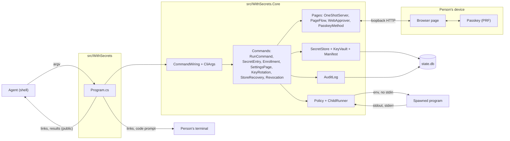
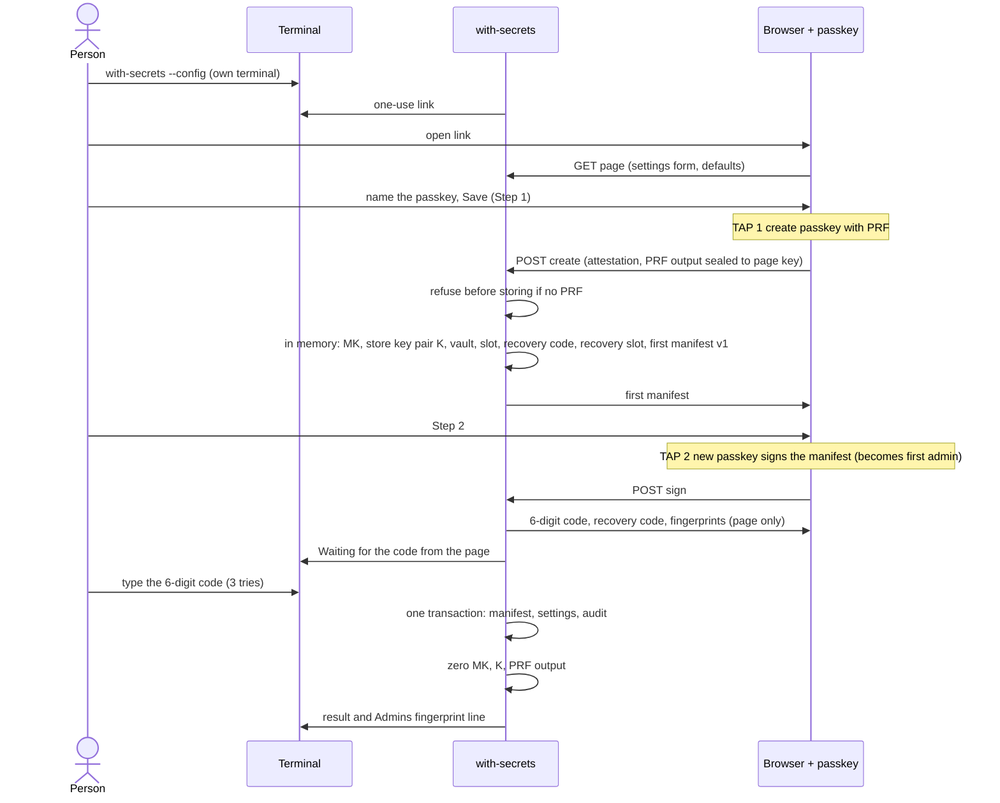
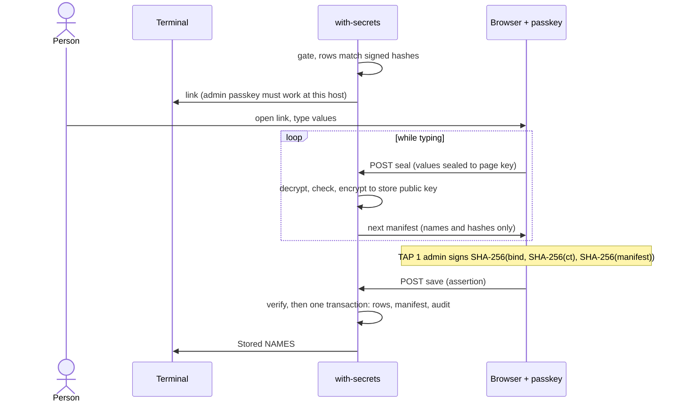
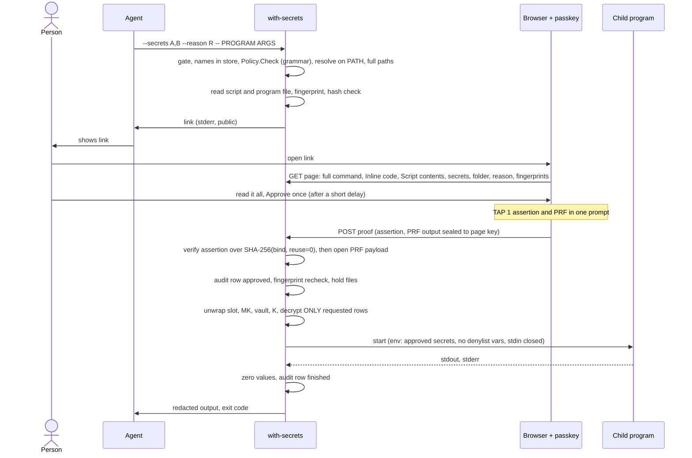
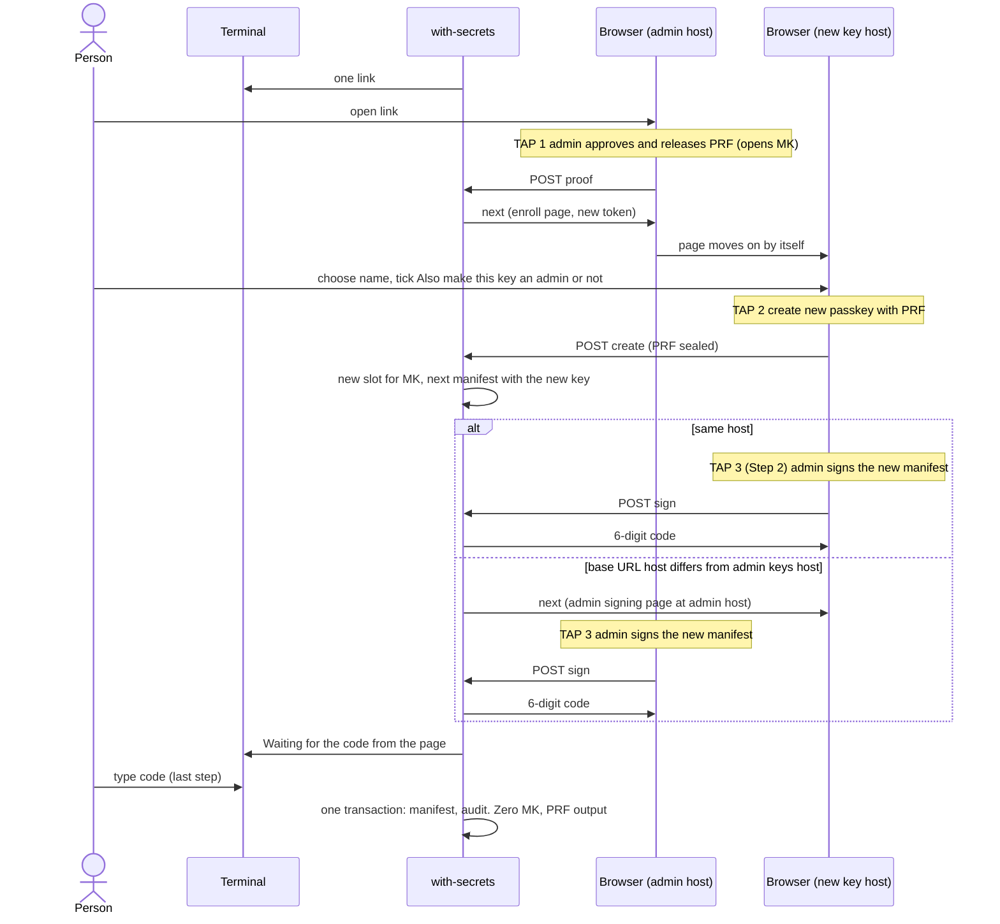
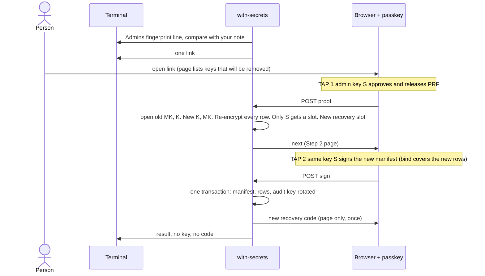

# with-secrets: architecture

The code and README describe the current single-process prototype. Sections 10.1 and 10.2 describe later work; Section 10.2 is the accepted target design, not implemented behavior. For current behavior, the source of truth is the code (`src/WithSecrets.Core`, `src/WithSecrets`), then `README.md`. For the accepted service/authority design, use Section 10.2 and the decisions recorded there. This page links to the README for current implementation limits instead of repeating them.

## 1. What it is (current prototype)

- A CLI runs a program with secrets in its environment. An agent starts the command; a person approves it.
- The agent supplies secret names and a reason. The CLI does not print secret values, private keys, or the recovery code to agent-visible output. Approved values are injected into the child process environment.
- The person approves on a one-use web page with a passkey (WebAuthn). The same tap releases the secret-store key (WebAuthn PRF).
- The current prototype keeps its signed manifest, wrapped key material, Dotenvx ciphertext rows, settings, and audit chain in one SQLite file, `state.db`. The store private key is persisted only wrapped in the vault; the master key is persisted only in wrapped passkey/recovery slots. No plaintext store or master key is persisted.
- Terminal output is public (the agent reads it). Values and the recovery code appear only in the browser, apart from approved secret values in the child environment. Same-user process-memory access remains a documented limit (README).

## 2. Components (current prototype)

The diagram below is the existing single-process CLI. It is not the host-service topology accepted in Section 10.2.



- `CommandWiring.cs` lives in Core, not in the exe. `Program.cs` parses, opens `state.db`, runs the gate, then dispatches.
- Every page of one command shares one `OneShotServer` (`PageFlow`), so one port and one link per command.

## 3. Communications (current prototype)

The table describes the current CLI/browser/child-process flow, not the future local-service and authority protocol in Section 10.2.

| From -> to | Transport | What is sent | What protects it |
| --- | --- | --- | --- |
| Agent -> CLI | argv, process start | secret names, reason, program, args | Policy checks before any page; names are not secret |
| CLI -> Agent / terminal | stdout, stderr | one-use link, names, admin fingerprint line, redacted child output, exit code | **Public by design.** Never values, keys, recovery code |
| Person -> CLI | terminal stdin | the 6-digit confirmation code (first `--config`, `--enroll`, new store of `--recover`) | Read only after the last tap, 3 tries, prompt is the last line (`TerminalPrompt`) |
| CLI -> browser | HTTP on 127.0.0.1 and [::1], same port (setting `port`, `--port N`, else free). With `baseUrl` (http or https; passkeys need https or localhost): that name pointed at the port, or `ssh -L PORT:localhost:PORT` | HTML page, inline script and style allowed by CSP hash, data block (request text, bind, challenges) | Token: 16 random bytes in the path, fixed-time compare, 404 for anything else. Headers: strict CSP (`default-src 'none'`, `connect-src 'self'`), `no-store`, `nosniff`, `X-Frame-Options: DENY`, `no-referrer`. Both loopback addresses held, `ExclusiveAddressUse` on Windows |
| Browser -> CLI | POST `proof`, `deny`, `seal`, `save`, `create`, `sign`, `code` (body max 1 MB, 15 s body timeout) | passkey assertion or attestation, reuse minutes, PRF output, typed `--set` values, recovery code | See rows below. First outcome of a step is final, later requests get 404 |
| Browser <-> passkey | WebAuthn in the browser | challenge, assertion, PRF eval of the slot salt | Each prompt starts in its own tap (iOS rule). RP ID is the page host, passkey ignores ports |
| PRF output, browser -> CLI | inside the proof POST | 32 bytes sealed: fresh ECDH P-256 key, HKDF-SHA-256 (salt = bind, info `with-secrets/v1 prf`), AES-256-GCM (bind as AAD) to the page's own server key | Sealed to a key that lives for that page only. A passive observer (tunnel that ends TLS) sees ciphertext. An active man in the middle who replaces the page key is not stopped (README) |
| `--set` values, browser -> CLI | `seal` POSTs while typing (max 500 per page) | each value sealed the same way (own HKDF info `with-secrets/v1 secrets`) | Page server key per page. The Save tap signs `SHA-256(bind \|\| SHA-256(ct) \|\| SHA-256(manifest))` |
| Recovery code, browser -> CLI | `--recover` code page | code sealed to the page key | Never in terminal, log, audit or `state.db`. A typed code is not origin-bound: compare the printed admin fingerprint first |
| Lost reply | page resends the same body (3 tries: 8 s, 8 s, 20 s; `deny` one try of 20 s) | same bytes | Steps that lead on (`proof`, `create`, `sign`, `code`) keep one reply per verified body (SHA-256 of body, fixed-time compare), in memory until the command ends. No second page, no second code. Other steps (`save`, `seal`, `deny`): a resend after the outcome gets 404 and the page says the program already finished |
| CLI <-> `state.db` | SQLite, WAL, one transaction per write | manifest, ciphertext rows, sign counts, audit rows | Manifest signature checked before use (exit 4). Writes check the version they replace |
| CLI -> spawned program | environment, argv, closed stdin | only the approved secrets as env vars | Denylist, no stdin, redacted output (section 7) |
| Network diagnostics | Debug log events: terminal only with `--debug`, and the log file | method, route word, whole seconds, sizes, verdict words | No path, token, body, key or value (`NetLog` words, constant `AppLog` templates) |

What is public: everything on stdout/stderr. What never leaves the browser: typed values (only sealed), the recovery code in plaintext (only sealed on `--recover`, shown on the page once), the passkey private key, the raw PRF output.

## 4. Key hierarchy

```mermaid
flowchart LR
    PRF["Passkey PRF output (32 bytes)"]
    KEK["Slot KEK"]
    Slot["Key slot wrap (per passkey)"]
    MK["Master key MK"]
    Vault["Vault"]
    K["Store key K (Dotenvx private key)"]
    Rows["secrets rows (ECIES secp256k1)"]
    Vals["Secret values"]
    Code["Recovery code (20 bytes)"]
    RK["Recovery key RK"]
    RSlot["Recovery slot wrap"]

    PRF -->|"HKDF-SHA-256, salt = slot salt, info with-secrets/v1 slot"| KEK
    KEK -->|"AES-256-GCM, AAD cred id + salt"| Slot
    Slot -->|"unwrap"| MK
    Code -->|"HKDF-SHA-256, salt = recovery salt, info with-secrets/v1 recovery"| RK
    RK -->|"AES-256-GCM, AAD with-secrets/v1 recovery + store public key"| RSlot
    RSlot -->|"unwrap"| MK
    MK -->|"AES-256-GCM, AAD with-secrets/v1 vault + store public key"| Vault
    Vault -->|"unwrap"| K
    K -->|"Dotenvx decrypt, requested rows only"| Rows
    Rows --> Vals
```



| Secret | Lives | Zeroed |
| --- | --- | --- |
| PRF output | In the passkey. In the page as a plain `Uint8Array` until sealed: the page scripts never overwrite it (garbage collection only). Server: opened from the sealed payload into `Unlock` (bytes) | `Unlock.Dispose` after the run read its values (every exit path). Registration copies zeroed after the slot is wrapped |
| Slot KEK | Process memory during wrap or unwrap | `KeyVault` finally blocks |
| Master key MK | `state.db` only as slot wraps and the recovery slot. Plain in memory during a run, `--enroll`, `--rotate-key`, `--recover`, first `--config` | After use (`SecretValues.Clear`) |
| Store key K | `state.db` only as the vault. Plain as bytes plus a hex string during decrypt | Bytes zeroed. The hex string cannot be wiped (.NET) |
| Decrypted values | Bytes in `SecretValues`, strings in the child env and the redactor | Bytes when the child ends. Strings cannot be wiped |
| Recovery code | Offline, written by the person. Server makes it at first `--config`, `--recover`, `--rotate-key`, formats it for the page | Code bytes zeroed when the page ends (first `--config`, `--recover`) or after the slot is built (`--rotate-key`); the formatted text is a string and cannot be wiped. `--recover` holds the old K in `RecoveryCarry` until the end |
| Slot salt | Manifest. One shared salt per store (the first key's), because the page can pass one `eval` salt. The PRF output still differs per passkey | Not secret |

Facts that follow from this: `state.db` alone cannot decrypt anything. A same-user agent that reads process memory during a run can get K (README "The secret store"). `--unenroll` does not rotate MK or K. `--rotate-key` does.

## 5. Signed state

The manifest is one row in `state.db`, as canonical JSON, signed by an admin passkey.

| Item | Detail |
| --- | --- |
| Contents | version `v`, `keys` (id, name, public key, alg, rp, created, admin flag, slot salt and wrap), `store` (store public key), `vault`, optional `recovery` slot, `secrets` (name -> SHA-256 of ciphertext), `settings` |
| Not in it | sign counts (table `sign_counts`), saved approvals, audit rows, the secret ciphertext itself (rows table, covered by the hashes) |
| Signature | admin assertion over `SHA-256(bind \|\| SHA-256(manifest text))`. Stored with its authenticator data and client data |
| Who may sign | a key that is an admin in the **stored** manifest and stays one. A key that only becomes admin in the new manifest cannot sign it. An admin cannot approve its own removal. The last admin cannot be removed |
| Verify before use | `Program.cs` runs `state.Gate` before every command, including `--list` and `--audit`. Failure prints `with-secrets: state failed verification: delete state.db to start over (only if you did not edit it)` (or the damaged or other-schema message) and exits 4. `--help` and bad arguments exit before the gate. Verified manifests are cached per process |
| Rows | every `SecretStore` read (`--list`, a run, `--set`, `--rotate-key`, `--recover`) checks every row against its signed hash (the gate checks integrity and the manifest only): a swapped row, a row with no hash or a hash with no row is exit 4 |
| Writes | one transaction: manifest, rows, audit row. Refused when the stored version is not the one the page started from |
| Sign counts | stored beside the manifest, unsigned. An assertion must raise the count. An agent can inflate them (denial of service only) |
| Fingerprints | first 8 bytes of SHA-256 of each admin public key, 4x4 hex. Shown on every page (part of the signed text), in `--enrolled`, `--audit`, and in the terminal before `--recover` and `--rotate-key`. Detects a replaced state |
| Grants (saved approvals) | **Inactive with the PRF store.** `SecretStore.NeedsUnlock` is true, so `RunCommand` uses `ReuseOffer.Off`: no list on the page, none saved or used. Code, table and tests remain (`Reuse.cs`) |
| Audit hash chain | each row holds `prev_hash` and `hash` over its entry, first row chains to 64 zeros. `--audit --verify` names the first broken link (exit 4). Finds edits and deleted middle rows, not removed tail rows. Not signed: a same-user writer can recompute it |
| Schema | version 9, checked at open (`PRAGMA integrity_check`). Other versions are never migrated |

Gaps (agent deletes `state.db` and builds its own state, restore of an older copy, rollback) are in README "Admin keys" and "Known limits".

## 6. Flows

Legend: **TAP** is a passkey prompt (one per user tap). Page moves on by itself when a reply carries `next`. Participants: P person, T terminal, C with-secrets process, B browser and passkey.

### 6.1 First-run setup (`--config`, nothing enrolled)



### 6.2 Store secrets (`--set NAME`)



No PRF and no master key: `--set` only needs the store public key. `--remove` is the plain approval page signing the next manifest without those hashes.

### 6.3 Run approval



Deny, wrong proof, any error or the time limit gives exit 3 and the audit row `denied`. If the audit row cannot be written nothing runs (exit 5).

### 6.4 Enroll a passkey (`--enroll`)



The code is generated at registration but shown only on the last page. Nothing is stored before it is typed. `--unenroll NAME` is a single approval page where another admin signs the manifest without that key.

### 6.5 Rotate keys (`--rotate-key`)



Failure or timeout between the taps changes nothing.

### 6.6 Recover (`--recover`, all passkeys lost)


The old file is never deleted. Old admin keys are gone from the new state. Any failure leaves the old `state.db` as it was.

## 7. Policy and child process

| Area | Rule | File |
| --- | --- | --- |
| Secret names | `NAME` or `folder/NAME` (up to 3 folders, 200 characters in all; the last segment UPPER_SNAKE_CASE, no `DOTENV_` prefix; folders `[A-Za-z0-9_.-]{1,64}`, not `.` or `..`). One validator for all commands, the whole path is the store name and is data only. Every name must be listed (no `--all`). `--set` and `--remove`: 1 to 20 names | `Contracts.cs` (`SecretNames`), `SecretEntry.cs`. Values: 6 to 4096 characters |
| Program lookup | `env`, `printenv`, `set` are refused (they print the environment). PATH entries that are absolute only. Working directory not searched unless the program has a slash or backslash. Windows App Execution Aliases refused | `ChildProcess.cs` (`ProgramResolver`), `RunCommand.cs` |
| Paths | program and script are expanded to full paths. What is checked, shown and run is the expanded form. They must read the same as the typed form | `RunCommand.cs`, `Paths.cs` (`PathExpander`), `Policy.cs` |
| Command grammar | Interpreters in one strict form only: `PROG script [args]` or `PROG -c/-e CODE` (sh family, python, node, perl, ruby), PowerShell: `-NoProfile` required, then `-NonInteractive`, `-NoLogo`, `-ExecutionPolicy VALUE` (once each), then exactly `-File` or `-Command`; `cmd /d /c` (or `/k`, `/r`) with a tail of letters, digits and `. _ : \ /` `-`, first word a `.cmd`/`.bat` file or echo, dir, type, ver. Encoded commands, a bare interpreter and code starting with a dash are refused. Other programs: no analysis, `Run:` line only (a text-file program is still shown). Matches README "Known limits" and `--help` | `Policy.cs` |
| Limits | command max 16,000 characters. Inline code shown: first 4,000 characters. Script max 1 MB (page shows first 200 lines or 16 KB). Script must exist, be text, and be readable. Batch files ASCII | `Policy.cs`, `RunCommand.cs`, `ApprovalSummary.cs` |
| Page text | every line of code prefixed `  \| `. Control, bidi and zero-width characters replaced by a mark. Part of the signed text | `ApprovalSummary.cs` |
| Fingerprint | covers names, every variable-to-secret pair, the `.env` paths and ordinary variable names (when a `.env` is used or a variable differs from its secret), full program path, folder, and path and hash of the script and of the program file (when 1 MB or less). Recomputed after approval. A changed file denies | `Reuse.cs`, `RunCommand.cs` |
| File lock | shown files opened `FileShare.Read` until the child ends, hashed again. Windows only. Elsewhere only the last check before launch | `RunCommand.cs` (`HeldFiles`) |
| Environment | removed before launch: `DOTENV_PRIVATE_KEY*`, `NODE_OPTIONS`, `BASH_ENV`, `ENV`, `PYTHONPATH`, `PYTHONSTARTUP`, `PYTHONHOME`, `PERL5OPT`, `RUBYOPT`, `LD_PRELOAD`, `DOTNET_STARTUP_HOOKS`, `JAVA_TOOL_OPTIONS`, five `GIT_*` names (`GIT_CONFIG_GLOBAL`, `GIT_CONFIG_SYSTEM`, `GIT_EXEC_PATH`, `GIT_SSH_COMMAND`, `GIT_ASKPASS`), `SHELLOPTS`, `BASHOPTS`, `PS4`, `PS0`, `PROMPT_COMMAND`, `BASH_FUNC_*` and more (case-insensitive on Windows). Full list in `ChildRunner.CodeLoadingVariables` and README. Known gaps: README | `ChildProcess.cs` |
| Stdin | closed right after start: the child reads end of file | `ChildProcess.cs` |
| Launch | `.cmd` and `.bat` start as `cmd.exe /d /c "path" args` (no AutoRun). Arguments with quotes or `& \| < > ^ % !` are refused for cmd | `ChildProcess.cs`, `Policy.cs` |
| Output | read as UTF-8, redacted by `StreamRedactor` (chunk splits and common forms). Reversed, split, compressed or encrypted copies are not caught | `Redaction.cs` |
| Terminal-only commands | `--revoke --enroll --enrolled --unenroll --config` (not `--config --show`) `--recover --rotate-key` refuse when input, output or error is redirected (exit 3). `--set`, `--remove`, `--list`, `--audit` do not check | `CommandLine.cs`, `Program.cs` |

## 8. Trust boundaries (current prototype)

This table describes the current single-process implementation. The future local API trust model is described separately in Section 10.2. What the agent can and cannot do, and the known limits: README "Known limits", "Admin keys" and "The secret store". Summary:

| Actor | Capability | What stops it |
| --- | --- | --- |
| Agent (same OS user) | start a run, read terminal output, hold links | Cannot tap the passkey. Link is one-use and shows the whole request. Enrollment codes need a human typing in a real terminal |
| Agent | read `state.db` | No key on disk: K is only wrapped, MK only under PRF or the recovery code. Rows are ciphertext |
| Agent | edit `state.db` (keys, settings, rows, slot, vault) | Manifest signature and row hashes fail: exit 4 on every command |
| Agent | delete `state.db` and write its own signed state | **Not prevented.** Visible: admin fingerprints change on every page, `--enrolled`, `--audit` |
| Agent | restore an older `state.db`, rewrite audit and chain, inflate sign counts | Accepted limits (README) |
| Agent | read process memory during a run | **Not prevented.** K, MK, PRF output and values are in memory for that moment (README) |
| Agent | change the script or program after the page showed it | Fingerprint recheck, file hold (Windows) |
| Agent | pass options or env that load unshown code | Strict grammar, environment denylist, closed stdin. Gaps listed in README |
| Another local process | serve a look-alike page on localhost | Server holds both loopback addresses exclusively. Passkey RP ID ignores ports, so check the printed link before tapping (README) |
| Network observer (tunnel) | read page traffic | PRF output and `--set` values are sealed to the page key. Active man in the middle is out of scope |
| Child program | print or send secrets | Output redaction only. A program that sends its environment out is out of scope |
| Lost admin device | still opens the store with an old `state.db` copy | `--rotate-key` (keeps one key). `--unenroll` alone does not rotate MK or K |

## 9. Exit codes and error paths

| Code | Meaning | Typical causes |
| --- | --- | --- |
| 0 | success | run: the child exited 0. Commands: change made, `--help`, `--list`, `--audit` |
| 2 | usage | bad arguments, two commands, invalid or unknown secret name, policy refusal, script missing, too large or not text, changed while the request was built, command too long, App Execution Alias |
| 3 | denied | Deny on the page, wrong proof, time limit, internal error in a session (`HandleGuard`, text says only `internal error`), files changed while the page was open, file hold failed, nothing enrolled, no terminal for a human command, refused change |
| 4 | store error | `state.db` damaged, locked over 5 s, other schema, failed signature or row hash, unusable settings, cannot decrypt, `--audit --verify` finds a broken link |
| 5 | audit error | the audit row could not be written, so nothing ran |
| 127 | not found | program not on PATH, or the process cannot be started |
| other | the child's own exit code | passed through on a run |

Every web session ends on the first outcome. Deny, error and silence all end in a denial, never an approval. Gate failures happen before any link is printed.

## 10. Planned, not built

| Item | State |
| --- | --- |
| Task 20: remote mode for sandboxes (direct authority connection, machine identity, grants, and secret delivery) | Accepted target design in 10.2; implementation remains future work |
| Task 19: project `.env` declarations and invocation environment overrides | **Phase A built**; accepted `--env` layering and Dotenvx encrypted-value integration remain implementation work (see 10.1) |
| Local service, machine identity, direct HTTPS/mTLS authority communication (10.2) | Accepted target design; implementation not started. Task 16 (privilege separation) remains separate |
| Task 16: privilege separation (service or daemon under another OS account) | Future, priority not decided |
| Serilog logging (normal run quiet, `--debug` verbose, warnings and errors to a rolling file under `~/.with-secrets/logs`) | **Built** (`AppLog.cs`): Debug events to the terminal and file only with `--debug` or `WITH_SECRETS_DEBUG=1`; warnings and above always to the file (daily, 1 MB roll, 7 files); call sites use constant templates with route words, sizes and type names only |
| Hand tests (real browsers, phones, tunnel) | Open, see README "Checks" |

### 10.1 Project environment declarations and Dotenvx

**Status:** Phase A project declarations are implemented in `EnvDeclarations.cs`. Host service and remote authority are design-only. Integration with the existing Dotenvx loading/evaluation behavior, including encrypted project `.env` values and profile selection, remains follow-up work.

**Ownership boundary**

- Use the existing `Dotenvx.Core` NuGet package unchanged. The maintainer owns the C# port, not Dotenvx core; do not propose modifying either to accommodate with-secrets.
- Dotenvx remains responsible for its existing parsing/loading, interpolation/evaluation, encrypted `.env` value handling, and standard environment construction/injection behavior.
- with-secrets owns project-file selection/composition policy, classification of effective declarations, `secret://` resolution, provider mounts, approval, audit/request binding, and launching the child.
- The current Phase A parser is a deliberately limited implementation and rejects an effective encrypted declaration. That is current state, not the desired long-term parser boundary. Integrate with the existing package rather than reimplementing Dotenvx semantics.

**File selection**

- Default selection is the project's `.env` in the current working directory. Do not search parent directories.
- If the caller selects a Dotenvx profile (for example `local` or `development`), follow Dotenvx's existing profile/file-selection convention. Do not invent a second convention or infer profiles from ambient variables such as `NODE_ENV`.
- Explicit file selection through the existing repeatable `-f` / `--env-file` interface selects exactly the supplied files and replaces default selection.
- File ordering and profile expansion must match the actual Dotenvx implementation. The with-secrets composition rule is **first file wins**. Verify exact Dotenvx ordering and repeated-key semantics with tests before documenting specific profile filename patterns or precedence examples.
- A missing default `.env` means there are no project declarations. An explicitly selected missing file is an error; never silently skip it.

**Declarative model**

Selected project environment files may contain ordinary configuration, Dotenvx-encrypted project values, and external secret references:

```dotenv
# Ordinary configuration
API_URL=http://localhost:5000
LOG_LEVEL=Debug

# Dotenvx-encrypted project value
API_KEY=<encrypted Dotenvx value>

# External secret resolved by with-secrets
GITHUB_TOKEN=secret://team/development/github/token
DATABASE_PASSWORD=secret://personal/database/password
```

- The left side is the child environment-variable name; the right side is a logical secret path. They may differ, e.g. `STRIPE_KEY=secret://team/payments/STRIPE_PRODUCTION_KEY`.
- Dotenvx comments and syntax remain Dotenvx's responsibility. Comments are not declarations.
- Ordinary values are not secret-store references. Dotenvx-encrypted values remain encrypted in source control and are decrypted through the existing Dotenvx mechanism. External `secret://` values are resolved by with-secrets.
- Compose selected files first, using the ordered first-file-wins rule, then classify only the final effective value of each variable. An overridden reference must never be requested, approved, or decrypted.
- Validate every effective reference before approval. A missing mount, permission, provider, secret, or required credential is a hard error. No fallback, cross-provider search, silent substitution, or alternate-name prompt.
- An explicit `secret://` declaration must not silently be satisfied or replaced by an inherited environment variable. Ordinary inherited-environment behavior and encrypted-value precedence must remain compatible with Dotenvx and be covered by tests.

**Discovery and CLI behavior**

- Keep `--secrets NAME[,NAME...]` for explicit requests and compatibility; it composes with effective declarations from selected project files.
- `--needs` is read-only discovery. It reports selected files, ordinary variable names, effective variable-to-secret mappings, and whether references are resolvable. It does not approve, decrypt, or display secret values.
- A `--needs` result is informational, not an authorization or trusted cached plan. The run command independently recomputes and validates its plan.
- Do not scan source code for environment-variable usage; dynamic lookups make this unreliable and language-specific. The request set is selected declarations plus explicit `--secrets`.
- Additional `--env NAME` layering is deferred.

**Approval and trust**

- The human approval page is the control point because an agent can modify project environment files.
- Show the human approver every selected file path, every effective secret mapping, and every effective ordinary variable/value. Never show plaintext secret values. Agent/terminal-facing output shows names and paths only.
- Bind selected file paths, effective declarations, ordinary values, secret mappings, command/script, working directory, request identity, and expiry to the approval fingerprint/signature. Read files once per request; approval, audit, and launch use the same immutable snapshot. A file changed while approval is pending must not change what launches.
- Preserve protected-variable rules: secret references cannot target code-loading variables, process-selection variables such as `PATH`, `PATHEXT`, or `COMSPEC`, proxy variables, or git identity variables. Continue stripping the existing child code-loading variables. A denylist is not a complete security boundary; showing ordinary values is still required.
- Do not expose the Dotenvx decryption key or plaintext secrets to the agent.

**Implementation status**

| Capability | State |
| --- | --- |
| Default `.env` in working directory; no parent traversal | Implemented |
| Explicit repeatable `-f` / `--env-file` selection | Implemented |
| Phase A comments, optional `export`, basic quoted/unquoted values | Implemented in current parser |
| First-file-wins composition and effective-reference-only resolution | Implemented and tested |
| `secret://` references and renamed environment mapping | Implemented and tested |
| `--secrets` additions and read-only `--needs` | Implemented and tested |
| Approval display of paths, secret mappings, and ordinary values | Implemented in Phase A |
| Dotenvx encrypted project values through existing `Dotenvx.Core` | Follow-up integration; current Phase A parser rejects effective encrypted values |
| Dotenvx profile selection | Open pending verification against current Dotenvx behavior |
| Additional `--env NAME` layering | Deferred |

### 10.2 Local service, machine identity and direct authority communication (planned)

Status: design only. This section records the accepted design. It supersedes the earlier proposal and review notes; it does not change the Phase A \`.env\` model. Task 16 (privilege separation) remains a separate future decision.

#### Goals and operating model

- The CLI is backend-agnostic. It communicates only with its local host service through one shared API/protocol, whether the service fulfills requests from a local authority or connects directly to one configured remote authority.
- The host service is the trusted execution boundary: it validates requests, obtains authorization, resolves and decrypts approved secrets, prepares the child environment, and owns the final launch decision. The CLI is a client; it does not independently retrieve secret values or make the final launch decision.
- Each independently installed host service has its own machine identity. Windows and WSL installations are separate identities. Docker launched through the host-side CLI uses the host service and host identity; the host service launches the Docker client with approved values in its process environment and passes variable names, not secret values, in Docker command arguments. Values are not written to Docker volumes or secret files. The container receives them as environment variables; it does not run an independently enrolled service or hold a machine key.
- A host service operates with one authority:
  - **Local authority:** the host service also performs the authority role and owns/accesses the local provider/store and authoritative security state.
  - **Remote authority:** the host service connects directly to its one configured remote authority. That authority owns authoritative machine records, grants, provider access, and approval decisions; the local host service retains only its permitted in-memory cache and working authorization state.
- Each host has exactly one configured authority identity and endpoint. There is no authority selection, automatic fallback, alternate authority, relay, reverse tunnel, or multi-hop routing in the initial design. Changing authority requires an explicit administrative operation.
- The authority endpoint address is routing information only. The enrolled authority machine identity is the trust identity; changing DNS name or IP address does not change that identity or silently change trust.
- Remote hosts are assumed to be directly addressable at their configured endpoint. Multi-hop routing and intermediaries are deferred until a concrete requirement exists.
- Secret delivery to a child remains ordinary environment variables. The agent does not receive secret values, private keys, or recovery codes.

#### Local clients and transport

All local clients use the same HTTP API and application protocol. The CLI sends launch requests to the local host service; the service prepares and launches the requested child process and returns its exit status and redacted output. Do not introduce separate named-pipe, Unix-socket, or Docker-specific authentication protocols.

- The Windows host service exposes its local client API on loopback HTTP. Localhost alone is not treated as machine authentication or human administrator authentication.
- WSL uses its own independently enrolled WSL host service. The intended client path is `WSL CLI → WSL host service → Windows host service`; the WSL host service authenticates to the Windows host service using the existing machine identity and HTTPS/mTLS protocol. Do not trust a request merely because it originates on a WSL network interface.
- The browser administration listener is separate from the machine-to-machine listener. It is enabled only on the authority host, binds only to loopback, and uses HTTP for the local browser. Non-authority host services do not enable or expose the browser administration interface.
- The authority host runs a separate machine-to-machine HTTPS listener. It does not serve the browser SPA on that listener. The machine listener is not a privileged browser endpoint.
- The browser listener uses the browser session, origin/CSRF protections, and fresh operation-bound passkey authorization defined in Section 10.5. Browser passkeys authorize human administrative operations; they are not used as machine credentials.
- The machine-to-machine listener requires TLS 1.3 mutual authentication before accepting any HTTP request. It has zero unauthenticated endpoints, without exception, including health, status, diagnostics, and discovery.
- The machine listener uses HTTP/2 only. It does not fall back to HTTP/1.1 or TLS 1.2. The browser listener remains independently compatible with ordinary browser-supported HTTP.
- The machine API uses the shared, versioned HTTP API and OpenAPI contract. Transport authentication identifies the calling machine; application authorization still evaluates every request independently.
- This is a developer-machine trust model, not isolation from malicious processes already running with the developer's privileges. Such processes may be able to interact with local services or inspect same-user process memory.
- Docker is launched through a host-side CLI request. The host service owns the launch and supplies approved values to the Docker client through its process environment. The container does not need direct service access, a separate machine identity, an identity-key volume, or secret files.

#### Machine identity and enrollment

- Each host service generates and securely retains its own ECDSA P-256 machine identity private key. The key signs; it is not used to encrypt or wrap secrets.
- The machine fingerprint is SHA-256 of the canonical public key (SubjectPublicKeyInfo) and is the stable cryptographic identity. It is not a certificate thumbprint. A friendly name is authority-managed display metadata, not identity.
- Initial machine identity creation also creates a required self-signed X.509 identity certificate using the existing persistent ECDSA P-256 identity key. It introduces no additional persistent private key. The certificate is a CA-capable trust anchor (`BasicConstraints CA=true`, `pathLen=0`) with `DigitalSignature` and `KeyCertSign` key usage and a 10-year validity period. Its public certificate is stored as machine metadata and included in enrollment.
- Enrollment verifies that the identity certificate contains exactly the public key supplied for the machine identity, verifies its self-signature and required CA/key-usage properties, and then follows the normal Pending/Trusted approval process. Possession of a valid certificate does not itself establish trust.
- Each running host-service instance creates a separate temporary ECDSA P-256 TLS key pair in memory. Its temporary leaf certificate is signed by the persistent machine identity key, is not a CA, has `DigitalSignature` key usage and both `serverAuth` and `clientAuth` EKUs, and is valid for 24 hours. The same temporary certificate/key is used for TLS server and client authentication. The temporary key is distinct from the persistent identity key and is never persisted.
- The temporary certificate's SAN contains a URI identifying the machine, in the form `urn:with-secrets:machine:<identity-fingerprint>`. The SAN is a lookup hint only; certificate signature/chain validation proves that the identified machine issued the certificate. Missing, malformed, or ambiguous identity SANs are rejected without trying other identities.
- A temporary certificate is rotated in memory one hour before expiry. New TLS handshakes use the replacement; existing connections may finish. A service restart generates a new temporary key and certificate.
- No external CA, OS trust-store installation, or separate persistent TLS private key is required. Peers validate the temporary leaf against the enrolled machine identity certificate as a custom trust anchor.
- Identity-certificate renewal uses the same persistent identity key and therefore preserves the machine fingerprint. A replacement certificate with the same public key, valid self-signature, required certificate profile, and acceptable validity is accepted without administrator re-enrollment. A different public key is a new machine identity and requires explicit enrollment/approval.
- Machine identity key replacement is a separate security-sensitive trust transition. It is never automatic; the old identity is revoked and the new identity is explicitly enrolled and approved. Existing grants do not transfer automatically. If the old key is unavailable, the replacement is treated as a new machine identity; there is no automatic recovery or hostname/IP-based continuity.
- The private key is kept outside ordinary application data. On a developer machine it is protected by the host OS. For Docker-launched workloads, the host service retains the key; no Docker volume contains it.

- Enrollment uses the existing CLI \`admin\` verb. A newly discovered fingerprint is **Pending** and cannot request secrets or create grants until an administrator approves it and assigns a friendly name through the authority's admin web interface.
- First contact presents a newly generated machine public key, its fingerprint, and host name, with proof of possession of the private key. The authority may record that identity as Pending, but it grants no secret access. An administrator explicitly approves the pending identity and pins the authority's public signing key through the authenticated enrollment flow; the host must not accept an untrusted authority key merely because it was presented by the network.
- The authority records the host name established at enrollment. Requests present both fingerprint and current host name; both must match. A mismatch is rejected and recorded as pending for administrator review. The administrator explicitly approves a legitimate host-name change in the admin web interface. A mismatch does not silently change the binding or delete the enrollment.
- Friendly-name changes are display-only, may be made at any time, and do not invalidate grants or cache. They are audited.
- Machine listing, details, status changes, friendly-name changes, host-name change approval, and audit history are managed through the admin web interface.

#### Machine status and authorization invalidation

The authority retains machine records and their history. A previously known Untrusted fingerprint is not treated as a new Pending machine.

| Status | Meaning | Secret access |
| --- | --- | --- |
| Pending | Newly discovered and not yet approved | Denied |
| Trusted | Approved and trusted | Allowed subject to grants and approval |
| Disabled | Temporarily suspended by an administrator | Denied |
| Untrusted | Administrator has explicitly withdrawn trust | Denied |

- Pending → Trusted requires explicit administrator approval and assignment of a friendly name.
- Trusted → Disabled and Trusted → Untrusted invalidate all grants and authorization state.
- Disabled → Trusted is an ordinary re-enable, but starts clean: no old grants or cache are restored.
- Untrusted → Trusted requires an explicit confirmation identifying the machine. It also starts clean.
- Disabled and Untrusted have the same access-control effect; the distinction records administrative intent.
- Every administrative action that invalidates a machine's authorization increments a monotonically increasing security revision for that machine fingerprint. The revision is per machine, not global. Display-only friendly-name changes do not increment it.
- A revision change invalidates the machine's entire cache and all grants. No selective preservation is attempted.
- Status changes, revision changes, grant invalidation, and cancellation of pending work are recorded in the authority audit history.
- Disabling or untrusting a machine also invalidates its active authenticated machine connections. The receiving host stops accepting new requests on those connections, initiates HTTP/2 `GOAWAY`, and closes remaining connections after a bounded grace period. Per-request authorization and the secret-release checkpoint remain authoritative; connection closure is defense-in-depth, not an authorization cache.

#### Cache, grants, startup, and reconnection

- Secret values and the host service's working authorization/grant state are memory-only. The host service does not persist secret cache values or authorization state locally. A host-service restart destroys them.
- Durable grants live at the authority. The approver chooses the grant expiration at approval time, including an indefinite grant where offered. Do not impose a new fixed lifetime.
- The CLI exposes `with-secrets approve COMMAND` and `with-secrets run COMMAND`. `approve` performs the normal request validation and human approval flow to create or update a grant, but does not launch the command. `run` performs the same normal validation and uses an applicable, unexpired grant without prompting; it does not bypass request scope or constraints. Preapproval is limited to the approved grant scope, not blanket permission.
- An active grant may be extended, an expired grant renewed, or a grant revoked through an authority-controlled operation. The authority is the source of truth for all grant changes. Connected hosts apply updates immediately. An offline host cannot use an extension or renewal it has not received; its previously synchronized grant remains subject to its existing expiration and the separate offline-authorization lease. A grant change never extends the offline lease.
- At startup, the host service must authenticate to its authority and reconcile machine status, host-name binding, and security revision before accepting secret requests. If the authority is unavailable at startup, the service cannot accept new requests.
- After successful startup reconciliation, if the security revision is unchanged, the authority may restore still-valid grants into host-service memory. Secret values are fetched on demand and cached in memory. If the revision changed, old grants are not restored.
- If the authority becomes temporarily unavailable while the service is already running, existing in-memory cache and grants may continue to be used only within a finite offline-authorization lease. The authority is the sole source of policy and sets the lease duration; hosts cannot choose, extend, or override it. A connected host applies an authority policy change immediately. An offline host remains bound by its already-issued lease and must reconnect and reconcile before obtaining a new lease or continuing after expiry. In local-authority mode, the local authority sets the policy. The authority issues each offline lease with an explicit duration/expiration. The host measures elapsed lease time with a monotonic clock, never the wall clock, so changing the system date or time cannot extend offline access. A service restart destroys the in-memory lease and requires fresh authority reconciliation before secret requests are accepted. An indefinite durable grant does not create an indefinite offline lease. When the lease expires, the host must fail closed for secret use until it can reconnect and reconcile with the authority. New retrievals or approvals that require authority participation cannot proceed while disconnected.
- Losing connectivity alone does not immediately invalidate the cache. However, the authority records revocations durably and distributes them to every host; a host must apply a received revocation immediately, clear affected grants/cache, and refuse the revoked fingerprint. An offline host that has not received the event is still bounded by its finite offline-authorization lease and must reconcile before resuming use.
- The authority invalidates grants and in-flight requests when a security transition occurs and delivers the existing invalidation messages through authenticated HTTP/2 long polling. Each host maintains one outstanding long-poll request; the authority holds it until the existing protocol has an invalidation message to deliver. The response carries the existing message payload without redefining it. The host acknowledges through the existing acknowledgment operation and immediately issues its next long poll.
- Long polling changes only the transport. Preserve the already-defined invalidation message contract, sequencing, acknowledgment semantics, retry/retention behavior, duplicate handling, security-revision rules, host-side cleanup/cancellation, and reconnect reconciliation unchanged. Do not introduce a new event schema, sequencing model, delivery guarantee, heartbeat, periodic empty polling, WebSocket, custom streaming protocol, or message broker.
- The host cancels its own affected pending work and clears the affected cache and authorization state before acknowledging. It never inspects, signals, suspends, terminates, or otherwise interacts with already-launched child processes.
- Invalidation events are notifications, not the source of truth. On every reconnect, the host authenticates and obtains current status and security revision before resuming requests. If the revision differs from the last successfully synchronized revision, it purges all cached secret values and authorization state even if the machine is Trusted again.
- Duplicate or older invalidation events are ignored by revision. An acknowledgment is sent only after cleanup and cancellation of pending pre-launch work completes. If cleanup fails, no acknowledgment is sent; reconnect reconciliation remains the fallback.
- Reconciliation is limited to the security state needed to establish cache validity; it does not require downloading all machine configuration.

#### Process launch and invalidation race

- The host service prepares the child process and its environment without launching it. Secret values are held only in the service's working memory and the prepared child environment; they are not returned to the CLI as a separate secret response.
- Immediately before process creation, the host service performs a final authorization check and commits the launch against its current local authorization state. The service, not the CLI, owns this launch boundary.
- Launch commit and local invalidation handling are serialized so only one wins the race.
- If invalidation wins, the pending launch is cancelled and the prepared environment is discarded.
- If launch wins, the child is considered launched. Later invalidation must not inspect, signal, suspend, terminate, or otherwise interact with it.
- An authority cannot prevent a launch that occurs while the host is disconnected and has not yet received an invalidation. This is consistent with the offline-cache policy. In remote-authority mode, the host service's offline freshness and expiration policy remains the limit on cached use; a new retrieval or new approval requiring the authority cannot proceed.

#### Machine-to-machine HTTPS, TLS, and certificate validation

Machine-to-machine communication uses ordinary HTTPS with TLS 1.3 mutual authentication. TLS replaces the former custom application-level ECDH handshake, transcript signatures, HKDF session-key derivation, AES-GCM message wrapping, and per-message sequence encryption. Do not implement a second encrypted channel inside HTTPS.

**TLS and HTTP requirements**

- Require TLS 1.3 and HTTP/2 for every machine-to-machine connection. Do not fall back to TLS 1.2, HTTP/1.1, or plaintext.
- Use the platform TLS implementation through .NET. Do not implement TLS, invent cipher suites, or add third-party cryptography dependencies.
- Disable TLS 0-RTT and TLS session resumption initially. A new connection performs a fresh certificate-authenticated handshake.
- Keep healthy HTTP/2 connections persistent. Do not impose maximum connection age or idle timeouts. Ordinary network failure detection still applies.
- Kestrel selects the current temporary certificate for each new server handshake. Clients use a new connection pool after their temporary certificate rotates; existing connections in the old pool may drain and finish in-flight work. Dispose the old pool after draining, with a bounded shutdown timeout. Do not interrupt healthy connections solely because the certificate used at their handshake later expires.
- Disable automatic HTTP redirects and ambient system HTTP proxy use for machine connections. A 3xx response is an unexpected protocol response, not permission to connect to another endpoint. Endpoint changes require explicit configuration/administration. Never forward machine credentials or client certificates to another destination.
- Disable all HTTP caching for the machine API, on both clients and servers. Every response uses `Cache-Control: no-store`; do not emit `ETag`, `Last-Modified`, or other cache validators, and do not support conditional requests. No intermediary/reverse-proxy caching is permitted.
- Disable HTTP compression in both directions. Do not negotiate compressed request or response bodies.
- Use `application/json` with UTF-8 for machine API requests and responses. Reject unsupported media types and content encodings. Do not support multipart, form-encoded, XML, or alternative representations.
- Use the existing canonical JSON rules wherever signatures or request digests depend on serialization. Keep the API versioned under `/api/v1/` and described by the shared OpenAPI contract.
- Every endpoint on the machine listener requires a successfully authenticated client certificate before HTTP processing. There are zero anonymous exceptions, including health/status or diagnostics.
- Machine API errors use standard HTTP status codes and structured JSON error codes with a correlation/request ID. Never return stack traces, filesystem paths, secret values, provider credentials, private keys, or internal cryptographic details. Do not redirect to browser login pages.

**Machine certificate validation**

- The persistent machine identity key remains the stable identity. The 10-year self-signed identity certificate is the enrolled trust anchor; the 24-hour temporary leaf certificate is used for TLS handshakes.
- For an inbound client certificate, read the machine identity fingerprint from its SAN URI, locate that exact enrolled identity certificate, and validate the temporary leaf chain against that certificate using a narrowly scoped custom-root trust policy. Verify the leaf signature, validity, CA=false constraint, key usage, both required EKUs, and expected identity. Then check that the machine is currently trusted and enabled.
- For an outbound connection, validate the server's temporary certificate against the one configured authority identity certificate. Verify the SAN identity and chain against that exact expected identity. Do not try other enrolled identities or accept an arbitrary valid certificate.
- DNS names and IP addresses are routing information only, not machine identity. A hostname mismatch may be accepted only after the expected enrolled machine identity and certificate chain have been successfully verified. Never disable certificate validation globally.
- Endpoint address and expected authority identity are separate configuration values. Changing an address does not change trust; changing authority identity requires an explicit administrative operation.
- The authority's public signing key remains separately pinned through administrator-approved enrollment. It is not replaced by the TLS certificate or machine identity key.

**Authentication, authorization, and release**

- The server derives the caller's machine identity exclusively from the successfully validated TLS client certificate. The client cannot select or override its identity through an HTTP header, URL, or JSON field. Any machine identifier supplied as a target/resource is untrusted input and is independently authorized.
- Machine authentication identifies the calling host; it does not grant blanket access. The authority checks current machine status, grant scope/expiration, policy, and security revision independently for every API request. An established connection is never a standing authorization.
- The authority performs a final authorization checkpoint immediately before releasing a secret. This checkpoint is the linearization point for concurrent release and revocation: if revocation takes effect first, release is denied; if the checkpoint succeeds first, that release may complete. A secret already delivered cannot be recalled.
- Revocation stops new requests, closes active connections, and cancels pending work where practical. It does not inspect, signal, suspend, or terminate already-launched child processes, and cannot retract a secret already delivered.

**Connection recovery, retries, and resource limits**

- If a persistent connection fails, the client reconnects directly to the same configured authority using the current temporary certificate, with bounded exponential backoff and jitter. There is no alternate authority, insecure fallback, reverse tunnel, or relay.
- Each logical operation has a unique request ID. Retries of durable/idempotent operations reuse the same ID; the authority records processed IDs and results atomically with the operation so a committed mutation is not executed twice.
- Read-only metadata requests may be retried when safe. Administrative mutations use the existing idempotency mechanism. A secret release whose response is lost has an ambiguous outcome and is not automatically retried; the client may make a new request, which is independently authorized at the current release checkpoint. Do not persist secret values merely to replay a response.
- Use fixed, built-in resource safeguards appropriate for a development tool: modest global and per-machine concurrent-request limits, bounded request bodies, and operation-specific timeout defaults. These are implementation constants, not user settings, environment variables, or deployment configuration. Do not add request-per-second quotas, adaptive throttling, reputation scoring, or elaborate abuse detection. Reject excess concurrent work rather than queueing it without bound.
- Cancellation propagates to server work where safe. A timeout or disconnect does not prove that an operation did not complete.
- Durable authority operations remain atomic in SQLite. Machine records/statuses, security revisions, grants, signing-key metadata/rotation history, audit history, processed request IDs/results, and pending invalidation state are durable. Secret values and host working authorization/cache state remain memory-only.
- A machine disable/untrust operation atomically updates status, increments security revision, invalidates grants, and records the audit event. Grant approval atomically records approved scope, expiration, and audit event.
- Do not add a message broker or distributed transaction system.

**Application-level signatures and key separation**

- TLS authenticates live connections and protects ordinary API traffic. Do not sign every ordinary HTTP request or response on top of TLS.
- Retain application-level signatures for durable authority-issued records whose authenticity must survive beyond a live connection, including grants and other durable authority-issued security records. Verify these signatures against the separately pinned authority public signing key.
- Continue signing durable host audit events with the machine identity signing key. The authority verifies those signatures, deduplicates event IDs, and tracks per-machine sequence numbers.
- Keep machine identity signing keys, authority signing keys, and secret-data encryption/wrapping keys cryptographically separate. The machine identity key also signs its temporary TLS leaf certificates; it is not used to encrypt or wrap secrets. The authority signing key is not the machine TLS key.
- Routine authority signing-key rotation is authorized by a transition signed by the currently trusted authority key. If that key is compromised or unavailable, replacement requires explicit authenticated administrator recovery; an unknown key is never trusted automatically.
- Dotenvx/store encryption remains separate from transport encryption. The existing store ciphertext format is unchanged.

#### Direct authority routing

- The initial design connects each host directly to its one configured authority over HTTPS/mTLS.
- No relay, opaque forwarding service, central router, HTTP CONNECT tunnel, reverse tunnel, mesh discovery, or multi-hop routing is part of the initial implementation.
- The configured endpoint is directly addressable. The host validates the expected authority machine identity independently of the endpoint address.
- A future intermediary or multi-hop route may be considered only when a concrete requirement exists. It must preserve the same end-to-end machine identity, authorization, and API contract; it must not become an authority or policy layer.

#### Request replay protection and durable authority state

- Every logical operation has a unique request ID. A retry of the same durable operation reuses that ID; the authority records processed IDs and results in the same SQLite transaction as the operation, so a committed operation is not executed twice.
- Secret-release requests are not automatically replayed after an ambiguous transport failure. The client must not infer success or failure from a timeout; a new release request requires current authorization and a new release checkpoint.
- Durable operations are idempotent. Stored results are operation metadata, not secret values or decrypted payloads.
- Machine records and statuses, host-name bindings, friendly names, public keys and identity certificates, security revisions, grants and expirations, signing-key metadata and rotation history, audit history, processed request IDs/results, and pending invalidation delivery state are durable.
- A machine disable/untrust operation atomically updates status, increments security revision, invalidates grants, and records the audit event.
- Grant approval atomically records the approved scope, expiration, and audit event.
- Authority key rotation atomically records the new key and its authenticated trust transition.
- A committed operation remains committed after a crash; an uncommitted operation has no partial effects.
- The authority signing private key is not stored in plaintext in the SQLite database. It is protected separately using an OS-protected key store or equivalent protected secret storage; SQLite contains public trust material and metadata, not the plaintext private key.

#### Audit events, delivery, and administration

- The authority is the durable source of audit history. The local host service maintains a SQLite outbox for events not yet acknowledged by the authority.
- Audit an authorization attempt, including denied attempts, and every use of a grant, whether online or under a valid offline lease. Record the authorization decision separately from the launch outcome and execution outcome.
- Each event contains a unique event ID, a per-machine monotonically increasing sequence number, event timestamp, machine identity, project/working directory, executable and arguments, grant ID when applicable, authorization decision, launch outcome, and execution result when available (including exit code or termination status). Do not record an OS user identity; the local API does not authenticate individual same-user callers.
- Record command arguments only after secret redaction. Never record secret values, private keys, or decrypted secret material.
- The host signs each event with its machine identity private key before committing it to the local SQLite outbox. The event must be durably committed before a secret-bearing child process is launched.
- Upload is asynchronous. The host retries unacknowledged events; the authority verifies the machine signature, deduplicates by event ID, and tracks per-machine sequence numbers so missing events or sequence gaps can be detected. The authority acknowledges durable receipt. Acknowledged events may then be removed from the local outbox.
- If the local audit database is unavailable, corrupt, or full and an event cannot be durably committed, fail closed for secret-bearing launches. Non-secret commands may continue.
- Audit retention is controlled by the authority. The admin web interface provides searchable audit history with filters for machine, project/working directory, time range, authorization outcome, and launch/execution outcome. Do not add audit export in this phase.
- Do not add a hash chain to the new host/authority audit protocol. Signed events, unique IDs, per-machine sequence numbers, and authority acknowledgements provide the required integrity and gap detection within the documented developer-machine trust boundary. A compromised same-user process or administrator-level attacker may still tamper with local state or misuse the host identity; the protocol does not claim to prove completeness or truthfulness of records produced by a compromised host.

#### Authority key protection, startup lock, and administrator authentication

The authority has two distinct security concerns: making its protected key hierarchy available to perform its work, and authenticating an administrator who authorizes sensitive administrative changes. Unlocking the authority is not blanket administrator authorization.

**Startup and unlock policy**

- The authority process may start while its protected key hierarchy remains locked. In the locked state it must not serve secret-related requests, resolve or release secrets, use grants to authorize secret-bearing launches, or perform administrative changes that require protected keys.
- **Manual unlock is the default.** An administrator must explicitly unlock the authority before it begins serving secret-related requests.
- **Unattended unlock is opt-in.** An administrator may explicitly configure the authority to unlock after startup using a platform-protected mechanism appropriate to that deployment. This option must be visibly enabled and documented as a weaker protection against an attacker who can control the running host or invoke its OS key-protection facility.
- Unattended unlock changes only how the authority's key hierarchy becomes available after startup. It does not bypass administrator authentication for sensitive operations.
- The exact cross-platform key-protection mechanism and the manual-unlock ceremony remain implementation/design details to validate against the existing passkey-PRF vault and each supported deployment platform. Do not assume DPAPI, Keychain, a Linux keyring, or a hosted KMS is universally available or equivalent. Do not claim absolute security; document the threat model and platform-specific limits.
- Locking the authority must discard usable in-memory key material and decrypted working material as far as the runtime permits. Health/status endpoints may report that the process is running but locked; they must not disclose protected material.

**Sensitive administrator operations**

- Sensitive administrative operations always require a fresh passkey authentication with user verification, regardless of whether the authority was manually or automatically unlocked.
- The authentication challenge must be bound to the specific operation and its security-relevant parameters (for example, target machine, grant scope and expiration, key identity, or settings being changed). It must be single-use, time-limited, and protected against replay. A previously authenticated web session or an earlier unlock does not satisfy this requirement.
- At minimum, sensitive operations include administrator passkey enrollment/removal/replacement; machine trust, disable, untrust, or re-trust transitions; grant creation, scope/expiration changes, extension, renewal, and revocation; secret and provider-credential creation, replacement, or removal; security-setting and unlock-policy changes; and authority-key recovery or rotation.
- Recovery is a separate, tightly controlled ceremony. A recovery code or unattended-unlock key is not a routine substitute for fresh passkey authentication on sensitive operations.
- Failed or unavailable passkey authentication fails closed. There is no fallback to an ordinary password, an unlocked authority session, or unattended-unlock material for these operations.
- Sensitive-operation attempts and outcomes are durably audited without recording passkey secrets, PRF output, recovery codes, or private key material.

**Grant use is not an administrative operation**

- A valid, applicable, unexpired grant authorizes routine use within its approved scope without another human approval or passkey prompt. Requiring a passkey for every grant use would defeat the purpose of preapproval and is not part of this design.
- Passkey authentication is required to create or change the grant, not to exercise it. Grant scope, expiration, machine status, security revision, and offline-authorization lease continue to be enforced on every use.
- An authority unlock, including unattended unlock, does not itself create a grant or expand any existing grant.

**Key separation**

- Keep machine identity signing keys, authority message-signing keys, and secret-data encryption/wrapping keys cryptographically separate. A key used to authenticate protocol messages must not be reused to encrypt or wrap secret data.
- Protect the authority signing private key outside plaintext SQLite, as already required above. Protect secret-data encryption keys separately; persist only ciphertext and wrapped key material. Use authenticated encryption and bind ciphertext to stable record identity/version and purpose through authenticated associated data.
- The precise authority key hierarchy, key-wrapping implementation, rotation, backup, and recovery procedure must be documented and tested before production use. Reuse sound existing vault primitives where appropriate, but do not assume the current prototype's user-interactive PRF unlock flow automatically solves unattended service startup.

#### Current implementation boundary

This section is the accepted target design, not a claim that the service, authority, or machine-to-machine protocol is already implemented. The current prototype uses SQLite. Task 16 (service account and privilege separation) remains separate and is not expanded here. The existing Phase A \`.env\` behavior in Section 10.1 remains unchanged.
### 10.3 Secret providers, logical mounts, and namespaces

**Status:** Agreed architecture direction; provider implementations and mount configuration are not yet built.

with-secrets supports multiple secret sources/providers concurrently. Project declarations use logical names; the host authority maps those names to configured provider instances.

**Logical paths**

Examples:

- `secret://personal/github/token`
- `secret://team/development/github/token`
- `secret://infrastructure/aws/production/access-key`

The path is a logical name only. It does not expose provider name, account, SDK, API endpoint, or physical storage location to the project. Path segments are organizational namespaces, not implicit provider selectors.

**Mount model**

- A mount maps a logical location to a configured provider instance and a provider-side location. There are two forms: a **tree mount**, which maps a provider-side folder/namespace and exposes its relative contents below a logical folder; and an **individual-secret mount**, which maps one specific provider secret to an arbitrary logical secret path.
- For a tree mount, the logical path is formed from the logical mount point plus the provider-relative path beneath the configured provider base path. For an individual-secret mount, the configured logical path names that one provider secret; its provider-side path need not resemble the logical path.
- Mounts are configured by the host authority, not checked into the project repository. Project files remain portable and contain no provider credentials or machine-specific provider configuration.
- Mount definitions are global, with project-specific permissions/allowlists. A project may use a logical path only when policy grants access.
- Multiple mounts/providers coexist. A provider tree can be mounted at multiple logical locations, and individual secrets from different providers can be mounted into the same logical namespace. The same underlying provider secret may therefore have multiple logical paths.
- Provider ACLs remain in force. with-secrets human approval is an additional release gate, not a replacement for provider authorization.
- Provider authentication and SDK/API credentials stay on the host/authority side. Windows/WSL/Docker CLIs do not receive provider credentials and do not need provider SDKs.
- Logical path resolution uses **longest-prefix matching** for tree mounts, with segment-boundary-aware prefixes. More-specific tree mounts override broader tree mounts for their subtrees. An individual-secret mount resolves its exact logical secret path. This is deterministic namespace routing, not fallback: once a logical path selects a mount, any permission, availability, authentication, or missing-secret failure is a hard error and must not fall through to another mount or provider.

**Provider identity, logical identity, and shared values**

- Every listed provider secret has an external identity supplied by its adapter. The identity is opaque to the core and scoped to one provider instance; the core stores and compares it but does not parse it.
- If the provider exposes no native stable ID, its first-party adapter constructs one from provider-specific information. The adapter must return the same ID for the same underlying secret across listings and restarts, and preserve it across renames or moves when the provider can establish continuity.
- The core associates provider instance ID plus external secret ID with one underlying secret identity. Logical paths are separate references to that identity, not the identity itself.
- The same external identity may be exposed through multiple logical paths, including multiple tree mounts or a combination of tree and individual-secret mounts. These are references to the same underlying secret.
- Cache entries and freshness state are keyed by provider instance ID plus external secret ID, so the underlying value is cached once regardless of how many logical paths reference it. Grants and project permissions remain specific to the logical path through which access is requested; a grant for one logical path does not authorize another.
- Provider invalidation identifies an underlying secret by external ID. The core resolves that identity and invalidates its cached value and grants for every logical reference.

**Logical namespace reconciliation**

- The core maintains the logical folder/file structure implied by configured mounts and provider listings. Tree mounts populate and reconcile their exposed files; individual-secret mounts define one explicit logical file.
- Provider paths returned by an adapter are relative to the provider-side base path for the tree mount. The core combines that relative path with the logical mount point to form the logical path.
- A successful, complete listing reconciles the contents of the listed scope. A failed, cancelled, rate-limited, or incomplete listing never implies deletion and leaves the last known logical entries intact.
- A file is removed from the logical namespace only when the core has reliable confirmation that it is genuinely absent, such as its absence from a successful, complete listing of the relevant scope or an explicit provider deletion signal.
- Confirmed deletion removes the logical file entry and invalidates its cached value and all grants associated with that logical file. A later file created at the same provider path with a different external ID is a new underlying secret at the same logical location; it receives no previous cache value or grants and requires fresh authorization.
- Removing a provider file does not remove the configured mount or its parent logical folders. Multiple logical references to the same external identity are reconciled independently as files, while sharing the underlying cache identity.
**No fallback or cross-provider search**

- A missing mount, denied project permission, unavailable provider, missing secret, or provider authentication failure is a hard error.
- Do not search other mounts/providers, fall back to an environment variable, prompt for an alternate name, or silently substitute another value.
- Do not query every provider looking for a matching name. This prevents accidental cross-tenant disclosure and keeps resolution auditable.
- Approval and audit identify the logical name and selected provider/mount identity without exposing credentials or values.

**Provider candidates**

1Password and Bitwarden Secrets Manager are optional provider candidates behind the host/authority adapter boundary. For Bitwarden, the target is Secrets Manager, not the personal password-manager product. These are not first-release requirements. The local encrypted SQLite store remains a first-party provider.

Mount configuration and project permission formats, and provider metadata shown to approvers, remain open. Mount resolution, provider identity/reconciliation, provider version/rotation semantics, provider outage behavior, and retrieval error handling are specified below. Provider-specific syntax must not leak into project `.env` declarations.

### 10.3.1 Provider adapter contract and lifecycle

**Status:** Architecture decisions agreed; common interface and provider implementations are not yet implemented.

Provider adapters isolate provider-specific access behind the authority. Adapters execute in-process with the authority; they are not separate services or plugins loaded dynamically at runtime. The authority discovers and registers the adapters bundled with its release. Adapter implementations may be independently identified/versioned, but are distributed with and tied to an authority release.

An adapter instance represents one configured provider connection. Multiple connections to the same provider type use separate instances and independent configuration. The authority assigns each instance a unique, stable instance ID and supplies it during initialization. In remote mode, adapters run at the remote authority; in local mode, they run at the local authority.

**Responsibilities and boundary**

- The adapter contains provider integration logic only. It does not provide UI, HTML, JavaScript, dynamic configuration forms, or configuration schemas for the admin UI.
- The admin UI owns provider-specific configuration screens. The adapter exposes its configuration type and validation results for the authority/UI integration.
- Adapters are read-only with respect to provider data: no create, modify, rotate, delete, or migration operations.
- The core depends only on the common adapter contract, not provider SDKs or provider-specific types.
- Every adapter implements the complete required contract. There are no optional capability flags or optional operations.
- The authority owns provider configuration persistence, configuration revisions, operation timeouts, concurrency limits, cache/freshness policy, grant lifetimes, and secret delivery. Adapters do not own the secret cache and do not write cache timestamps.
- Adapters must be thread-safe, support concurrent calls, and honor cancellation. They may declare provider-specific concurrency constraints for the authority to enforce.

**Required operations**

Every adapter provides initialization, configuration update, shutdown, configuration validation, mount validation, secret retrieval, and secret listing. Pagination is implemented internally by the adapter and exposed through opaque continuation tokens.

```csharp
public interface IProviderAdapter
{
    Type ConfigurationType { get; }

    Task InitializeAsync(
        IAdapterConfiguration configuration,
        AdapterInitializationContext context,
        CancellationToken cancellationToken);

    Task UpdateConfigurationAsync(
        IAdapterConfiguration configuration,
        CancellationToken cancellationToken);

    Task ShutdownAsync(CancellationToken cancellationToken);

    Task<IReadOnlyList<ProviderValidationIssue>> ValidateConfigurationAsync(
        IAdapterConfiguration configuration,
        CancellationToken cancellationToken);

    Task<IReadOnlyList<ProviderValidationIssue>> ValidateMountAsync(
        IAdapterConfiguration configuration,
        string basePath,
        CancellationToken cancellationToken);

    Task<RetrieveSecretResult> RetrieveSecretAsync(
        string path,
        CancellationToken cancellationToken);

    Task<ListSecretsResult> ListSecretsAsync(
        ListSecretsRequest request,
        CancellationToken cancellationToken);
}
```

There is deliberately no health-check or refresh operation. The adapter owns its provider connection and recovery behavior and reports health changes when it learns them; the core does not poll adapters. Retrieval occurs only when the core asks for a secret. The core decides when to retrieve again based on its cache and freshness policy.

**Configuration contract**

- Adapter configuration is a strongly typed in-process .NET object. JSON is the persistence format, not the runtime boundary.
- Each adapter defines a concrete configuration type implementing `IAdapterConfiguration`, including `Load(JsonDocument document)` to load persisted JSON.
- The adapter factory selects the adapter type, creates the matching configuration type, loads it, and passes the typed configuration to the adapter.
- A generic base class may provide typed configuration storage, type checking, and dispatch only:

```csharp
public abstract class ProviderAdapter<TConfiguration> : IProviderAdapter
    where TConfiguration : class, IAdapterConfiguration
{
    public Type ConfigurationType => typeof(TConfiguration);
    protected TConfiguration? Configuration { get; private set; }
}
```

The base class does not manage provider connections, recovery, rollback, or atomic replacement of adapter-owned resources.

The authority serializes configuration updates per adapter instance. `UpdateConfigurationAsync` receives an already committed configuration, applies it, and returns promptly; provider connection establishment/re-establishment continues asynchronously. A connection failure after the configuration has been committed does not reject or roll back that configuration. When a newer update arrives while an earlier connection attempt is running, the adapter cancels or supersedes the stale attempt and converges on the latest committed configuration. A stale attempt must not overwrite health for the newer configuration.

Configuration validation may contact the real provider using the proposed configuration. Validation issues have a message, severity, and optional UI target:

```csharp
public enum ValidationSeverity
{
    Error,
    Warning
}

public sealed record ProviderValidationIssue(
    string Message,
    ValidationSeverity Severity,
    string? Target = null,
    string? ProviderCode = null);
```

An error blocks saving. A warning permits saving after explicit admin confirmation; for example, a provider may be temporarily unavailable or rate-limited during validation. `Target` may identify a field or category for UI highlighting. `ProviderCode` is an optional provider-specific diagnostic code for display and troubleshooting; core behavior does not depend on it. Messages must be actionable and safe for administrator display and must not include credentials, secret values, or raw provider response bodies. Adapters are first-party code; normal UI output encoding applies.

Both validation methods return all reliably identifiable issues, not just the first failure. Multiple issues may target the same field or section. The core preserves the adapter's deterministic issue order and does not deduplicate issues. Validation findings are normal return values; operational failures use `ProviderAdapterException`.

`ValidateConfigurationAsync` validates a proposed provider-instance configuration, including its connection and credentials. `ValidateMountAsync` validates a provider-side base path using the supplied proposed configuration without changing the active configuration. Core validation of logical path syntax, mount overlap, and logical routing remains separate from provider-side mount validation.

Provider-specific configuration changes can affect connection state, mount access, or the identity/source of exposed secrets. The adapter determines which existing mounts are affected and reports required provider-data invalidation through the event contract below; the core does not inspect provider-specific configuration fields or classify their meaning.

A proposed configuration is validated before activation. The authority validates the proposed configuration and revalidates every affected mount using that proposed configuration. Any validation error rejects the entire change and leaves the previous configuration, provider resources, mounts, cache, grants, and operational state unchanged. Warnings require explicit administrator confirmation. Only after all required validations pass (and warnings are confirmed) does the authority commit the new configuration and call `UpdateConfigurationAsync`. The adapter then applies the committed configuration and manages its connection/recovery asynchronously. A post-commit operational connection failure does not roll back the committed configuration.

Policy-only changes take effect immediately without reconnecting or invalidating provider data. Reducing a permitted age or duration is enforced immediately against existing cache entries; it never resets `lastVerifiedAt`.

Provider settings belong to configured **provider instances**, not provider types. Two instances using the same adapter/provider type may have different credentials, connection settings, and policies.

**Initialization, lifecycle, and health**

Lifecycle and health are independent status dimensions.

```csharp
public enum AdapterLifecycleState
{
    Initializing,
    Ready,
    Unavailable,
    ShuttingDown
}

public enum AdapterHealthState
{
    Initializing,
    Healthy,
    Degraded,
    Unavailable,
    Misconfigured
}
```

The authority initializes both dimensions to `Initializing`. It owns lifecycle boundary transitions: it sets `Initializing` and `ShuttingDown`; the adapter may report `Ready` or `Unavailable`. Health remains `Initializing` until the adapter has a real provider response or other reliable health information. This avoids presenting an unknown or empty health result during startup.

`InitializeAsync` performs adapter-internal setup and starts provider connection work without waiting for provider connectivity to succeed. Once its internal setup is complete, the adapter reports lifecycle `Ready`, even if the provider connection is still being established; health can remain `Initializing`. If adapter-internal initialization fails, it reports lifecycle `Unavailable` and remains registered so it can recover. Provider connectivity failures normally affect health, not lifecycle. The adapter owns recovery and may later report `Ready` after an internal initialization failure; there is no separate `RecoverAsync` operation.

When configuration is updated, the adapter immediately reports health `Initializing`, applies the configuration, and begins reconnecting asynchronously. Lifecycle does not need to change during a configuration update; for example, it may remain `Ready` while health is `Initializing`.

Status reporting uses one reporter method and typed events:

```csharp
public interface IAdapterStatusReporter
{
    void Report(AdapterStatusEvent statusEvent);
}

public abstract record AdapterStatusEvent;

public sealed record LifecycleChangedEvent(
    AdapterLifecycleState State,
    string? Message = null) : AdapterStatusEvent;

public sealed record HealthChangedEvent(
    AdapterHealthState State,
    string? Message = null) : AdapterStatusEvent;

public sealed record InvalidateProviderDataEvent(
    IReadOnlyList<Guid>? MountIds = null,
    IReadOnlyList<string>? ExternalSecretIds = null,
    bool InvalidateEntireProviderInstance = false) : AdapterStatusEvent;
```

`InvalidateProviderDataEvent` is a separate event on the same reporter/event channel. It identifies what provider data must be invalidated, not why. The adapter may request invalidation for the entire provider instance, one or more mounts, or one or more external secret IDs. The event is scoped to the reporting provider instance, so external IDs are interpreted within that instance. The core resolves the requested scopes to affected logical references.

Every invalidation invalidates both cached values and grants for the selected scope; there are no independent cache-only or grant-only flags. Invalidating an external secret ID affects its shared cached value and every logical reference to it, including references through different mounts. Invalidating a mount affects data exposed through that logical mount; invalidating the provider instance affects all its data.

Adapters may report invalidation while active, including while initializing, ready, or unavailable. The authority rejects invalidation after shutdown begins or after the adapter instance is unregistered. Handling begins immediately but must not block unrelated provider operations; physical cleanup may complete asynchronously. Invalidation takes precedence over work already in progress: a retrieval that finishes after its target has been invalidated must be discarded and must not be cached or delivered. Unrelated in-flight operations continue normally.

Each accepted invalidation produces an audit record identifying the provider instance, requested scope, affected identifiers, and timestamp, without values or credentials. The event and audit record do not carry a reason; explanatory detail belongs in structured logs.

The initialization context supplies the instance identity, provider identity/version, logger, and status reporter:

```csharp
public sealed record AdapterInitializationContext(
    Guid InstanceId,
    string ProviderType,
    string AdapterVersion,
    ILogger Logger,
    IAdapterStatusReporter StatusReporter);
```

The authority timestamps status receipt and retains the latest lifecycle and health states, each with an optional concise message and authority-assigned timestamp. It does not persist status history; detailed history belongs in logs. No operation/correlation ID is required in status events because instance identity and structured logs provide correlation. Status messages are suitable for the admin UI and must not contain secret values, credentials, or sensitive provider responses.

Invalid or stale lifecycle reports (for example, a delayed `Ready` after shutdown has started) are ignored and logged at Debug/Warning level; they are not thrown back to the adapter. Health updates are accepted until shutdown begins. After shutdown begins, further health updates are ignored and the last health value is retained.

**Shutdown and removal**

- The authority stops accepting new operations for the adapter and transitions lifecycle to `ShuttingDown`.
- It cancels ongoing initialization and background connection attempts.
- In-flight provider operations are cancelled or allowed to finish within a bounded shutdown deadline enforced by the authority.
- The authority invokes `ShutdownAsync(CancellationToken)`; the adapter releases its connections and other resources.
- The status reporter remains available during shutdown for any permitted final reporting, but lifecycle remains authority-controlled. Once shutdown completes, the authority stops accepting status updates.
- Deleting an adapter instance is blocked while mounts reference it. After references are removed and deletion is committed, the authority stops new operations, drains/cancels in-flight work within the shutdown deadline, shuts down and disposes the adapter, then removes it from the registry. Provider-side data is never modified or deleted.

**Retrieval and listing data contracts**

A retrieval returns UTF-8 bytes only; provider metadata is not returned with the value:

```csharp
public sealed record RetrieveSecretResult(byte[] Value);
```

The core validates strict UTF-8 before updating its cache and preserves the exact bytes without normalization or re-encoding. The CLI later converts to the target process encoding; if the value cannot be represented, the operation fails rather than silently corrupting it. Host-service responses use UTF-8. An empty provider value is treated as unset. A missing path or provider error is a hard failure; there is no fallback.

Listing returns one page of immediate children (nonrecursive), names and optional descriptions only, never values:

```csharp
public sealed record ListSecretsRequest(
    string Path,
    string? Filter,
    string? ContinuationToken);

public sealed record ListSecretsResult(
    IReadOnlyList<ProviderSecretInfo> Secrets,
    string? NextContinuationToken,
    bool IsComplete);

public sealed record ProviderSecretInfo(
    string Path,
    string ExternalSecretId,
    string? Description);
```

`IsComplete` is true only when the adapter has successfully enumerated the entire requested scope; intermediate pages are false, and the final page is true only when no results remain for that scope. A failed or cancelled enumeration is an operational failure, not a complete empty result. The core reconciles deletions only after the complete scope has been successfully enumerated.

`Path` is relative to the provider-side base path selected by the mount. `ExternalSecretId` is required and opaque to the core; it is stable for the same underlying provider secret across listings and adapter restarts, and unique within the provider instance. The adapter must supply it even when the provider has no native identifier, constructing a stable provider-specific identifier when necessary. The core stores the external ID and associates it with the underlying secret identity; adapters do not need to know logical secret IDs.

The adapter owns provider pagination. The authority passes the opaque continuation token through unchanged. Listing returns immediate children only (nonrecursive); the UI navigates by requesting subpaths. Provider listing may supply descriptions. Description ownership is explicit:

```csharp
public enum DescriptionSource
{
    Provider,
    Local
}
```

When the source is `Provider`, each provider listing refreshes the effective description, including setting it to null when the provider has no description. When the source is `Local`, provider listings do not overwrite it. There is one effective description and one source marker, not separate competing local/provider descriptions.

**Logging and diagnostics**

Adapters use the existing `Microsoft.Extensions.Logging.ILogger` abstraction, which can be backed by the application's existing Serilog setup. There is no separate adapter logging framework or metrics interface. Detailed diagnostics go to structured logs; status messages remain concise and safe for display. Never log secret values, credentials, or decrypted provider responses.

**Implementation notes**

- The adapter contract is a design boundary, not a promise that a provider is already implemented.
- Provider-specific connection setup, authentication, retry/backoff strategy, and recovery are adapter responsibilities; global timeouts, cancellation, concurrency enforcement, cache policy, and status retention remain authority responsibilities.
- The precise public API for declaring adapter concurrency constraints and the exact configuration factory/registration mechanism remain implementation details to settle while implementing the common contract.
- Provider listing, mount validation, and retrieval must all resolve against the exact configured adapter instance selected by the mount. They must not search other providers or mounts.
- The cache is keyed by provider instance ID plus opaque external secret ID, never by logical path. Grants and project permissions are evaluated against the requested logical path.
- The core owns the association between provider external identity and logical references. Adapters supply external IDs and provider-relative paths; they never need to know core logical IDs.
- Tree-mount listing reconciliation updates the logical file/folder structure. Individual-secret mounts identify one explicit provider secret. Multiple logical references to one external identity share a cache entry but retain independent logical-path authorization.
- A confirmed provider-side deletion removes the affected logical file references and invalidates their grants and the shared cached value. Recreating a secret at the same provider path with a different external ID creates a new underlying identity and does not inherit grants or cached values.

### 10.3.2 Provider versioning and secret rotation

**Status:** Agreed architecture decision.

Logical secret paths resolve to the provider's **current active value**; project declarations and grants do not pin a provider-specific version.

- The adapter retrieves the provider's current active value when the core requests retrieval. Provider version identifiers, version history, and rotation metadata remain internal to the adapter and are not exposed through logical paths, project declarations, grants, or the common retrieval result.
- The core owns cache freshness and determines when another retrieval occurs. A provider-side rotation becomes visible to with-secrets when the core next retrieves the value; it does not bypass the core's cache policy.
- Provider rotation does not change the logical secret identity or require grant changes. Grants authorize the logical secret, not a particular provider version.
- If the provider deletes, retires, or otherwise makes the current secret unavailable, retrieval fails. The adapter must not silently return an older version as a fallback.
- Provider-specific version selection, rollback, and historical-version retrieval are outside the common adapter contract unless explicitly introduced as a future, separately designed feature.

This keeps project declarations and authorization independent of provider-specific versioning models while preserving the core's single cache/freshness policy.

### 10.3.3 Cache freshness, provider outages, and stale serving

**Status:** Agreed architecture decision.

The core owns cache freshness and stale-serving policy. Stale serving is an availability safeguard for temporary provider outages, not an alternate source of truth.

- Stale serving is configured per provider instance through MaxStaleDuration. It is not a provider-type setting and is not configured per secret or mount.
- The default is zero (disabled). A configured value may be from zero through a hard system-wide maximum of 24 hours. Values above the cap are rejected, not silently clamped. The cap is a system constant initially, not another administrator setting.
- The maximum age is measured from the cached value's lastVerifiedAt timestamp: the last successful retrieval that proved the value current. It is not measured from when an outage begins. A value already 20 hours old has at most 4 hours remaining under the 24-hour maximum.
- A cached value may be served stale only after the core's bounded retry policy is exhausted for an eligible temporary availability failure (Unavailable or RateLimited), and only while its age remains within that provider instance's configured MaxStaleDuration.
- Stale fallback does not apply to authentication or authorization failures, missing/deleted secrets, invalid configuration, invalid provider responses, unknown errors, or cancellation. If no cached value exists, retrieval fails.
- A successful provider retrieval replaces the cached value and updates lastVerifiedAt. A failed refresh leaves both the existing cached value and its original lastVerifiedAt unchanged. A failure must never extend the stale-serving window.
- Once the maximum permitted age is reached, retrieval fails closed. When the provider recovers, the next retrieval attempt fetches the current provider value and replaces the stale cache entry; there is no special stale-first recovery mode.
- Changing MaxStaleDuration is a policy-only provider-instance configuration change. It applies immediately to existing cache entries without reconnecting or reinitializing the adapter and without changing cached values or timestamps. Reducing the duration immediately enforces the shorter limit.

Audit history records the retrieval outcome without recording secret values or credentials:

| Outcome | Meaning |
| --- | --- |
| Fresh | Value retrieved successfully from the provider for this request |
| Cached | Value served from cache within the normal freshness policy |
| Stale | Expired cache value served under the provider instance's outage allowance |
| Failed | Retrieval failed and no value was delivered |

Each audit event identifies the logical secret path and selected provider instance, with its timestamp. A Cached outcome does not imply an outage; it means the cached value was still within normal freshness policy.

### 10.3.4 Provider errors, cancellation, and retries

**Status:** Agreed architecture decision.

Adapters translate provider-specific failures into a common typed exception. Core behavior depends only on the common error category, never on provider-specific exception types or message parsing.

~~~csharp
public enum ProviderErrorKind
{
    Unavailable,
    RateLimited,
    AuthenticationFailed,
    AccessDenied,
    SecretNotFound,
    InvalidConfiguration,
    InvalidResponse,
    Unknown
}

public sealed class ProviderAdapterException : Exception
{
    public ProviderErrorKind Kind { get; }
    public string? ProviderCode { get; }
    public TimeSpan? RetryAfter { get; }

    public ProviderAdapterException(
        ProviderErrorKind kind,
        string message,
        string? providerCode = null,
        TimeSpan? retryAfter = null,
        Exception? innerException = null)
        : base(message, innerException)
    {
        Kind = kind;
        ProviderCode = providerCode;
        RetryAfter = retryAfter;
    }
}
~~~

- ProviderCode is optional provider-specific diagnostic metadata for structured logs and troubleshooting only. It must not contain credentials, secret values, or sensitive provider response data. Core behavior is determined exclusively by Kind.
- RetryAfter is optional provider-supplied retry guidance, principally for rate limiting. The core owns retry scheduling, limits, and backoff; adapters do not run independent retry loops.
- Only Unavailable and RateLimited are retryable. Authentication failures, access denial, missing secrets, invalid configuration, invalid responses, and Unknown fail immediately and are never retried.
- The core applies a small, bounded number of automatic retries with a bounded overall retrieval deadline. System-wide defaults and limits govern retries; provider instances and adapters cannot expand them. A supplied RetryAfter is respected only within those core-enforced limits.
- Retries apply only to the provider operation. Mount resolution, authorization, and cache-policy evaluation occur once per request, and the selected provider instance remains fixed throughout the request.
- Caller or authority cancellation propagates as cancellation and does not qualify for stale fallback. A provider-side timeout is translated to ProviderAdapterException(Unavailable). If the authority's provider-operation deadline expires while the caller remains active, the operation is treated as Unavailable and may qualify for stale fallback after retries, subject to the normal stale policy.
- After retry exhaustion, stale-cache eligibility is determined by the final common error category and the provider instance's MaxStaleDuration. Unexpected exceptions are treated as Unknown and fail closed.

### 10.4 Application-specific request declarations (curl add-on)

**Status:** Complementary design proposal accepted for documentation; adapter behavior and security review remain open. This extends the declarative `.env` model; it does not replace ordinary environment variables or `secret://` mappings.

Initial curl-oriented naming proposal:

```dotenv
# Header name is ordinary configuration.
curl_api.github.com_authorization_key=Authorization

# Header value is resolved by with-secrets.
curl_api.github.com_authorization_value=secret://team/development/github/token
```

- The `curl_` prefix identifies the intended application adapter. The host portion identifies the exact destination domain; `_key` names the header and `_value` provides its literal or secret-reference value.
- These are with-secrets curl-adapter declarations, not ordinary variables passed through to the child environment.
- Compose declarations first. Only the effective surviving declaration is considered. A secret-valued `_value` uses the same mount and approval model as any other `secret://` reference.
- Exact-host matching is the initial proposal. Do not send a credential to a different host. HTTPS-only use, redirect behavior, conflicting headers, duplicate declarations, and interactions with curl configuration files require explicit security review.
- The adapter must not place the secret in command-line arguments, shell history, terminal output, logs, or persistent temporary files. The concrete interception/injection mechanism is open; do not claim it is implemented.
- Unknown application prefixes must not silently become ordinary environment variables. Behavior when an adapter is unavailable (clear error versus unused declaration) remains open.
- This is curl-specific initially. Do not generalize it into a broad command/network authorization broker; with-secrets remains focused on secret exposure.

### 10.5 Administration web application and API

**Status:** Accepted target design. This defines the canonical human administration interface for the host service and authority. It does not change the security or deployment boundaries in Section 10.2.

#### Frontend application

- Use React, TypeScript, and Vite.
- Build one cohesive, fully responsive single-page application (SPA), not separate websites for individual workflows. Desktop, tablet, and mobile are first-class layouts.
- Use standard HTML, CSS, and TypeScript. Use CSS Modules and CSS custom properties for shared styling/design tokens, with CSS Grid and Flexbox for responsive layouts. Prefer native HTML controls where practical.
- Do not introduce a large UI component framework initially; build small reusable accessible components.
- Organize the UI by feature, including machines, providers, mounts, grants, approvals, policies, authority status/settings, and audit.
- Keep presentation separate from API communication. Generate the TypeScript API client from the OpenAPI contract.
- Use URL-based navigation for primary application views and dialogs for contextual operations. Use React state for local UI state and a small server-state/query library (TanStack Query) for fetching, caching, mutations, and invalidation. Do not introduce a global Redux-style state store initially.
- The SPA is the canonical human interface. Native applications may be added as optional clients later; they are not required components and do not form a security boundary.

#### Accessibility

Target WCAG 2.2 AA throughout the application, including every security-sensitive workflow.

- Support keyboard-only operation, visible focus, logical tab order, semantic HTML, and accessible names, labels, and descriptions.
- Manage focus correctly in dialogs and announce validation errors and asynchronous status changes accessibly.
- Meet contrast requirements; do not use color as the only indicator.
- Support text scaling and 200% zoom. Ordinary workflows must remain usable on small screens without horizontal scrolling.
- Provide adequate touch targets, respect reduced-motion preferences, and avoid flashing content.
- Passkey enrollment, authorization, unlock, and recovery flows must be accessible and must not impose unnecessary time limits.
- Include automated accessibility checks and manual keyboard-only and screen-reader testing.

#### API contract and browser security

- OpenAPI is the authoritative, documented API contract. Generate the frontend TypeScript client from it.
- Initial API namespace is `/api/v1/`. Changes within v1 are additive and backwards-compatible; breaking changes require a new major version. Unsupported versions return a documented error.
- Treat every client as untrusted. The server validates every request and enforces authentication, authorization, and operation-specific security. UI restrictions, hidden controls, and obscure endpoints are not security controls.
- Validate request schemas and bound request sizes. Return safe errors without leaking secrets, credentials, private keys, recovery material, or internal security details.
- Never include secret values, provider credentials, private keys, or recovery material in API responses, logs, diagnostics, telemetry, or errors.
- Serve the frontend and API from the same origin. Do not enable general CORS. Validate browser origins and protect browser state-changing requests against CSRF.
- API routes under `/api/v1/` must never fall through to the SPA fallback. Application routes should resolve to the SPA.

#### Read-only browser session and per-operation administration authorization

A browser session and administrative authorization are separate security concepts.

**Browser session**
- Use a server-managed `HttpOnly`, `SameSite` cookie with expiration, CSRF protection, explicit logout, and revocation.
- The browser session is read-only: it permits navigation and inspection of authorized metadata.
- Browser session credentials cannot authorize state changes and cannot be elevated into a generally privileged session.

**Administrative authorization**
- Every administrative mutation requires a fresh passkey authorization with user verification.
- Bind authorization to the exact operation and its security-relevant parameters.
- Make authorization time-limited, single-use, and replay-protected.
- Completing one operation does not authorize a subsequent operation. Each mutation requires its own fresh authorization.
- Enforce this at the API/server boundary, regardless of frontend behavior.
- Routine use of an existing applicable grant does not require fresh administrative passkey authorization; creating or changing grants does.

#### Administration UI secret boundary

The administration UI manages metadata, not secret values.

It may manage provider configurations, logical mounts and paths, machine identities and trust, grants, policies, authority settings, and audit records. It must not retrieve or display existing secret values, provider credentials, private keys, or recovery material.

The only credential-entry exception is when an administrator explicitly creates or replaces a provider credential:

- Use a dedicated credential-submission endpoint and request model.
- Treat the input as write-only: never return, prepopulate, reveal, or offer to copy the credential.
- Exclude request bodies from logs and telemetry.
- After saving, display metadata only (for example provider identity, credential status, and last-updated time).
- Replacement is atomic: validate and securely store the proposed credential before activating it; preserve the existing credential if validation or storage fails.
- Provider-specific credential semantics remain adapter-owned. The adapter reports standardized validation and provider-data invalidation results; core logic does not inspect credentials or infer provider-specific authentication semantics.

Secret retrieval remains exclusively part of authorized child-process launches.

#### Hosting, packaging, and deployment scope

- Kestrel serves the SPA and API from the same origin.
- The Windows host service serves the frontend and `/api/v1/`.
- Vite builds static frontend assets ahead of time. Bundle those assets into the .NET application and publish one self-contained Windows EXE. There must be no loose frontend files, Node runtime, separate frontend server, or runtime asset downloads.
- Frontend and backend versions always match. The build/publish pipeline must verify that the final artifact is genuinely a single EXE containing the required frontend assets.
- A future remote authority may serve the same frontend build and API contract from its own Kestrel server.

Initial release scope:
- Local Windows host service and local authority.
- The local Windows browser connects to the service over loopback HTTP.
- Support WSL and Docker clients.
- No LAN-facing administration interface, remote browser access, or remote-authority deployment in the initial release.

The browser's loopback interface and WSL service-to-service connection are distinct access paths. WSL does not need the browser application exposed to it. For the WSL client path, use the existing independently enrolled machine identities and authenticated protocol:

`WSL client → WSL host service → mutually authenticated and encrypted machine connection → Windows host service → local authority`

The WSL and Windows host services each have independent machine identities and private keys. The WSL host service authenticates to the Windows host service using the existing machine-to-machine mutual-authentication and encrypted-communication protocol. The Windows service verifies trust and authorization before accepting requests. Do not introduce WSL-specific credentials or trust a request merely because it originates on a WSL network interface. Make the necessary local virtual-network connectivity available to WSL without enabling general LAN administration access.

The web application is a human interface, not an authority or execution boundary. The authority remains responsible for authoritative state and authorization. Preserve the backend-agnostic shared API/protocol and authority abstraction so local and future remote-authority deployments use the same contract.

#### Implementation and verification

- Build and test the frontend independently, then integrate its generated assets into the .NET build/publish pipeline.
- Test API security independently of the UI, including direct API attempts to bypass approval, passkey authorization, and machine/grant authorization.
- Test same-origin behavior, CSRF and origin validation, route fallback separation, and API version handling.
- Test the read-only browser session and operation-bound passkey authorization, including replay, expiry, parameter substitution, and attempts to reuse one authorization for another mutation.
- Test credential write-only handling, request-body logging exclusion, and atomic replacement failure behavior.
- Include automated accessibility tests and manual keyboard/screen-reader checks.
- Verify the published Windows artifact is one self-contained EXE with matching frontend/backend versions and no runtime frontend dependencies.

## 11. Where is it in the code

| Concept | File (`src/WithSecrets.Core` unless noted) |
| --- | --- |
| Entry, gate, dispatch | `src/WithSecrets/Program.cs` |
| Command wiring, targets, code reader | `CommandWiring.cs` |
| Argument parsing, `NeedsTerminal` | `CommandLine.cs` |
| Run pipeline, exit codes | `RunCommand.cs` |
| Project `.env`: parser, composition, `secret://` grammar, `--needs` | `EnvDeclarations.cs` |
| Command grammar, length limits | `Policy.cs` |
| Approval text, request fingerprint, script view | `ApprovalSummary.cs`, `Reuse.cs` |
| Child process, PATH lookup, env denylist | `ChildProcess.cs` |
| Output redaction | `Redaction.cs` |
| Loopback server, tokens, headers, `HandleGuard`, `NetLog` | `OneShotServer.cs` |
| One link per command, `next`, time budget | `PageFlow.cs` |
| Approval page and session, proof handling, CSP | `WebApprover.cs` |
| Passkey proof, RP ID, sign counts | `PasskeyMethod.cs`, `WebAuthn.cs`, `PasskeyStore.cs`, `Proof.cs` |
| PRF page code, label, sealed payload | `PrfClient.cs`, `SecretCrypto.cs` |
| First setup and registration pages | `SettingsPage.cs`, `PasskeyRegistration.cs` |
| Settings and limits | `ToolSettings.cs`, `ApprovalSettings.cs` |
| Enroll, unenroll, names | `Enrollment.cs`, `EnrollmentTarget.cs` |
| `--set`, `--remove` | `SecretEntry.cs` |
| Secret rows, hashes, decrypt only requested | `SecretStore.cs` |
| Slots, vault, recovery slot | `KeyVault.cs`, `RecoveryCode.cs` |
| Signed manifest | `Manifest.cs` |
| SQLite, schema 9, gate, integrity | `StateDatabase.cs` |
| Rotate keys, recover | `KeyRotation.cs`, `StoreRecovery.cs` |
| Revoke | `Revocation.cs` |
| Audit log, hash chain, `--audit` | `AuditLog.cs` |
| Terminal prompt (lines are written at once; nothing is held or dropped) | `TerminalPrompt.cs` |
| Logging: Serilog setup, file rules, `--debug` terminal sink | `AppLog.cs` |
| Saved approvals (inactive with this store) | `Reuse.cs` |
| Tests | `tests/WithSecrets.Tests`, browser tests `tests/WithSecrets.E2E` |

## Remaining implementation checks and maintainer choices

These are not unresolved questions about the accepted Section 10.2 architecture. They are current-prototype validation or product-maintenance items.

1. **Cross-host `--enroll` browser test:** the server-side flow is implemented and traced in `Enrollment.cs` and `PasskeyRegistration.cs`, but the real cross-host HTTPS flow still needs a manual browser test. The existing E2E test cannot complete it because its test server has no HTTPS host.
2. **PRF output cleanup:** page scripts currently do not overwrite the browser-side PRF `Uint8Array` after sealing. Calling `fill(0)` after successful sealing may reduce its lifetime, but cannot erase browser/WebAuthn or other copies. Decide whether to add this best-effort cleanup as implementation hardening.
3. **`--revoke` command:** the current passkey-PRF store does not create or use saved approvals, but `--revoke` remains implemented and can clear any rows in the grants table. Decide whether to retain this dormant compatibility/admin command or remove it.

The README path spelling is already correct (`%USERPROFILE%\\.with-secrets\\state.db`); the previous note about missing backslashes was stale and has been removed.