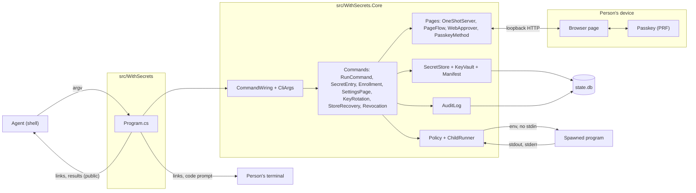
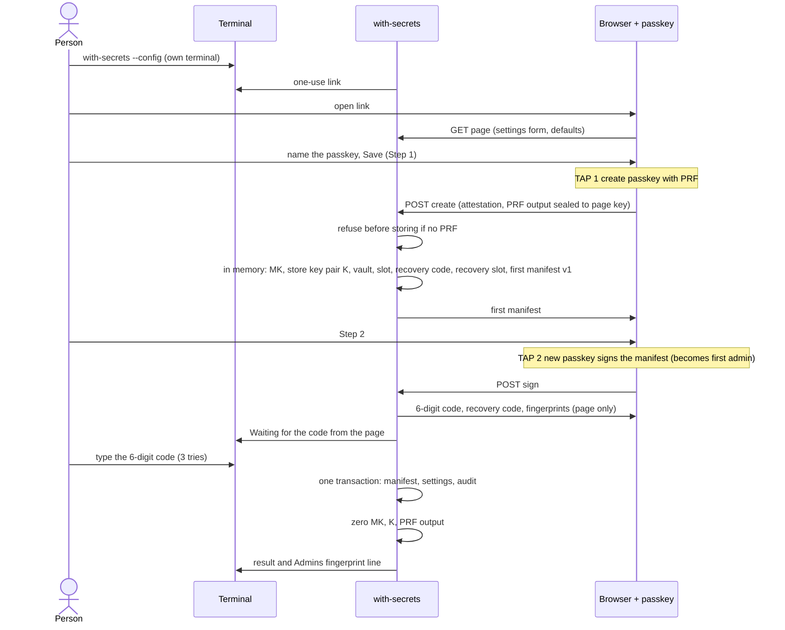
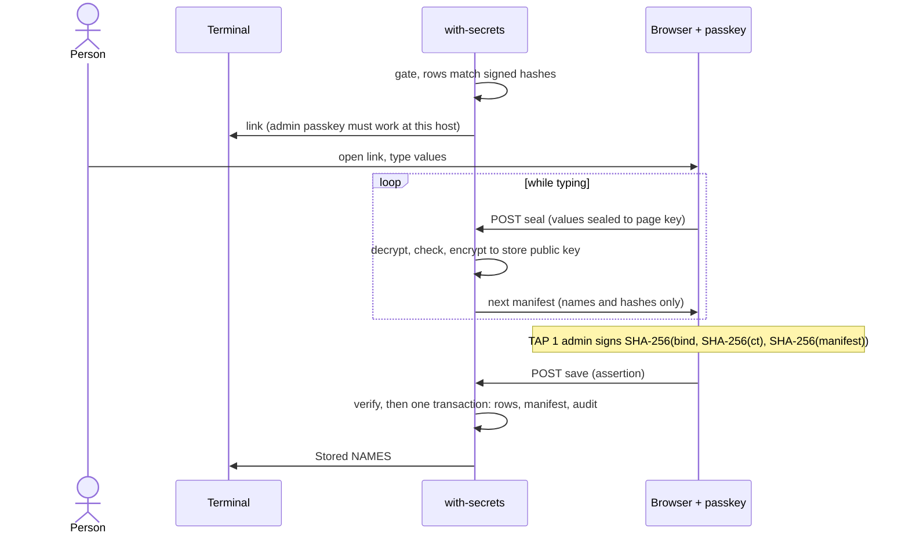
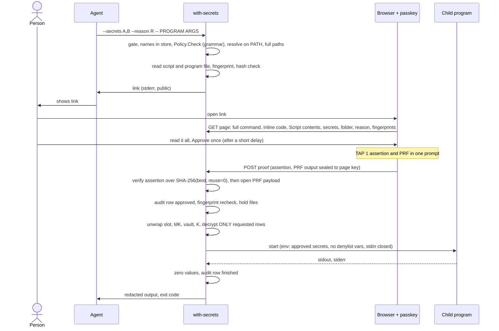
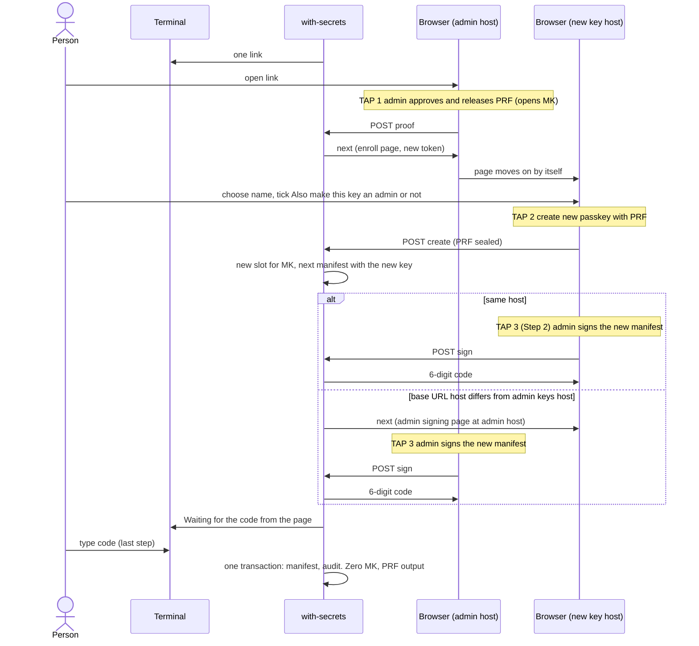
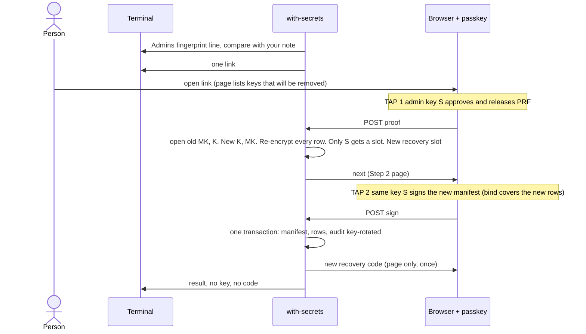

# with-secrets: architecture

Source of truth is the code (`src/WithSecrets.Core`, `src/WithSecrets`), then `README.md`. This page links to the README for limits instead of repeating them.

## 1. What it is

- A CLI that runs a program with secrets in its environment. An AI agent starts it, a person approves it.
- The agent names secrets and gives a reason. It never sees a value, a key or a recovery code.
- The person approves on a one-use web page with a passkey (WebAuthn). The same tap releases the secret store key (WebAuthn PRF).
- Everything is in one SQLite file, `state.db` (signed manifest, Dotenvx ciphertext rows, audit chain). No key is stored on the machine.
- Terminal output is public (the agent reads it). Values and the recovery code appear only in the browser.

## 2. Components



- `CommandWiring.cs` lives in Core, not in the exe. `Program.cs` parses, opens `state.db`, runs the gate, then dispatches.
- Every page of one command shares one `OneShotServer` (`PageFlow`), so one port and one link per command.

## 3. Communications

| From -> to | Transport | What is sent | What protects it |
| --- | --- | --- | --- |
| Agent -> CLI | argv, process start | secret names, reason, program, args | Policy checks before any page; names are not secret |
| CLI -> Agent / terminal | stdout, stderr | one-use link, names, admin fingerprint line, redacted child output, exit code | **Public by design.** Never values, keys, recovery code |
| Person -> CLI | terminal stdin | the 6-digit confirmation code (first `--config`, `--enroll`, new store of `--recover`) | Read only after the last tap, 3 tries, prompt is the last line (`TerminalPrompt`) |
| CLI -> browser | HTTP on 127.0.0.1 and [::1], same port (setting `port`, `--port N`, else free). With `baseUrl` (http or https; passkeys need https or localhost): that name pointed at the port, or `ssh -L PORT:localhost:PORT` | HTML page, inline script and style allowed by CSP hash, data block (request text, bind, challenges) | Token: 16 random bytes in the path, fixed-time compare, 404 for anything else. Headers: strict CSP (`default-src 'none'`, `connect-src 'self'`), `no-store`, `nosniff`, `X-Frame-Options: DENY`, `no-referrer`. Both loopback addresses held, `ExclusiveAddressUse` on Windows |
| Browser -> CLI | POST `proof`, `deny`, `seal`, `save`, `create`, `sign`, `code` (body max 1 MB, 15 s body timeout) | passkey assertion or attestation, reuse minutes, PRF output, typed `--set` values, recovery code | See rows below. First outcome of a step is final, later requests get 404 |
| Browser <-> passkey | WebAuthn in the browser | challenge, assertion, PRF eval of the slot salt | Each prompt starts in its own tap (iOS rule). RP ID is the page host, passkey ignores ports |
| PRF output, browser -> CLI | inside the proof POST | 32 bytes sealed: fresh ECDH P-256 key, HKDF-SHA-256 (salt = bind, info `with-secrets/v1 prf`), AES-256-GCM (bind as AAD) to the page's own server key | Sealed to a key that lives for that page only. A passive observer (tunnel that ends TLS) sees ciphertext. An active man in the middle who replaces the page key is not stopped (README) |
| `--set` values, browser -> CLI | `seal` POSTs while typing (max 500 per page) | each value sealed the same way (own HKDF info `with-secrets/v1 secrets`) | Page server key per page. The Save tap signs `SHA-256(bind \|\| SHA-256(ct) \|\| SHA-256(manifest))` |
| Recovery code, browser -> CLI | `--recover` code page | code sealed to the page key | Never in terminal, log, audit or `state.db`. A typed code is not origin-bound: compare the printed admin fingerprint first |
| Lost reply | page resends the same body (3 tries: 8 s, 8 s, 20 s; `deny` one try of 20 s) | same bytes | Steps that lead on (`proof`, `create`, `sign`, `code`) keep one reply per verified body (SHA-256 of body, fixed-time compare), in memory until the command ends. No second page, no second code. Other steps (`save`, `seal`, `deny`): a resend after the outcome gets 404 and the page says the program already finished |
| CLI <-> `state.db` | SQLite, WAL, one transaction per write | manifest, ciphertext rows, sign counts, audit rows | Manifest signature checked before use (exit 4). Writes check the version they replace |
| CLI -> spawned program | environment, argv, closed stdin | only the approved secrets as env vars | Denylist, no stdin, redacted output (section 7) |
| Network diagnostics | Debug log events: terminal only with `--debug`, and the log file | method, route word, whole seconds, sizes, verdict words | No path, token, body, key or value (`NetLog` words, constant `AppLog` templates) |

What is public: everything on stdout/stderr. What never leaves the browser: typed values (only sealed), the recovery code in plaintext (only sealed on `--recover`, shown on the page once), the passkey private key, the raw PRF output.

## 4. Key hierarchy

```mermaid
flowchart LR
    PRF["Passkey PRF output (32 bytes)"]
    KEK["Slot KEK"]
    Slot["Key slot wrap (per passkey)"]
    MK["Master key MK"]
    Vault["Vault"]
    K["Store key K (Dotenvx private key)"]
    Rows["secrets rows (ECIES secp256k1)"]
    Vals["Secret values"]
    Code["Recovery code (20 bytes)"]
    RK["Recovery key RK"]
    RSlot["Recovery slot wrap"]

    PRF -->|"HKDF-SHA-256, salt = slot salt, info with-secrets/v1 slot"| KEK
    KEK -->|"AES-256-GCM, AAD cred id + salt"| Slot
    Slot -->|"unwrap"| MK
    Code -->|"HKDF-SHA-256, salt = recovery salt, info with-secrets/v1 recovery"| RK
    RK -->|"AES-256-GCM, AAD with-secrets/v1 recovery + store public key"| RSlot
    RSlot -->|"unwrap"| MK
    MK -->|"AES-256-GCM, AAD with-secrets/v1 vault + store public key"| Vault
    Vault -->|"unwrap"| K
    K -->|"Dotenvx decrypt, requested rows only"| Rows
    Rows --> Vals
```



| Secret | Lives | Zeroed |
| --- | --- | --- |
| PRF output | In the passkey. In the page as a plain `Uint8Array` until sealed: the page scripts never overwrite it (garbage collection only). Server: opened from the sealed payload into `Unlock` (bytes) | `Unlock.Dispose` after the run read its values (every exit path). Registration copies zeroed after the slot is wrapped |
| Slot KEK | Process memory during wrap or unwrap | `KeyVault` finally blocks |
| Master key MK | `state.db` only as slot wraps and the recovery slot. Plain in memory during a run, `--enroll`, `--rotate-key`, `--recover`, first `--config` | After use (`SecretValues.Clear`) |
| Store key K | `state.db` only as the vault. Plain as bytes plus a hex string during decrypt | Bytes zeroed. The hex string cannot be wiped (.NET) |
| Decrypted values | Bytes in `SecretValues`, strings in the child env and the redactor | Bytes when the child ends. Strings cannot be wiped |
| Recovery code | Offline, written by the person. Server makes it at first `--config`, `--recover`, `--rotate-key`, formats it for the page | Code bytes zeroed when the page ends (first `--config`, `--recover`) or after the slot is built (`--rotate-key`); the formatted text is a string and cannot be wiped. `--recover` holds the old K in `RecoveryCarry` until the end |
| Slot salt | Manifest. One shared salt per store (the first key's), because the page can pass one `eval` salt. The PRF output still differs per passkey | Not secret |

Facts that follow from this: `state.db` alone cannot decrypt anything. A same-user agent that reads process memory during a run can get K (README "The secret store"). `--unenroll` does not rotate MK or K. `--rotate-key` does.

## 5. Signed state

The manifest is one row in `state.db`, as canonical JSON, signed by an admin passkey.

| Item | Detail |
| --- | --- |
| Contents | version `v`, `keys` (id, name, public key, alg, rp, created, admin flag, slot salt and wrap), `store` (store public key), `vault`, optional `recovery` slot, `secrets` (name -> SHA-256 of ciphertext), `settings` |
| Not in it | sign counts (table `sign_counts`), saved approvals, audit rows, the secret ciphertext itself (rows table, covered by the hashes) |
| Signature | admin assertion over `SHA-256(bind \|\| SHA-256(manifest text))`. Stored with its authenticator data and client data |
| Who may sign | a key that is an admin in the **stored** manifest and stays one. A key that only becomes admin in the new manifest cannot sign it. An admin cannot approve its own removal. The last admin cannot be removed |
| Verify before use | `Program.cs` runs `state.Gate` before every command, including `--list` and `--audit`. Failure prints `with-secrets: state failed verification: delete state.db to start over (only if you did not edit it)` (or the damaged or other-schema message) and exits 4. `--help` and bad arguments exit before the gate. Verified manifests are cached per process |
| Rows | every `SecretStore` read (`--list`, a run, `--set`, `--rotate-key`, `--recover`) checks every row against its signed hash (the gate checks integrity and the manifest only): a swapped row, a row with no hash or a hash with no row is exit 4 |
| Writes | one transaction: manifest, rows, audit row. Refused when the stored version is not the one the page started from |
| Sign counts | stored beside the manifest, unsigned. An assertion must raise the count. An agent can inflate them (denial of service only) |
| Fingerprints | first 8 bytes of SHA-256 of each admin public key, 4x4 hex. Shown on every page (part of the signed text), in `--enrolled`, `--audit`, and in the terminal before `--recover` and `--rotate-key`. Detects a replaced state |
| Grants (saved approvals) | **Inactive with the PRF store.** `SecretStore.NeedsUnlock` is true, so `RunCommand` uses `ReuseOffer.Off`: no list on the page, none saved or used. Code, table and tests remain (`Reuse.cs`) |
| Audit hash chain | each row holds `prev_hash` and `hash` over its entry, first row chains to 64 zeros. `--audit --verify` names the first broken link (exit 4). Finds edits and deleted middle rows, not removed tail rows. Not signed: a same-user writer can recompute it |
| Schema | version 9, checked at open (`PRAGMA integrity_check`). Other versions are never migrated |

Gaps (agent deletes `state.db` and builds its own state, restore of an older copy, rollback) are in README "Admin keys" and "Known limits".

## 6. Flows

Legend: **TAP** is a passkey prompt (one per user tap). Page moves on by itself when a reply carries `next`. Participants: P person, T terminal, C with-secrets process, B browser and passkey.

### 6.1 First-run setup (`--config`, nothing enrolled)



### 6.2 Store secrets (`--set NAME`)



No PRF and no master key: `--set` only needs the store public key. `--remove` is the plain approval page signing the next manifest without those hashes.

### 6.3 Run approval



Deny, wrong proof, any error or the time limit gives exit 3 and the audit row `denied`. If the audit row cannot be written nothing runs (exit 5).

### 6.4 Enroll a passkey (`--enroll`)



The code is generated at registration but shown only on the last page. Nothing is stored before it is typed. `--unenroll NAME` is a single approval page where another admin signs the manifest without that key.

### 6.5 Rotate keys (`--rotate-key`)



Failure or timeout between the taps changes nothing.

### 6.6 Recover (`--recover`, all passkeys lost)


The old file is never deleted. Old admin keys are gone from the new state. Any failure leaves the old `state.db` as it was.

## 7. Policy and child process

| Area | Rule | File |
| --- | --- | --- |
| Secret names | `NAME` or `folder/NAME` (up to 3 folders, 200 characters in all; the last segment UPPER_SNAKE_CASE, no `DOTENV_` prefix; folders `[A-Za-z0-9_.-]{1,64}`, not `.` or `..`). One validator for all commands, the whole path is the store name and is data only. Every name must be listed (no `--all`). `--set` and `--remove`: 1 to 20 names | `Contracts.cs` (`SecretNames`), `SecretEntry.cs`. Values: 6 to 4096 characters |
| Program lookup | `env`, `printenv`, `set` are refused (they print the environment). PATH entries that are absolute only. Working directory not searched unless the program has a slash or backslash. Windows App Execution Aliases refused | `ChildProcess.cs` (`ProgramResolver`), `RunCommand.cs` |
| Paths | program and script are expanded to full paths. What is checked, shown and run is the expanded form. They must read the same as the typed form | `RunCommand.cs`, `Paths.cs` (`PathExpander`), `Policy.cs` |
| Command grammar | Interpreters in one strict form only: `PROG script [args]` or `PROG -c/-e CODE` (sh family, python, node, perl, ruby), PowerShell: `-NoProfile` required, then `-NonInteractive`, `-NoLogo`, `-ExecutionPolicy VALUE` (once each), then exactly `-File` or `-Command`; `cmd /d /c` (or `/k`, `/r`) with a tail of letters, digits and `. _ : \ /` `-`, first word a `.cmd`/`.bat` file or echo, dir, type, ver. Encoded commands, a bare interpreter and code starting with a dash are refused. Other programs: no analysis, `Run:` line only (a text-file program is still shown). Matches README "Known limits" and `--help` | `Policy.cs` |
| Limits | command max 16,000 characters. Inline code shown: first 4,000 characters. Script max 1 MB (page shows first 200 lines or 16 KB). Script must exist, be text, and be readable. Batch files ASCII | `Policy.cs`, `RunCommand.cs`, `ApprovalSummary.cs` |
| Page text | every line of code prefixed `  \| `. Control, bidi and zero-width characters replaced by a mark. Part of the signed text | `ApprovalSummary.cs` |
| Fingerprint | covers names, every variable-to-secret pair, the `.env` paths and ordinary variable names (when a `.env` is used or a variable differs from its secret), full program path, folder, and path and hash of the script and of the program file (when 1 MB or less). Recomputed after approval. A changed file denies | `Reuse.cs`, `RunCommand.cs` |
| File lock | shown files opened `FileShare.Read` until the child ends, hashed again. Windows only. Elsewhere only the last check before launch | `RunCommand.cs` (`HeldFiles`) |
| Environment | removed before launch: `DOTENV_PRIVATE_KEY*`, `NODE_OPTIONS`, `BASH_ENV`, `ENV`, `PYTHONPATH`, `PYTHONSTARTUP`, `PYTHONHOME`, `PERL5OPT`, `RUBYOPT`, `LD_PRELOAD`, `DOTNET_STARTUP_HOOKS`, `JAVA_TOOL_OPTIONS`, five `GIT_*` names (`GIT_CONFIG_GLOBAL`, `GIT_CONFIG_SYSTEM`, `GIT_EXEC_PATH`, `GIT_SSH_COMMAND`, `GIT_ASKPASS`), `SHELLOPTS`, `BASHOPTS`, `PS4`, `PS0`, `PROMPT_COMMAND`, `BASH_FUNC_*` and more (case-insensitive on Windows). Full list in `ChildRunner.CodeLoadingVariables` and README. Known gaps: README | `ChildProcess.cs` |
| Stdin | closed right after start: the child reads end of file | `ChildProcess.cs` |
| Launch | `.cmd` and `.bat` start as `cmd.exe /d /c "path" args` (no AutoRun). Arguments with quotes or `& \| < > ^ % !` are refused for cmd | `ChildProcess.cs`, `Policy.cs` |
| Output | read as UTF-8, redacted by `StreamRedactor` (chunk splits and common forms). Reversed, split, compressed or encrypted copies are not caught | `Redaction.cs` |
| Terminal-only commands | `--revoke --enroll --enrolled --unenroll --config` (not `--config --show`) `--recover --rotate-key` refuse when input, output or error is redirected (exit 3). `--set`, `--remove`, `--list`, `--audit` do not check | `CommandLine.cs`, `Program.cs` |

## 8. Trust boundaries

What the agent can and cannot do, and the known limits: README "Known limits", "Admin keys" and "The secret store". Summary:

| Actor | Capability | What stops it |
| --- | --- | --- |
| Agent (same OS user) | start a run, read terminal output, hold links | Cannot tap the passkey. Link is one-use and shows the whole request. Enrollment codes need a human typing in a real terminal |
| Agent | read `state.db` | No key on disk: K is only wrapped, MK only under PRF or the recovery code. Rows are ciphertext |
| Agent | edit `state.db` (keys, settings, rows, slot, vault) | Manifest signature and row hashes fail: exit 4 on every command |
| Agent | delete `state.db` and write its own signed state | **Not prevented.** Visible: admin fingerprints change on every page, `--enrolled`, `--audit` |
| Agent | restore an older `state.db`, rewrite audit and chain, inflate sign counts | Accepted limits (README) |
| Agent | read process memory during a run | **Not prevented.** K, MK, PRF output and values are in memory for that moment (README) |
| Agent | change the script or program after the page showed it | Fingerprint recheck, file hold (Windows) |
| Agent | pass options or env that load unshown code | Strict grammar, environment denylist, closed stdin. Gaps listed in README |
| Another local process | serve a look-alike page on localhost | Server holds both loopback addresses exclusively. Passkey RP ID ignores ports, so check the printed link before tapping (README) |
| Network observer (tunnel) | read page traffic | PRF output and `--set` values are sealed to the page key. Active man in the middle is out of scope |
| Child program | print or send secrets | Output redaction only. A program that sends its environment out is out of scope |
| Lost admin device | still opens the store with an old `state.db` copy | `--rotate-key` (keeps one key). `--unenroll` alone does not rotate MK or K |

## 9. Exit codes and error paths

| Code | Meaning | Typical causes |
| --- | --- | --- |
| 0 | success | run: the child exited 0. Commands: change made, `--help`, `--list`, `--audit` |
| 2 | usage | bad arguments, two commands, invalid or unknown secret name, policy refusal, script missing, too large or not text, changed while the request was built, command too long, App Execution Alias |
| 3 | denied | Deny on the page, wrong proof, time limit, internal error in a session (`HandleGuard`, text says only `internal error`), files changed while the page was open, file hold failed, nothing enrolled, no terminal for a human command, refused change |
| 4 | store error | `state.db` damaged, locked over 5 s, other schema, failed signature or row hash, unusable settings, cannot decrypt, `--audit --verify` finds a broken link |
| 5 | audit error | the audit row could not be written, so nothing ran |
| 127 | not found | program not on PATH, or the process cannot be started |
| other | the child's own exit code | passed through on a run |

Every web session ends on the first outcome. Deny, error and silence all end in a denial, never an approval. Gate failures happen before any link is printed.

## 10. Roadmap and target architecture

This document records both the implemented baseline and the intended architecture. A design decision is not evidence that a feature is implemented.

Status labels:
- **Implemented** — present in the repository and covered by the stated checks.
- **Agreed / design** — a maintainer decision; implementation is not implied.
- **Proposed** — a concrete option for review, not yet accepted.
- **Open** — requires validation or a maintainer decision.
- **Deferred** — intentionally postponed.

### 10.1 Project environment declarations and Dotenvx

**Status:** Phase A project declarations are implemented in `EnvDeclarations.cs`. Host service and remote authority are design-only. Integration with the existing Dotenvx loading/evaluation behavior, including encrypted project `.env` values and profile selection, remains follow-up work.

**Ownership boundary**

- Use the existing `Dotenvx.Core` NuGet package unchanged. The maintainer owns the C# port, not Dotenvx core; do not propose modifying either to accommodate with-secrets.
- Dotenvx remains responsible for its existing parsing/loading, interpolation/evaluation, encrypted `.env` value handling, and standard environment construction/injection behavior.
- with-secrets owns project-file selection/composition policy, classification of effective declarations, `secret://` resolution, provider mounts, approval, audit/request binding, and launching the child.
- The current Phase A parser is a deliberately limited implementation and rejects an effective encrypted declaration. That is current state, not the desired long-term parser boundary. Integrate with the existing package rather than reimplementing Dotenvx semantics.

**File selection**

- Default selection is the project's `.env` in the current working directory. Do not search parent directories.
- If the caller selects a Dotenvx profile (for example `local` or `development`), follow Dotenvx's existing profile/file-selection convention. Do not invent a second convention or infer profiles from ambient variables such as `NODE_ENV`.
- Explicit file selection through the existing repeatable `-f` / `--env-file` interface selects exactly the supplied files and replaces default selection.
- File ordering and profile expansion must match the actual Dotenvx implementation. The with-secrets composition rule is **first file wins**. Verify exact Dotenvx ordering and repeated-key semantics with tests before documenting specific profile filename patterns or precedence examples.
- A missing default `.env` means there are no project declarations. An explicitly selected missing file is an error; never silently skip it.

**Declarative model**

Selected project environment files may contain ordinary configuration, Dotenvx-encrypted project values, and external secret references:

```dotenv
# Ordinary configuration
API_URL=http://localhost:5000
LOG_LEVEL=Debug

# Dotenvx-encrypted project value
API_KEY=<encrypted Dotenvx value>

# External secret resolved by with-secrets
GITHUB_TOKEN=secret://team/development/github/token
DATABASE_PASSWORD=secret://personal/database/password
```

- The left side is the child environment-variable name; the right side is a logical secret path. They may differ, e.g. `STRIPE_KEY=secret://team/payments/STRIPE_PRODUCTION_KEY`.
- Dotenvx comments and syntax remain Dotenvx's responsibility. Comments are not declarations.
- Ordinary values are not secret-store references. Dotenvx-encrypted values remain encrypted in source control and are decrypted through the existing Dotenvx mechanism. External `secret://` values are resolved by with-secrets.
- Compose selected files first, using the ordered first-file-wins rule, then classify only the final effective value of each variable. An overridden reference must never be requested, approved, or decrypted.
- Validate every effective reference before approval. A missing mount, permission, provider, secret, or required credential is a hard error. No fallback, cross-provider search, silent substitution, or alternate-name prompt.
- An explicit `secret://` declaration must not silently be satisfied or replaced by an inherited environment variable. Ordinary inherited-environment behavior and encrypted-value precedence must remain compatible with Dotenvx and be covered by tests.

**Discovery and CLI behavior**

- Keep `--secrets NAME[,NAME...]` for explicit requests and compatibility; it composes with effective declarations from selected project files.
- `--needs` is read-only discovery. It reports selected files, ordinary variable names, effective variable-to-secret mappings, and whether references are resolvable. It does not approve, decrypt, or display secret values.
- A `--needs` result is informational, not an authorization or trusted cached plan. The run command independently recomputes and validates its plan.
- Do not scan source code for environment-variable usage; dynamic lookups make this unreliable and language-specific. The request set is selected declarations plus explicit `--secrets`.
- Additional `--env NAME` layering is deferred.

**Approval and trust**

- The human approval page is the control point because an agent can modify project environment files.
- Show the human approver every selected file path, every effective secret mapping, and every effective ordinary variable/value. Never show plaintext secret values. Agent/terminal-facing output shows names and paths only.
- Bind selected file paths, effective declarations, ordinary values, secret mappings, command/script, working directory, request identity, and expiry to the approval fingerprint/signature. Read files once per request; approval, audit, and launch use the same immutable snapshot. A file changed while approval is pending must not change what launches.
- Preserve protected-variable rules: secret references cannot target code-loading variables, process-selection variables such as `PATH`, `PATHEXT`, or `COMSPEC`, proxy variables, or git identity variables. Continue stripping the existing child code-loading variables. A denylist is not a complete security boundary; showing ordinary values is still required.
- Do not expose the Dotenvx decryption key or plaintext secrets to the agent.

**Implementation status**

| Capability | State |
| --- | --- |
| Default `.env` in working directory; no parent traversal | Implemented |
| Explicit repeatable `-f` / `--env-file` selection | Implemented |
| Phase A comments, optional `export`, basic quoted/unquoted values | Implemented in current parser |
| First-file-wins composition and effective-reference-only resolution | Implemented and tested |
| `secret://` references and renamed environment mapping | Implemented and tested |
| `--secrets` additions and read-only `--needs` | Implemented and tested |
| Approval display of paths, secret mappings, and ordinary values | Implemented in Phase A |
| Dotenvx encrypted project values through existing `Dotenvx.Core` | Follow-up integration; current Phase A parser rejects effective encrypted values |
| Dotenvx profile selection | Open pending verification against current Dotenvx behavior |
| Additional `--env NAME` layering | Deferred |

### 10.2 Local host service and remote authority

**Status:** Agreed architecture direction; not implemented. Define the service contract before implementation.

**Architecture decisions**

1. The CLI uses one shared, versioned API/protocol regardless of storage backend. It does not know whether a request is fulfilled locally or remotely.
2. The Windows host service is the stable endpoint for Windows, WSL, and Docker clients:
   `CLI (Windows / WSL / Docker) -> Windows host service -> local authority OR remote authority`.
3. In local mode, the host service accesses the encrypted local SQLite store and configured local providers. In remote mode, it authenticates and relays to a remote with-secrets authority over HTTPS.
4. The host service is the outbound network boundary, allowing WSL/Docker clients to operate without direct Internet access.
5. The host service does **not** launch child processes, change execution identity, or own child lifecycle. The requesting CLI launches the child and injects approved values into its environment.
6. Local and remote authorities implement the same logical API contract. The host service is not a blind HTTP proxy: it authenticates callers, validates requests, binds approvals to request identity/names, and validates responses.
7. The service is an implementation/deployment boundary, not a reason to turn with-secrets into a general authorization broker. The product remains focused on minimizing plaintext secret exposure. Convenience and standard process/environment compatibility remain important; same-user malicious-process inspection is not claimed to be prevented.

**Host service responsibilities**

- Own access to local encrypted storage, provider configuration, and provider credentials.
- Authenticate local clients; loopback, pipe name, WSL/Docker labels, or `host.docker.internal` reachability alone are not identity.
- Validate protocol version, request shape, caller scope, project policy, requested names, and expiry.
- Bind request ID to authenticated client, project, command context, selected declarations, requested logical names, and approval.
- In relay mode, authenticate/forward to remote and validate the signed response.
- Never log secret values, decrypted payloads, passkey material, or bearer credentials. Avoid persistent plaintext caches; retain plaintext only as long as required.

**CLI responsibilities**

- Discover and compose project declarations using section 10.1.
- Generate a fresh per-request ephemeral key pair; its private key remains in the CLI process.
- Submit structured request metadata, including project/working-directory context, command/script summary and fingerprint, selected declaration snapshot, requested secret mappings, reasons, and ephemeral public key.
- Wait for approval/result, verify signature and request binding, decrypt locally, compose the final environment, and launch the child.
- Preserve normal inherited environment and child process semantics subject to explicit policy filtering. Environment variables remain the delivery mechanism, not a storage mechanism or security boundary; descendants may inherit them and sufficiently privileged or same-user processes may inspect them.

**Local client authentication**

- Windows local transport should use a secured named pipe with an explicit ACL.
- WSL and Docker need deliberate host access and short-lived, request-scoped client credentials. Do not treat a client label as proof of identity or expose a general-purpose store token.
- Exact WSL/Docker bootstrap, peer identity, and credential-delivery mechanics remain open for threat-model review.

**Request and response binding**

A request includes protocol version, unique ID, creation/expiry, nonce, authenticated client and machine identity, project/working-directory identity, command/script summary and fingerprint, selected file/declaration snapshot, requested names, reasons, and the CLI ephemeral public key.

The host authenticates the caller and signs the canonical request envelope. The authority approves the exact request digest and resolves only those names. The response includes protocol version, request ID/digest, authority identity, response ephemeral public key, encrypted payload, expiry/one-time semantics, and authority signature. The CLI verifies the trusted authority signature and all request bindings before decrypting or launching.

Replay, response substitution, cross-request reuse, expired requests, and changed secret-name sets fail closed. Retry after a lost response must be idempotent for the same request, not create a second approval. The relay must not be able to substitute a response or decrypt secret values.

**Cryptographic direction**

Agreed shape: persistent machine identity signing key plus a fresh CLI-held ephemeral key per request; the authority response is encrypted to that request key and signed by the authority. Do not reuse the machine identity signing key as an encryption key. Use standard .NET cryptography and standard formats; no custom cryptography or third-party crypto dependencies.

The following suite is a **proposed default pending protocol review**, not a final wire-protocol commitment:

| Purpose | Proposed choice |
| --- | --- |
| Machine identity signature | ECDSA P-256 |
| Ephemeral response key agreement | ECDH P-256 |
| KDF | HKDF-SHA-256 |
| Payload encryption | AES-256-GCM |
| Fingerprint | SHA-256 of canonical public-key representation |
| Serialization | Canonical JSON with explicit protocol version |

Canonicalization, signature input, associated data, nonce/replay storage, key rotation, trust-root distribution, and test vectors require protocol design before implementation.

**Machine identity lifecycle**

- Generate a persistent machine identity during explicit enrollment/installation. Show the public key and fingerprint to the user.
- The authority must explicitly enroll and authorize the public key; a fingerprint alone is not proof of enrollment.
- Support revocation and replacement. Reconnection must not silently replace a trusted identity.
- Protect private identity material with platform facilities where possible (Windows CNG, TPM-backed protection when available). Hardware backing is an enhancement, not a prerequisite.
- Each independent host service has its own identity. WSL/Docker clients using the Windows host service use that host service identity; they do not silently gain independent authority identities.
- Enrollment UX, approval of new identities, rotation/revocation propagation, and recovery remain open.

**Approval authority**

- Every request identifies which authority is responsible for approval. Local and remote authorities must not independently approve or disagree about the same request.
- In local mode, approval is performed by the local authority using the existing passkey approval model.
- In remote mode, the remote authority is the source of truth for policy, approval, and secret resolution unless a later explicit decision changes this.
- Passkeys are origin/RP-bound. A remote HTTPS authority has its own passkey origin and enrollment; local and remote stores do not share passkeys, recovery codes, manifests, or trust roots.
- A remote authority cannot inspect local files. The CLI sends the relevant paths, human-readable declaration/command summary, and fingerprints needed for the human to review exactly what will run. The authority binds that submitted snapshot to approval; the CLI enforces the local snapshot at launch.
- Local-versus-remote approval UX, remote page reachability, and metadata confidentiality from the relay remain open.

**Proposed build sequence**

1. Define versioned protocol types, canonical serialization, request digest, signatures, ephemeral key agreement, KDF, AEAD, expiry, replay, retry, and substitution tests.
2. Put the current local run/approval pipeline behind an authority interface without changing CLI child-process behavior.
3. Implement the Windows host service and secured local API; keep local authority mode working end-to-end.
4. Add machine identity enrollment, fingerprint display, revocation, and rotation.
5. Add WSL connectivity, then Docker connectivity, with explicit client authentication.
6. Add remote relay mode and remote authority; verify local and remote modes implement the same API contract.
7. Add integration tests for parity, failure behavior, request binding, and no-plaintext-persistence guarantees.

### 10.3 Secret providers, logical mounts, and namespaces

**Status:** Agreed architecture direction; provider implementations and mount configuration are not yet built.

with-secrets supports multiple secret sources/providers concurrently. Project declarations use logical names; the host authority maps those names to configured provider instances.

**Logical paths**

Examples:

- `secret://personal/github/token`
- `secret://team/development/github/token`
- `secret://infrastructure/aws/production/access-key`

The path is a logical name only. It does not expose provider name, account, SDK, API endpoint, or physical storage location to the project. Path segments are organizational namespaces, not implicit provider selectors.

**Mount model**

- A mount maps a logical path prefix to one configured provider instance and its provider-side namespace/path.
- Mounts are configured by the host authority, not checked into the project repository. Project files remain portable and contain no provider credentials or machine-specific provider configuration.
- Initial direction: global mount definitions with project-specific permissions/allowlists. A project may use a mount only when policy grants access.
- Multiple mounts/providers coexist. A host may have local with-secrets storage, Dotenvx project values, and external providers concurrently.
- Provider ACLs remain in force. with-secrets human approval is an additional release gate, not a replacement for provider authorization.
- Provider authentication and SDK/API credentials stay on the host/authority side. Windows/WSL/Docker CLIs do not receive provider credentials and do not need provider SDKs.
- Each logical path resolves deterministically through exactly one mount using **longest-prefix matching**. Prefix matching is segment-boundary-aware: a mount at `secret://team` matches `secret://team/development/app`, but does not match `secret://teamwork/app`. More-specific mounts override broader mounts for their subtrees (for example, `secret://team/development` takes precedence over `secret://team`). This is deterministic namespace routing, not fallback: once the most-specific matching mount is selected, any permission, availability, authentication, or missing-secret failure is a hard error and must not fall through to a broader mount or another provider.

**No fallback or cross-provider search**

- A missing mount, denied project permission, unavailable provider, missing secret, or provider authentication failure is a hard error.
- Do not search other mounts/providers, fall back to an environment variable, prompt for an alternate name, or silently substitute another value.
- Do not query every provider looking for a matching name. This prevents accidental cross-tenant disclosure and keeps resolution auditable.
- Approval and audit identify the logical name and selected provider/mount identity without exposing credentials or values.

**Provider candidates**

1Password and Bitwarden Secrets Manager are optional provider candidates behind the host/authority adapter boundary. For Bitwarden, the target is Secrets Manager, not the personal password-manager product. These are not first-release requirements. The local encrypted SQLite store remains a first-party provider.

Mount configuration format, project permission format, provider outage behavior, and provider metadata shown to approvers remain open. Mount resolution and provider version/rotation semantics are specified below. Provider-specific syntax must not leak into project `.env` declarations.

### 10.3.1 Provider adapter contract and lifecycle

**Status:** Architecture decisions agreed; common interface and provider implementations are not yet implemented.

Provider adapters isolate provider-specific access behind the authority. Adapters execute in-process with the authority; they are not separate services or plugins loaded dynamically at runtime. The authority discovers and registers the adapters bundled with its release. Adapter implementations may be independently identified/versioned, but are distributed with and tied to an authority release.

An adapter instance represents one configured provider connection. Multiple connections to the same provider type use separate instances and independent configuration. The authority assigns each instance a unique, stable instance ID and supplies it during initialization. In remote mode, adapters run at the remote authority; in local mode, they run at the local authority.

**Responsibilities and boundary**

- The adapter contains provider integration logic only. It does not provide UI, HTML, JavaScript, dynamic configuration forms, or configuration schemas for the admin UI.
- The admin UI owns provider-specific configuration screens. The adapter exposes its configuration type and validation results for the authority/UI integration.
- Adapters are read-only with respect to provider data: no create, modify, rotate, delete, or migration operations.
- The core depends only on the common adapter contract, not provider SDKs or provider-specific types.
- Every adapter implements the complete required contract. There are no optional capability flags or optional operations.
- The authority owns provider configuration persistence, configuration revisions, operation timeouts, concurrency limits, cache/freshness policy, grant lifetimes, and secret delivery. Adapters do not own the secret cache and do not write cache timestamps.
- Adapters must be thread-safe, support concurrent calls, and honor cancellation. They may declare provider-specific concurrency constraints for the authority to enforce.

**Required operations**

Every adapter provides initialization, configuration update, shutdown, configuration validation, mount validation, secret retrieval, and secret listing. Pagination is implemented internally by the adapter and exposed through opaque continuation tokens.

```csharp
public interface IProviderAdapter
{
    Type ConfigurationType { get; }

    Task InitializeAsync(
        IAdapterConfiguration configuration,
        AdapterInitializationContext context,
        CancellationToken cancellationToken);

    Task UpdateConfigurationAsync(
        IAdapterConfiguration configuration,
        CancellationToken cancellationToken);

    Task ShutdownAsync(CancellationToken cancellationToken);

    Task<IReadOnlyList<AdapterValidationIssue>> ValidateConfigurationAsync(
        IAdapterConfiguration configuration,
        CancellationToken cancellationToken);

    Task<IReadOnlyList<AdapterValidationIssue>> ValidateMountAsync(
        string basePath,
        CancellationToken cancellationToken);

    Task<RetrieveSecretResult> RetrieveSecretAsync(
        string path,
        CancellationToken cancellationToken);

    Task<ListSecretsResult> ListSecretsAsync(
        ListSecretsRequest request,
        CancellationToken cancellationToken);
}
```

There is deliberately no health-check or refresh operation. The adapter owns its provider connection and recovery behavior and reports health changes when it learns them; the core does not poll adapters. Retrieval occurs only when the core asks for a secret. The core decides when to retrieve again based on its cache and freshness policy.

**Configuration contract**

- Adapter configuration is a strongly typed in-process .NET object. JSON is the persistence format, not the runtime boundary.
- Each adapter defines a concrete configuration type implementing `IAdapterConfiguration`, including `Load(JsonDocument document)` to load persisted JSON.
- The adapter factory selects the adapter type, creates the matching configuration type, loads it, and passes the typed configuration to the adapter.
- A generic base class may provide typed configuration storage, type checking, and dispatch only:

```csharp
public abstract class ProviderAdapter<TConfiguration> : IProviderAdapter
    where TConfiguration : class, IAdapterConfiguration
{
    public Type ConfigurationType => typeof(TConfiguration);
    protected TConfiguration? Configuration { get; private set; }
}
```

The base class does not manage provider connections, recovery, rollback, or atomic replacement of adapter-owned resources.

The authority serializes configuration updates per adapter instance. `UpdateConfigurationAsync` receives an already committed configuration, applies it, and returns promptly; provider connection establishment/re-establishment continues asynchronously. A connection failure after the configuration has been committed does not reject or roll back that configuration. When a newer update arrives while an earlier connection attempt is running, the adapter cancels or supersedes the stale attempt and converges on the latest committed configuration. A stale attempt must not overwrite health for the newer configuration.

Configuration validation may contact the real provider using the proposed configuration. Validation issues have a message, severity, and optional UI target:

```csharp
public enum ValidationSeverity
{
    Error,
    Warning
}

public sealed record AdapterValidationIssue(
    string Message,
    ValidationSeverity Severity,
    string? Target = null);
```

An error blocks saving. A warning permits saving after explicit admin confirmation; for example, a provider may be temporarily unavailable or rate-limited during validation. `Target` may identify a field or category for UI highlighting. Mount validation checks a provider-side base path using the active configuration. Both validation methods return `IReadOnlyList<AdapterValidationIssue>`.

When a configuration change changes the effective source, affected mounts are revalidated and the relevant cache/grant invalidation rules apply. Credential-only rotation preserves grants and cached values when the effective source is unchanged. Operational metadata changes are harmless. Unknown configuration fields are treated as source-defining until explicitly classified otherwise.

**Initialization, lifecycle, and health**

Lifecycle and health are independent status dimensions.

```csharp
public enum AdapterLifecycleState
{
    Initializing,
    Ready,
    Unavailable,
    ShuttingDown
}

public enum AdapterHealthState
{
    Initializing,
    Healthy,
    Degraded,
    Unavailable,
    Misconfigured
}
```

The authority initializes both dimensions to `Initializing`. It owns lifecycle boundary transitions: it sets `Initializing` and `ShuttingDown`; the adapter may report `Ready` or `Unavailable`. Health remains `Initializing` until the adapter has a real provider response or other reliable health information. This avoids presenting an unknown or empty health result during startup.

`InitializeAsync` performs adapter-internal setup and starts provider connection work without waiting for provider connectivity to succeed. Once its internal setup is complete, the adapter reports lifecycle `Ready`, even if the provider connection is still being established; health can remain `Initializing`. If adapter-internal initialization fails, it reports lifecycle `Unavailable` and remains registered so it can recover. Provider connectivity failures normally affect health, not lifecycle. The adapter owns recovery and may later report `Ready` after an internal initialization failure; there is no separate `RecoverAsync` operation.

When configuration is updated, the adapter immediately reports health `Initializing`, applies the configuration, and begins reconnecting asynchronously. Lifecycle does not need to change during a configuration update; for example, it may remain `Ready` while health is `Initializing`.

Status reporting uses one reporter method and typed events:

```csharp
public interface IAdapterStatusReporter
{
    void Report(AdapterStatusEvent statusEvent);
}

public abstract record AdapterStatusEvent;

public sealed record LifecycleChangedEvent(
    AdapterLifecycleState State,
    string? Message = null) : AdapterStatusEvent;

public sealed record HealthChangedEvent(
    AdapterHealthState State,
    string? Message = null) : AdapterStatusEvent;
```

The initialization context supplies the instance identity, provider identity/version, logger, and status reporter:

```csharp
public sealed record AdapterInitializationContext(
    Guid InstanceId,
    string ProviderType,
    string AdapterVersion,
    ILogger Logger,
    IAdapterStatusReporter StatusReporter);
```

The authority timestamps status receipt and retains the latest lifecycle and health states, each with an optional concise message and authority-assigned timestamp. It does not persist status history; detailed history belongs in logs. No operation/correlation ID is required in status events because instance identity and structured logs provide correlation. Status messages are suitable for the admin UI and must not contain secret values, credentials, or sensitive provider responses.

Invalid or stale lifecycle reports (for example, a delayed `Ready` after shutdown has started) are ignored and logged at Debug/Warning level; they are not thrown back to the adapter. Health updates are accepted until shutdown begins. After shutdown begins, further health updates are ignored and the last health value is retained.

**Shutdown and removal**

- The authority stops accepting new operations for the adapter and transitions lifecycle to `ShuttingDown`.
- It cancels ongoing initialization and background connection attempts.
- In-flight provider operations are cancelled or allowed to finish within a bounded shutdown deadline enforced by the authority.
- The authority invokes `ShutdownAsync(CancellationToken)`; the adapter releases its connections and other resources.
- The status reporter remains available during shutdown for any permitted final reporting, but lifecycle remains authority-controlled. Once shutdown completes, the authority stops accepting status updates.
- Deleting an adapter instance is blocked while mounts reference it. After references are removed and deletion is committed, the authority stops new operations, drains/cancels in-flight work within the shutdown deadline, shuts down and disposes the adapter, then removes it from the registry. Provider-side data is never modified or deleted.

**Retrieval and listing data contracts**

A retrieval returns UTF-8 bytes only; provider metadata is not returned with the value:

```csharp
public sealed record RetrieveSecretResult(byte[] Value);
```

The core validates strict UTF-8 before updating its cache and preserves the exact bytes without normalization or re-encoding. The CLI later converts to the target process encoding; if the value cannot be represented, the operation fails rather than silently corrupting it. Host-service responses use UTF-8. An empty provider value is treated as unset. A missing path or provider error is a hard failure; there is no fallback.

Listing returns one page of immediate children (nonrecursive), names and optional descriptions only, never values:

```csharp
public sealed record ListSecretsRequest(
    string Path,
    string? Filter,
    string? ContinuationToken);

public sealed record ListSecretsResult(
    IReadOnlyList<ProviderSecretInfo> Secrets,
    string? NextContinuationToken);

public sealed record ProviderSecretInfo(
    string Path,
    string? Description);
```

The adapter owns provider pagination. The authority passes the opaque continuation token through unchanged. The adapter scopes paths to the mount's provider-side base path; the UI navigates by requesting subpaths. Provider listing may supply descriptions. Description ownership is explicit:

```csharp
public enum DescriptionSource
{
    Provider,
    Local
}
```

When the source is `Provider`, each provider listing refreshes the effective description, including setting it to null when the provider has no description. When the source is `Local`, provider listings do not overwrite it. There is one effective description and one source marker, not separate competing local/provider descriptions.

**Logging and diagnostics**

Adapters use the existing `Microsoft.Extensions.Logging.ILogger` abstraction, which can be backed by the application's existing Serilog setup. There is no separate adapter logging framework or metrics interface. Detailed diagnostics go to structured logs; status messages remain concise and safe for display. Never log secret values, credentials, or decrypted provider responses.

**Implementation notes**

- The adapter contract is a design boundary, not a promise that a provider is already implemented.
- Provider-specific connection setup, authentication, retry/backoff strategy, and recovery are adapter responsibilities; global timeouts, cancellation, concurrency enforcement, cache policy, and status retention remain authority responsibilities.
- The precise public API for declaring adapter concurrency constraints and the exact configuration factory/registration mechanism remain implementation details to settle while implementing the common contract.
- Provider listing, mount validation, and retrieval must all resolve against the exact configured adapter instance selected by the mount. They must not search other providers or mounts.

### 10.3.2 Provider versioning and secret rotation

**Status:** Agreed architecture decision.

Logical secret paths resolve to the provider's **current active value**; project declarations and grants do not pin a provider-specific version.

- The adapter retrieves the provider's current active value when the core requests retrieval. Provider version identifiers, version history, and rotation metadata remain internal to the adapter and are not exposed through logical paths, project declarations, grants, or the common retrieval result.
- The core owns cache freshness and determines when another retrieval occurs. A provider-side rotation becomes visible to with-secrets when the core next retrieves the value; it does not bypass the core's cache policy.
- Provider rotation does not change the logical secret identity or require grant changes. Grants authorize the logical secret, not a particular provider version.
- If the provider deletes, retires, or otherwise makes the current secret unavailable, retrieval fails. The adapter must not silently return an older version as a fallback.
- Provider-specific version selection, rollback, and historical-version retrieval are outside the common adapter contract unless explicitly introduced as a future, separately designed feature.

This keeps project declarations and authorization independent of provider-specific versioning models while preserving the core's single cache/freshness policy.

### 10.4 Application-specific request declarations (curl add-on)

**Status:** Complementary design proposal accepted for documentation; adapter behavior and security review remain open. This extends the declarative `.env` model; it does not replace ordinary environment variables or `secret://` mappings.

Initial curl-oriented naming proposal:

```dotenv
# Header name is ordinary configuration.
curl_api.github.com_authorization_key=Authorization

# Header value is resolved by with-secrets.
curl_api.github.com_authorization_value=secret://team/development/github/token
```

- The `curl_` prefix identifies the intended application adapter. The host portion identifies the exact destination domain; `_key` names the header and `_value` provides its literal or secret-reference value.
- These are with-secrets curl-adapter declarations, not ordinary variables passed through to the child environment.
- Compose declarations first. Only the effective surviving declaration is considered. A secret-valued `_value` uses the same mount and approval model as any other `secret://` reference.
- Exact-host matching is the initial proposal. Do not send a credential to a different host. HTTPS-only use, redirect behavior, conflicting headers, duplicate declarations, and interactions with curl configuration files require explicit security review.
- The adapter must not place the secret in command-line arguments, shell history, terminal output, logs, or persistent temporary files. The concrete interception/injection mechanism is open; do not claim it is implemented.
- Unknown application prefixes must not silently become ordinary environment variables. Behavior when an adapter is unavailable (clear error versus unused declaration) remains open.
- This is curl-specific initially. Do not generalize it into a broad command/network authorization broker; with-secrets remains focused on secret exposure.

## 11. Where is it in the code

| Concept | File (`src/WithSecrets.Core` unless noted) |
| --- | --- |
| Entry, gate, dispatch | `src/WithSecrets/Program.cs` |
| Command wiring, targets, code reader | `CommandWiring.cs` |
| Argument parsing, `NeedsTerminal` | `CommandLine.cs` |
| Run pipeline, exit codes | `RunCommand.cs` |
| Project `.env`: parser, composition, `secret://` grammar, `--needs` | `EnvDeclarations.cs` |
| Command grammar, length limits | `Policy.cs` |
| Approval text, request fingerprint, script view | `ApprovalSummary.cs`, `Reuse.cs` |
| Child process, PATH lookup, env denylist | `ChildProcess.cs` |
| Output redaction | `Redaction.cs` |
| Loopback server, tokens, headers, `HandleGuard`, `NetLog` | `OneShotServer.cs` |
| One link per command, `next`, time budget | `PageFlow.cs` |
| Approval page and session, proof handling, CSP | `WebApprover.cs` |
| Passkey proof, RP ID, sign counts | `PasskeyMethod.cs`, `WebAuthn.cs`, `PasskeyStore.cs`, `Proof.cs` |
| PRF page code, label, sealed payload | `PrfClient.cs`, `SecretCrypto.cs` |
| First setup and registration pages | `SettingsPage.cs`, `PasskeyRegistration.cs` |
| Settings and limits | `ToolSettings.cs`, `ApprovalSettings.cs` |
| Enroll, unenroll, names | `Enrollment.cs`, `EnrollmentTarget.cs` |
| `--set`, `--remove` | `SecretEntry.cs` |
| Secret rows, hashes, decrypt only requested | `SecretStore.cs` |
| Slots, vault, recovery slot | `KeyVault.cs`, `RecoveryCode.cs` |
| Signed manifest | `Manifest.cs` |
| SQLite, schema 9, gate, integrity | `StateDatabase.cs` |
| Rotate keys, recover | `KeyRotation.cs`, `StoreRecovery.cs` |
| Revoke | `Revocation.cs` |
| Audit log, hash chain, `--audit` | `AuditLog.cs` |
| Terminal prompt (lines are written at once; nothing is held or dropped) | `TerminalPrompt.cs` |
| Logging: Serilog setup, file rules, `--debug` terminal sink | `AppLog.cs` |
| Saved approvals (inactive with this store) | `Reuse.cs` |
| Tests | `tests/WithSecrets.Tests`, browser tests `tests/WithSecrets.E2E` |

## Open questions for the maintainer

Answered from the code: the grammar in section 7 matches `Policy.cs`, README "Known limits" and `--help` (the page scripts never zero the PRF output: see section 4). Task 19 and Task 20 are in `.claude/plan.md` and the ledger, not in the plan file; no code exists for them.

1. Cross-host `--enroll` (6.4, the `else` branch) is traced in `Enrollment.cs` and `PasskeyRegistration.cs` but has not been run in a browser. Hand test still open.
2. Should the page scripts overwrite the PRF `Uint8Array` after sealing? Today they do not (no `fill(0)` in any page), and the browser's copy is out of reach anyway.
3. `--revoke` clears saved approvals, which are inactive with the PRF store. Keep the command or retire it?
4. README line 39 shows the path as `%USERPROFILE%.with-secretsstate.db` (backslashes lost). It should be `%USERPROFILE%\.with-secrets\state.db`. Not edited here.
