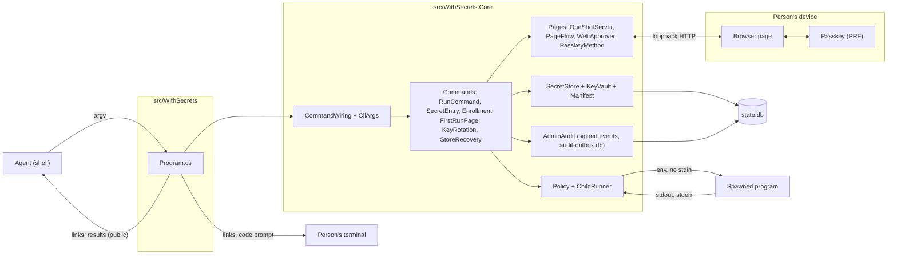
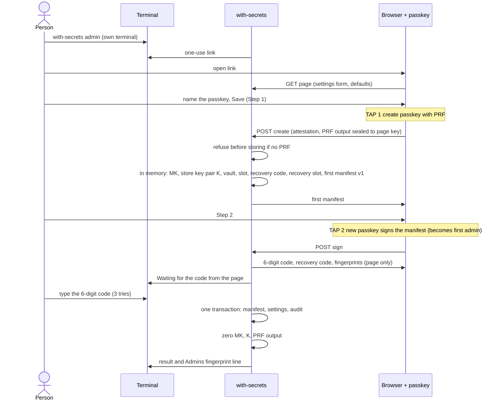
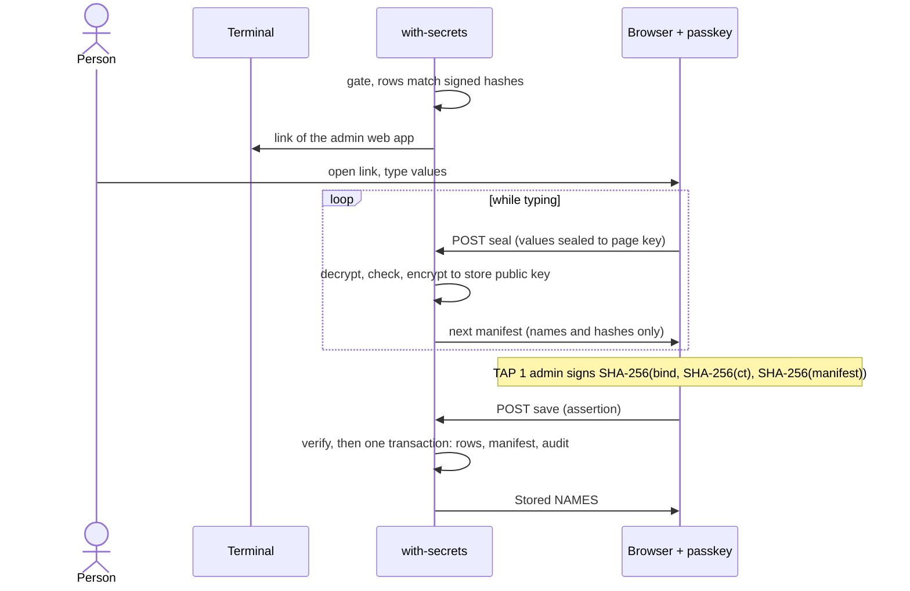
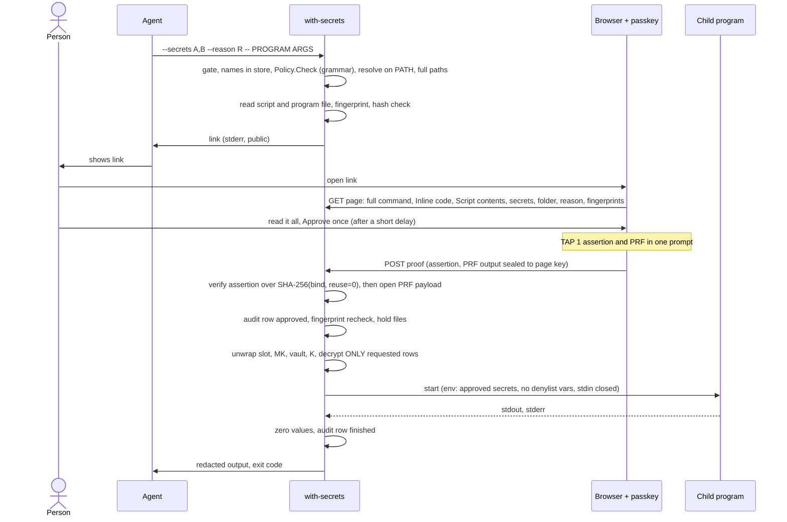
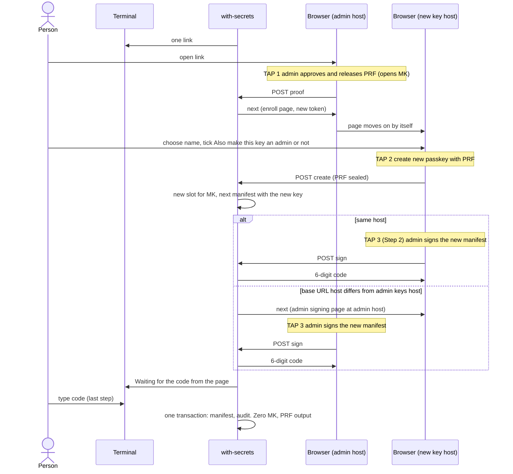
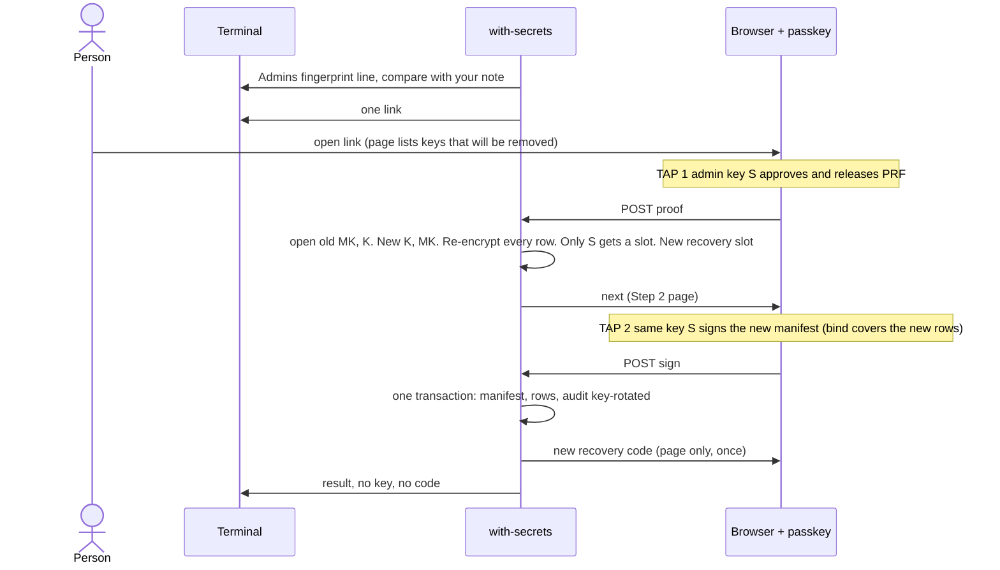

# with-secrets: architecture

The code is the source of truth (`src/WithSecrets.Core`, `src/WithSecrets`); [reference](reference.md) describes each behaviour and limit in detail, and this page is the design and the threat model. Sections 10.2 and 10.5 hold the design of the machine identity, the authority and the admin application.

## 1. What it is

- A CLI runs a program with secrets in its environment. An agent starts the command; a person approves it.
- The agent supplies secret names and a reason. The CLI does not print secret values, private keys, or the recovery code to agent-visible output. Approved values are injected into the child process environment.
- The person approves on a one-use web page with a passkey (WebAuthn). The same tap releases the secret-store key (WebAuthn PRF).
- The current prototype keeps its signed manifest, wrapped key material, Dotenvx ciphertext rows, and settings in one SQLite file, `state.db` (there is no audit table; administrative events are signed audit events in `audit-outbox.db`, see Task M4 below). The store private key is persisted only wrapped in the vault; the master key is persisted only in wrapped passkey/recovery slots. No plaintext store or master key is persisted.
- Terminal output is public (the agent reads it). Values and the recovery code appear only in the browser, apart from approved secret values in the child environment. Same-user process-memory access remains a documented limit (reference.md).

## 2. Components

The diagram below is the existing single-process CLI. It is not the host-service topology accepted in Section 10.2.

- `CommandWiring.cs` lives in Core, not in the exe. `Program.cs` parses, opens `state.db`, runs the gate, then dispatches.
- Every page of one command shares one `OneShotServer` (`PageFlow`), so one port and one link per command.

## 3. Communications

The table describes the current CLI/browser/child-process flow, not the future local-service and authority protocol in Section 10.2.

| From -> to | Transport | What is sent | What protects it |
| --- | --- | --- | --- |
| Agent -> CLI | argv, process start | secret names, reason, program, args | Policy checks before any page; names are not secret |
| CLI -> host service | HTTP/1.1 carried over a **channel only the current OS user can open**: Windows, a named pipe `with-secrets-<user SID>` (access list: the user only, network clients refused; the service and the command at the same elevation level); Linux and macOS, a Unix-domain socket `service.sock` in a directory owned by the user with mode 700 (`$XDG_RUNTIME_DIR/with-secrets` on Linux, `$TMPDIR/with-secrets` on macOS, each only when it is a private per-user place, else `/tmp/with-secrets-UID`; see "Local transport" below). There is no port and no plaintext TCP listener for the command line. `POST /v1/launch` with the canonical `LaunchRequest` JSON and its digest in `X-Request-Digest`, `POST /v1/launch/{id}/cancel`, `POST /v1/identity`, `GET /v1/status` | the request (names, pairs, reason, program, arguments, folder, the `.env` plan, the inherited environment), never a secret value | The OS: another user cannot open the channel (pipe access list; socket directory 700 and socket 600; on Linux and macOS the kernel-recorded peer user of each connection is checked too). The application: the client pins the service's machine identity and the service proves it before anything is sent (`/v1/identity`); `Host` must be a local name, no `Origin` header, JSON only, body max 1 MB with a 15 s read timeout, strict parse, digest, version and expiry checked. Reaching the channel is not authority: every request still needs its approval, and secrets open only after a passkey tap. A process of the same user is outside this boundary (see "Local transport" below) |
| Host service -> CLI | the response body of `POST /v1/launch`: NDJSON, one event per line (`approval` with the page link, `output` with redacted text and the stream, `result` with the outcome and the exit code) | the public link, redacted output, the exit status | **Public by design.** No event has a member that could hold a value; output is redacted in the service before it is sent |
| CLI -> Agent / terminal | stdout, stderr | one-use link, names, admin fingerprint line, redacted child output, exit code | **Public by design.** Never values, keys, recovery code |
| Person -> CLI | terminal stdin | the 6-digit confirmation code (first-time setup, adding a passkey, new store of `--recover`) | Read only after the last tap, 3 tries, prompt is the last line (`TerminalPrompt`) |
| Host service -> browser | HTTP on 127.0.0.1 and [::1] (the admin web app's port: `service --port N`, `WITH_SECRETS_PORT`, else 8765; a one-use approval page: setting `port`, `--port N`, else free). With `baseUrl` (http or https; passkeys need https or localhost): that name pointed at the port, or `ssh -L PORT:localhost:PORT` | HTML page, inline script and style allowed by CSP hash, data block (request text, bind, challenges) | Token: 16 random bytes in the path, fixed-time compare, 404 for anything else. Headers: strict CSP (`default-src 'none'`, `connect-src 'self'`), `no-store`, `nosniff`, `X-Frame-Options: DENY`, `no-referrer`. Both loopback addresses held, `ExclusiveAddressUse` on Windows |
| Browser -> CLI | POST `proof`, `deny`, `seal`, `save`, `create`, `sign`, `code` (body max 1 MB, 15 s body timeout) | passkey assertion or attestation, reuse minutes, PRF output, typed secret values, recovery code | See rows below. First outcome of a step is final, later requests get 404 |
| Browser <-> passkey | WebAuthn in the browser | challenge, assertion, PRF eval of the slot salt | Each prompt starts in its own tap (iOS rule). RP ID is the page host, passkey ignores ports |
| PRF output, browser -> CLI | inside the proof POST | 32 bytes sealed: fresh ECDH P-256 key, HKDF-SHA-256 (salt = bind, info `with-secrets/v1 prf`), AES-256-GCM (bind as AAD) to the page's own server key | Sealed to a key that lives for that page only. A passive observer (tunnel that ends TLS) sees ciphertext. An active man in the middle who replaces the page key is not stopped (reference.md) |
| Secret values, browser -> service | `seal` POSTs while typing (max 500 per page) | each value sealed the same way (own HKDF info `with-secrets/v1 secrets`) | Page server key per page. The Save tap signs `SHA-256(bind \|\| SHA-256(ct) \|\| SHA-256(manifest))` |
| Recovery code, browser -> CLI | `--recover` code page | code sealed to the page key | Never in terminal, log, audit or `state.db`. A typed code is not origin-bound: compare the printed admin fingerprint first |
| Lost reply | page resends the same body (3 tries: 8 s, 8 s, 20 s; `deny` one try of 20 s) | same bytes | Steps that lead on (`proof`, `create`, `sign`, `code`) keep one reply per verified body (SHA-256 of body, fixed-time compare), in memory until the command ends. No second page, no second code. Other steps (`save`, `seal`, `deny`): a resend after the outcome gets 404 and the page says the program already finished |
| CLI <-> `state.db` | SQLite, WAL, one transaction per write | manifest, ciphertext rows, sign counts | Manifest signature checked before use (exit 4). Writes check the version they replace |
| Host service -> spawned program | environment (the sender's inherited block, minus the denylist, plus ordinary `.env` values and the approved secrets), argv, closed stdin | only the approved secrets as env vars | Denylist, no stdin, redacted output (section 7) |
| Network diagnostics | Debug log events: terminal only with `--debug`, and the log file | method, route word, whole seconds, sizes, verdict words | No path, token, body, key or value (`NetLog` words, constant `AppLog` templates) |

### Local transport (CLI to host service)

The command line and the host service speak one application protocol (the `/v1` routes, the canonical request JSON and digest, the identity challenge, the NDJSON answer stream, cancellation by the client leaving). Only the channel that carries it differs by platform, behind one small abstraction (`LocalEndpoint`): the service listens on it, the client connects through it, and the same handlers answer on every channel. Remote machine-to-machine transport (TLS 1.3, HTTP/2, mutual authentication) is a different path and is unchanged.

| Platform | Channel | Who can open it |
| --- | --- | --- |
| Windows | named pipe `with-secrets-<user SID>` | the access list allows only the current user's SID and denies network (remote) clients; the first instance is created exclusively, so no other program can take the name first; the client asks for a pipe owned by the owner of its own token and does not let the service act as it. **Service and command run at the same elevation level** (see below) |
| Linux | Unix socket `$XDG_RUNTIME_DIR/with-secrets/service.sock` (else `/tmp/with-secrets-UID/service.sock`) | the directory must be a real directory owned by this user with mode 700 (a link, another owner or any other mode is refused, not repaired); the socket is mode 600; each connection's peer user (`SO_PEERCRED`) must be this user |
| macOS | Unix socket `$TMPDIR/with-secrets/service.sock` (else `/tmp/with-secrets-UID/service.sock`) | as Linux (`LOCAL_PEERCRED`). Machine transport to an authority is not available on macOS; this local channel is |

- **Where the directory is.** `XDG_RUNTIME_DIR` (Linux) or `TMPDIR` (macOS) is used only when it is an absolute path to a directory that this user owns and no one else can write to, and not a shared system directory (`/tmp`, `/var/tmp` and the like). When it is unset or unsuitable (macOS gives `/tmp` when `TMPDIR` is unset, which is shared) the directory is `/tmp/with-secrets-UID`, a different name for every user. In the shared `/tmp` another user can create that name first; the service and the command then find a directory that is not theirs and refuse it (the service does not start, with the reason): a denial of service at worst, never a takeover and never a connection through it. The owner, the type and the mode of the directory are read from the file system itself, not from the path.
- **One service per user.** A socket that something answers on is never replaced or removed: a second `with-secrets service` fails with that reason. A socket left by a service that is gone is replaced, and only then: it must be a socket (not a file, a directory or a link) owned by this user, and the probe connection must be *refused*, which is what a socket with no listener answers. No permission, a busy probe, an unexpected error or anything that cannot be told leaves the file alone and the start fails with the reason. The pipe's first-instance rule gives the same on Windows.
- **Windows elevation.** The service and the command run as the same user at the same elevation level. The owner of a process's token is the user for a normal process and the Administrators group for an elevated one, the pipe is owned by its creator's token owner, and the client (.NET's `CurrentUserOnly`) accepts only a pipe owned by its own token's owner; a pipe made at the other level is therefore refused (.NET source, `NamedPipeClientStream.Windows.cs`, the CurrentUserOnly check; seen on the CI runners, which are elevated). Both tokens hold the user's SID, so the access list would let each in; letting the client accept either owner would also accept a pipe that any administrator account made, so it is not done. The command says so (exit 7, "different elevation levels") instead of "not running". Start both from the same kind of terminal.
- **No fallback.** If the channel cannot be made safely (a directory that is not private or not this user's, a link in the way, a path that is not a socket, a path too long for the platform) the service does not start, and says why. The client never falls back to a port: with nothing on the channel a run exits 6.
- **Two surfaces, two listeners.** The channel serves only the command line's routes (`/v1`). The browser administration (`/api`, `/admin`) is served only on the loopback port, which serves nothing of `/v1`. Each connection is marked with the listener it came on and a request for the other surface is answered 404, so the browser administration is no way around the channel's access control and the command line's routes cannot be reached by a process that merely opens a port.
- **Threat model.** The channel keeps other OS users from the launch interface: they cannot connect, read a request or an answer (program names, arguments, working directory, environment declarations), inject or replay a request, or disturb a running launch or approval. A process that runs as the same user is outside this boundary, as before: it can already read the user's files and act as the user.
- **What the loopback port shows other local users (reviewed).** Any local user can open the admin web app's address and the one-use approval pages' ports, so what they can learn without the user's passkey was checked: before a session the API answers only the status (running, locked or unlocked, the unlock mode, versions) and the OpenAPI document; every other read needs a session, which is a cookie together with its own secret and is made only by an administrator's passkey; every change needs its own fresh tap. An approval page is a one-use address whose path holds a 128-bit random token and is given to the person through the terminal, so another user cannot guess it. Program names, arguments, working directories, environment declarations and secret names are therefore not visible to other users over the loopback port; they travel only on the user's own channel. What a local user can still learn is that the service runs and whether it is locked.

What is public: everything on stdout/stderr. What never leaves the browser: typed values (only sealed), the recovery code in plaintext (only sealed on `--recover`, shown on the page once), the passkey private key, the raw PRF output.

## 4. Key hierarchy

```mermaid
flowchart LR
    PRF["Passkey PRF output (32 bytes)"]
    KEK["Slot KEK"]
    Slot["Key slot wrap (per passkey)"]
    MK["Master key MK"]
    Vault["Vault"]
    K["Store key K (Dotenvx private key)"]
    Rows["secrets rows (ECIES secp256k1)"]
    Vals["Secret values"]
    Code["Recovery code (20 bytes)"]
    RK["Recovery key RK"]
    RSlot["Recovery slot wrap"]

    PRF -->|"HKDF-SHA-256, salt = slot salt, info with-secrets/v1 slot"| KEK
    KEK -->|"AES-256-GCM, AAD cred id + salt"| Slot
    Slot -->|"unwrap"| MK
    Code -->|"HKDF-SHA-256, salt = recovery salt, info with-secrets/v1 recovery"| RK
    RK -->|"AES-256-GCM, AAD with-secrets/v1 recovery + store public key"| RSlot
    RSlot -->|"unwrap"| MK
    MK -->|"AES-256-GCM, AAD with-secrets/v1 vault + store public key"| Vault
    Vault -->|"unwrap"| K
    K -->|"Dotenvx decrypt, requested rows only"| Rows
    Rows --> Vals
```

| Secret | Lives | Zeroed |
| --- | --- | --- |
| PRF output | In the passkey. In the page as a plain `Uint8Array` until sealed: the page scripts never overwrite it (garbage collection only). Server: opened from the sealed payload into `Unlock` (bytes) | `Unlock.Dispose` after the run read its values (every exit path). Registration copies zeroed after the slot is wrapped |
| Slot KEK | Process memory during wrap or unwrap | `KeyVault` finally blocks |
| Master key MK | `state.db` only as slot wraps and the recovery slot. Plain in memory during a run, adding a passkey, rotating the store key, `--recover`, the first-time setup | After use (`SecretValues.Clear`) |
| Store key K | `state.db` only as the vault. Plain as bytes plus a hex string during decrypt | Bytes zeroed. The hex string cannot be wiped (.NET) |
| Decrypted values | Bytes in `SecretValues`, strings in the child env and the redactor | Bytes when the child ends. Strings cannot be wiped |
| Recovery code | Offline, written by the person. Server makes it at the first-time setup, `--recover`, the rotation of the store key, formats it for the page | Code bytes zeroed when the page ends (the first-time setup, `--recover`) or after the slot is built (the rotation of the store key); the formatted text is a string and cannot be wiped. `--recover` holds the old K in `RecoveryCarry` until the end |
| Slot salt | Manifest. One shared salt per store (the first key's), because the page can pass one `eval` salt. The PRF output still differs per passkey | Not secret |

Facts that follow from this: `state.db` alone cannot decrypt anything. A same-user agent that reads process memory during a run can get K (reference.md "The secret store"). Removing a passkey does not rotate MK or K. Rotating the store key (admin web app) does.

## 5. Signed state

The manifest is one row in `state.db`, as canonical JSON, signed by an admin passkey.

| Item | Detail |
| --- | --- |
| Contents | version `v`, `keys` (id, name, public key, alg, rp, created, admin flag, slot salt and wrap), `store` (store public key), `vault`, optional `recovery` slot, `secrets` (name -> SHA-256 of ciphertext), `settings` |
| Not in it | sign counts (table `sign_counts`), the secret ciphertext itself (rows table, covered by the hashes) |
| Signature | admin assertion over `SHA-256(bind \|\| SHA-256(manifest text))`. Stored with its authenticator data and client data |
| Who may sign | a key that is an admin in the **stored** manifest and stays one. A key that only becomes admin in the new manifest cannot sign it. An admin cannot approve its own removal. The last admin cannot be removed |
| Verify before use | `Program.cs` runs `state.Gate` before every command. Failure prints `with-secrets: state failed verification: delete state.db to start over (only if you did not edit it)` (or the damaged or other-schema message) and exits 4. `--help` and bad arguments exit before the gate. Verified manifests are cached per process |
| Rows | every `SecretStore` read (a run, a secret change in the admin app, the rotation of the store key, `--recover`) checks every row against its signed hash (the gate checks integrity and the manifest only): a swapped row, a row with no hash or a hash with no row is exit 4 |
| Writes | one transaction: manifest, rows; the signed audit event is committed to the outbox just before the commit, and the change is not made if it cannot be. Refused when the stored version is not the one the page started from |
| Sign counts | stored beside the manifest, unsigned. An assertion must raise the count. An agent can inflate them (denial of service only) |
| Fingerprints | first 8 bytes of SHA-256 of each admin public key, 4x4 hex. Shown on every page (part of the signed text), and in the terminal before `--recover` and the rotation of the store key. Detects a replaced state |
| Grants (saved approvals) | **Inactive with the PRF store.** `SecretStore.NeedsUnlock` is true, so `RunCommand` uses `ReuseOffer.Off`: no list on the page, none saved or used. Code, table and tests remain (`Reuse.cs`) |
| Audit | no hash chain and no audit table in `state.db`: every administrative event is a signed event of type `admin` (machine key, per-machine sequence, unique id) in `audit-outbox.db`, uploaded to the authority. Integrity: the signature, the id, the sequence and the authority's acknowledgement. A same-user writer can still delete the outbox |
| Schema | version 9, checked at open (`PRAGMA integrity_check`). Other versions are never migrated |

Gaps (agent deletes `state.db` and builds its own state, restore of an older copy, rollback) are in reference.md "Admin keys" and "Known limits".

## 6. Flows

Legend: **TAP** is a passkey prompt (one per user tap). Page moves on by itself when a reply carries `next`. Participants: P person, T terminal, C with-secrets process, B browser and passkey.

### 6.1 First-run setup (`with-secrets admin`, nothing enrolled)

### 6.2 Store secrets (admin web app, Secrets page)

No PRF and no master key: storing a secret only needs the store public key. Removing a secret is a tap signing the next manifest without those hashes.

### 6.3 Run approval

Deny, wrong proof, any error or the time limit gives exit 3 and the audit row `denied`. If the audit row cannot be written nothing runs (exit 5).

Since Phase 1 the participant "with-secrets" is two parts: the CLI (parses, reads the `.env` once, prints, exits with the reported code) and the host service (everything from the policy checks to the exit status). The CLI sends a `LaunchRequest` and receives the events in section 3. The service prepares the child and its environment, then commits through a `LaunchGate` (a lock and an authorization revision): the process starts only if the launch was not cancelled and the revision is unchanged since it began; otherwise the prepared environment is discarded and the launch ends `cancelled` (exit 3, audit row `finished`, nothing ran). After the start nothing touches the child; a later invalidation does not stop it.

### 6.4 Enroll a passkey (admin web app, Passkeys page)

The code is generated at registration but shown only on the last page. Nothing is stored before it is typed. Removing a passkey is a single approval page where another admin signs the manifest without that key.

### 6.5 Rotate keys (admin web app, Settings, Secret store key)

Failure or timeout between the taps changes nothing. The link and the fingerprint line are printed in the terminal of the service.

### 6.6 Recover (`--recover`, all passkeys lost)

The old file is never deleted. Old admin keys are gone from the new state. Any failure leaves the old `state.db` as it was.

## 7. Policy and child process

| Area | Rule | File |
| --- | --- | --- |
| Secret names | `NAME` or `folder/NAME` (up to 3 folders, 200 characters in all; the last segment UPPER_SNAKE_CASE, no `DOTENV_` prefix; folders `[A-Za-z0-9_.-]{1,64}`, not `.` or `..`). One validator for all commands, the whole path is the store name and is data only. Every name must be listed (no `--all`). A secret change in the admin app: 1 to 20 names | `Contracts.cs` (`SecretNames`), `SecretEntry.cs`. Values: 6 to 4096 characters |
| Program lookup | `env`, `printenv`, `set` are refused (they print the environment). PATH entries that are absolute only. Working directory not searched unless the program has a slash or backslash. Windows App Execution Aliases refused | `ChildProcess.cs` (`ProgramResolver`), `RunCommand.cs` |
| Paths | program and script are expanded to full paths. What is checked, shown and run is the expanded form. They must read the same as the typed form | `RunCommand.cs`, `Paths.cs` (`PathExpander`), `Policy.cs` |
| Command grammar | Interpreters in one strict form only: `PROG script [args]` or `PROG -c/-e CODE` (sh family, python, node, perl, ruby), PowerShell: `-NoProfile` required, then `-NonInteractive`, `-NoLogo`, `-ExecutionPolicy VALUE` (once each), then exactly `-File` or `-Command`; `cmd /d /c` (or `/k`, `/r`) with a tail of letters, digits and `. _ : \ /` `-`, first word a `.cmd`/`.bat` file or echo, dir, type, ver. Encoded commands, a bare interpreter and code starting with a dash are refused. Other programs: no analysis, `Run:` line only (a text-file program is still shown). Matches reference.md "Known limits" and `--help` | `Policy.cs` |
| Limits | command max 16,000 characters. Inline code shown: first 4,000 characters. Script max 1 MB (page shows first 200 lines or 16 KB). Script must exist, be text, and be readable. Batch files ASCII | `Policy.cs`, `RunCommand.cs`, `ApprovalSummary.cs` |
| Page text | every line of code prefixed `  \| `. Control, bidi and zero-width characters replaced by a mark. Part of the signed text | `ApprovalSummary.cs` |
| Fingerprint | covers names, every variable-to-secret pair, the `.env` paths and ordinary variable names (when a `.env` is used or a variable differs from its secret), full program path, folder, and path and hash of the script and of the program file (when 1 MB or less). Recomputed after approval. A changed file denies | `Reuse.cs`, `RunCommand.cs` |
| File lock | shown files opened `FileShare.Read` until the child ends (nobody can write, delete or rename them) and hashed again. Windows runs the file itself. Elsewhere the system cannot lock a file, so the checked bytes are written once to a private folder (owner only, outside the project, read-only, checked again) and the child is told to run that copy, under the same name; it is deleted when the child ends. The working folder, arguments and environment are unchanged. The copy's folder also holds a link to each entry of the original's folder (none above 1000 entries), made without opening or following anything, so a script that finds neighbours by its own location (`dirname "$0"`, `BASH_SOURCE`, `Path(__file__).resolve().parent`, `$PSScriptRoot`) still does; those neighbours are read as they are when used, never as shown or approved. `$0`, `__file__` and the like are the copy's path, `..` is the private folder, and a new file cannot be written beside the script. In the step that starts the child the copies are checked again by path (hash, plain files, owner-only modes, folders not links). The child opens the file a moment later by its path, so a process of the same user (which owns the folder) can still change it in that gap; that is not prevented, and that process can already read the child's environment from `/proc`. What a script loads from beside itself is not covered by the approval, and the page says so | `RunCommand.cs` (`HeldFiles`) |
| Environment | removed before launch: `DOTENV_PRIVATE_KEY*`, `NODE_OPTIONS`, `BASH_ENV`, `ENV`, `PYTHONPATH`, `PYTHONSTARTUP`, `PYTHONHOME`, `PERL5OPT`, `RUBYOPT`, `LD_PRELOAD`, `DOTNET_STARTUP_HOOKS`, `JAVA_TOOL_OPTIONS`, five `GIT_*` names (`GIT_CONFIG_GLOBAL`, `GIT_CONFIG_SYSTEM`, `GIT_EXEC_PATH`, `GIT_SSH_COMMAND`, `GIT_ASKPASS`), `SHELLOPTS`, `BASHOPTS`, `PS4`, `PS0`, `PROMPT_COMMAND`, `BASH_FUNC_*` and more (case-insensitive on Windows). Full list in `ChildRunner.CodeLoadingVariables` and reference.md. Known gaps: reference.md | `ChildProcess.cs` |
| Stdin | closed right after start: the child reads end of file | `ChildProcess.cs` |
| Launch | `.cmd` and `.bat` start as `cmd.exe /d /c "path" args` (no AutoRun). Arguments with quotes or `& \| < > ^ % !` are refused for cmd | `ChildProcess.cs`, `Policy.cs` |
| Output | read as UTF-8, redacted by `StreamRedactor` (chunk splits and common forms). Reversed, split, compressed or encrypted copies are not caught | `Redaction.cs` |
| Terminal-only commands | `--recover` and the first-time setup of `admin` (nothing enrolled) refuse when input, output or error is redirected (exit 3). `--needs` does not check | `CommandLine.cs`, `Program.cs` |

## 8. Trust boundaries

This table describes the current single-process implementation. The future local API trust model is described separately in Section 10.2. What the agent can and cannot do, and the known limits: reference.md "Known limits", "Admin keys" and "The secret store". Summary:

| Actor | Capability | What stops it |
| --- | --- | --- |
| Agent (same OS user) | start a run, read terminal output, hold links | Cannot tap the passkey. Link is one-use and shows the whole request. Enrollment codes need a human typing in a real terminal |
| Agent | read `state.db` | No key on disk: K is only wrapped, MK only under PRF or the recovery code. Rows are ciphertext |
| Agent | edit `state.db` (keys, settings, rows, slot, vault) | Manifest signature and row hashes fail: exit 4 on every command |
| Agent | delete `state.db` and write its own signed state | **Not prevented.** Visible: admin fingerprints change on every page |
| Agent | restore an older `state.db`, rewrite audit and chain, inflate sign counts | Accepted limits (reference.md) |
| Agent | read process memory during a run | **Not prevented.** K, MK, PRF output and values are in memory for that moment (reference.md) |
| Agent | change the script or program after the page showed it | Fingerprint recheck, file hold (Windows) |
| Agent | pass options or env that load unshown code | Strict grammar, environment denylist, closed stdin. Gaps listed in reference.md |
| Another local process | serve a look-alike page on localhost | Server holds both loopback addresses exclusively. Passkey RP ID ignores ports, so check the printed link before tapping (reference.md) |
| Network observer (tunnel) | read page traffic | PRF output and secret values are sealed to the page key. Active man in the middle is out of scope |
| Child program | print or send secrets | Output redaction only. A program that sends its environment out is out of scope |
| Lost admin device | still opens the store with an old `state.db` copy | Rotate the store key in the admin web app (keeps one key). Removing a passkey alone does not rotate MK or K |

## 9. Exit codes and error paths

| Code | Meaning | Typical causes |
| --- | --- | --- |
| 0 | success | run: the child exited 0. approve: the grant was made. Commands: change made, `--help` |
| 2 | usage | bad arguments, two commands, invalid or unknown secret name, policy refusal, script missing, too large or not text, changed while the request was built, command too long, App Execution Alias |
| 3 | denied | Deny on the page, wrong proof, time limit, internal error in a session (`HandleGuard`, text says only `internal error`), files changed while the page was open, file hold failed, nothing enrolled, no terminal for a human command, refused change |
| 4 | store error | `state.db` damaged, locked over 5 s, other schema, failed signature or row hash, unusable settings, cannot decrypt |
| 5 | audit error | the audit row could not be written, or (behind the host service) the signed audit event could not be committed to `audit-outbox.db`, so nothing ran |
| 6 | host service not running | a run could not reach the host service (`with-secrets: the host service is not running. Start it with: with-secrets service`); nothing was asked and nothing ran |
| 7 | service not authenticated | the CLI could not verify that what answers is this machine's host service (no answer to the identity check in 5 s, a wrong or replayed answer, another fingerprint than the one pinned in `host.json`, an unreadable `host.json`), or no identity is pinned yet (the fingerprint is printed; an administrator approves it in the admin web app, which pins it); nothing was sent |
| 8 | authority locked | a run or approve reached the host service while the authority is locked (the service starts locked); nothing was asked and nothing ran. The line names the admin page where an administrator unlocks it with a passkey tap |
| 9 | service not ready or busy | the host service answered 503: it has not finished its startup check-in with its authority (it keeps trying and becomes ready by itself, for example after the authority key was recovered), or it already runs 8 launches; nothing was asked or run. Ask again in a moment |
| 127 | not found | program not on PATH, or the process cannot be started |
| other | the child's own exit code | passed through on a run |

Every web session ends on the first outcome. Deny, error and silence all end in a denial, never an approval. Gate failures happen before any link is printed.

## 10. Machines, the authority and the admin application

Everything in 10.2 and 10.5 is built except what is listed here. The "current implementation" paragraphs state exact behaviour; the rest of each section is the design it follows.

Not built: a Windows service that starts at logon; a macOS Keychain machine key store (macOS uses the owner-only key file, like Linux); privilege separation (the service under another OS account); `--env` layering and `${VAR}` expansion in `.env`; secret providers, mounts and namespaces. Hand tests with real phones, a tunnel and a screen reader are open.

### 10.2 Local service, machine identity and direct authority communication

This section records the design of the service, the machine identity, the authority and its audit, and what is built of it.

#### Goals and operating model

- The CLI is backend-agnostic. It communicates only with its local host service through one shared API/protocol, whether the service fulfills requests from a local authority or connects directly to one configured remote authority.
- The host service is the trusted execution boundary: it validates requests, obtains authorization, resolves and decrypts approved secrets, prepares the child environment, and owns the final launch decision. The CLI is a client; it does not independently retrieve secret values or make the final launch decision.
- Each independently installed host service has its own machine identity. Windows and WSL installations are separate identities. Docker launched through the host-side CLI uses the host service and host identity; the host service launches the Docker client with approved values in its process environment and passes variable names, not secret values, in Docker command arguments. Values are not written to Docker volumes or secret files. The container receives them as environment variables; it does not run an independently enrolled service or hold a machine key.
- A host service operates with one authority:
  - **Local authority:** the host service also performs the authority role and owns/accesses the local provider/store and authoritative security state.
  - **Remote authority:** the host service connects directly to its one configured remote authority. That authority owns authoritative machine records, grants, provider access, and approval decisions; the local host service retains only its permitted in-memory cache and working authorization state.
- Each host has exactly one configured authority identity and endpoint. There is no authority selection, automatic fallback, alternate authority, relay, reverse tunnel, or multi-hop routing in the initial design. Changing authority requires an explicit administrative operation.
- The authority endpoint address is routing information only. The enrolled authority machine identity is the trust identity; changing DNS name or IP address does not change that identity or silently change trust.
- Remote hosts are assumed to be directly addressable at their configured endpoint. Multi-hop routing and intermediaries are deferred until a concrete requirement exists.
- Secret delivery to a child remains ordinary environment variables. The agent does not receive secret values, private keys, or recovery codes.

#### Local clients and transport

All local clients use the same HTTP API and application protocol. The CLI sends launch requests to the local host service; the service prepares and launches the requested child process and returns its exit status and redacted output. Do not introduce separate named-pipe, Unix-socket, or Docker-specific authentication protocols.

- The Windows host service exposes its local client API on loopback HTTP. Localhost alone is not treated as machine authentication or human administrator authentication.
- WSL uses its own independently enrolled WSL host service. The intended client path is `WSL CLI → WSL host service → Windows host service`; the WSL host service authenticates to the Windows host service using the existing machine identity and HTTPS/mTLS protocol. Do not trust a request merely because it originates on a WSL network interface.
- The browser administration listener is separate from the machine-to-machine listener. It is enabled only on the authority host, binds only to loopback, and uses HTTP for the local browser. Non-authority host services do not enable or expose the browser administration interface.
- The authority host runs a separate machine-to-machine HTTPS listener. It does not serve the browser SPA on that listener. The machine listener is not a privileged browser endpoint.
- The browser listener uses the browser session, origin/CSRF protections, and fresh operation-bound passkey authorization defined in Section 10.5. Browser passkeys authorize human administrative operations; they are not used as machine credentials.
- The machine-to-machine listener requires TLS 1.3 and HTTP/2. Exactly one route is exempt from requiring an already-enrolled, trusted client certificate: the pairing route defined below. No other route is unauthenticated or available to an unknown, disabled, or untrusted machine. Health, status, diagnostics, and discovery remain authenticated.
- The machine listener uses HTTP/2 only. It does not fall back to HTTP/1.1 or TLS 1.2. The browser listener remains independently compatible with ordinary browser-supported HTTP.
- The machine API uses the shared, versioned HTTP API and OpenAPI contract. Transport authentication identifies the calling machine; application authorization still evaluates every request independently.
- This is a developer-machine trust model, not isolation from malicious processes already running with the developer's privileges. Such processes may be able to interact with local services or inspect same-user process memory.
- Docker is launched through a host-side CLI request. The host service owns the launch and supplies approved values to the Docker client through its process environment. The container does not need direct service access, a separate machine identity, an identity-key volume, or secret files.

#### Machine identity and enrollment

- Each host service generates and securely retains its own ECDSA P-256 machine identity private key. The key signs; it is not used to encrypt or wrap secrets.
- The machine fingerprint is SHA-256 of the canonical public key (SubjectPublicKeyInfo) and is the stable cryptographic identity. It is not a certificate thumbprint. A friendly name is authority-managed display metadata, not identity.
- Initial machine identity creation also creates a required self-signed X.509 identity certificate using the existing persistent ECDSA P-256 identity key. It introduces no additional persistent private key. The certificate is a CA-capable trust anchor (`BasicConstraints CA=true`, `pathLen=0`) with `DigitalSignature` and `KeyCertSign` key usage and a 10-year validity period. Its public certificate is stored as machine metadata and included in enrollment.
- Enrollment verifies that the identity certificate contains exactly the public key supplied for the machine identity, verifies its self-signature and required CA/key-usage properties, and then follows the normal Pending/Trusted approval process. Possession of a valid certificate does not itself establish trust.
- Each running host-service instance creates a separate temporary ECDSA P-256 TLS key pair in memory. Its temporary leaf certificate is signed by the persistent machine identity key, is not a CA, has `DigitalSignature` key usage and both `serverAuth` and `clientAuth` EKUs, and is valid for 24 hours. The same temporary certificate/key is used for TLS server and client authentication. The temporary key is distinct from the persistent identity key and is never persisted.
- The temporary certificate's SAN contains a URI identifying the machine, in the form `urn:with-secrets:machine:<identity-fingerprint>`. The SAN is a lookup hint only; certificate signature/chain validation proves that the identified machine issued the certificate. Missing, malformed, or ambiguous identity SANs are rejected without trying other identities.
- A temporary certificate is rotated in memory one hour before expiry. New TLS handshakes use the replacement; existing connections may finish. A service restart generates a new temporary key and certificate.
- No external CA, OS trust-store installation, or separate persistent TLS private key is required. Peers validate the temporary leaf against the enrolled machine identity certificate as a custom trust anchor.
- Identity-certificate renewal uses the same persistent identity key and therefore preserves the machine fingerprint. A replacement certificate with the same public key, valid self-signature, required certificate profile, and acceptable validity is accepted without administrator re-enrollment. A different public key is a new machine identity and requires explicit enrollment/approval.
- Machine identity key replacement is a separate security-sensitive trust transition. It is never automatic; the old identity is revoked and the new identity is explicitly enrolled and approved. Existing grants do not transfer automatically. If the old key is unavailable, the replacement is treated as a new machine identity; there is no automatic recovery or hostname/IP-based continuity.
- The private key is kept outside ordinary application data. On a developer machine it is protected by the host OS. For Docker-launched workloads, the host service retains the key; no Docker volume contains it.

- A new machine is paired with a one-time invitation created by an administrator in the authority's admin web interface. The invitation contains the authority URL, a unique invitation identifier, a randomly generated 128-bit pairing code, and a fixed short expiration. The authority stores only protected derived key material needed to verify the invitation proofs; it never stores or logs the plaintext code.
- The invitation is a local credential bundle, not a network message. The CLI parses the authority URL, invitation identifier, and code locally. The code is never placed in a URL path/query/fragment, command-line argument, HTTP header/body, log, diagnostic, or agent-facing output. It may be entered through a hidden terminal prompt or supplied unattended through a dedicated environment variable or protected secret store (including a Docker secret); a protected secret store is preferred to an environment variable. The pairing credential must not be inherited by launched child processes.
- Pairing first contacts only the pairing route over TLS 1.3/HTTP/2. The server certificate is provisional at this stage: the client accepts it only for this bootstrap exchange and only after structural certificate checks. The request contains only the invitation identifier and a fresh client nonce, not the machine identity or pairing code. The authority returns its public identity certificate, a fresh server nonce, and an HMAC-SHA-256 proof keyed by the invitation code and bound to a domain separator, invitation identifier, authority identity fingerprint, and both nonces. The client verifies the authority certificate profile and fingerprint and verifies the HMAC before trusting or sending machine registration data. A substituted authority certificate cannot produce the required proof.
- After authenticating the authority, the new machine establishes a fresh TLS 1.3/HTTP/2 connection pinned to that exact authority identity certificate. It presents its self-signed machine identity certificate and submits its public identity, fingerprint, host name, a fresh registration nonce, proof of possession of its persistent identity private key, and an HMAC-SHA-256 proof keyed by the pairing code. The registration proof is domain-separated and bound to the invitation identifier, machine fingerprint, host name, and registration nonce. The code itself is never transmitted. The authority accepts an unknown machine certificate only on the pairing route and only after validating the certificate structure and registration proofs.
- The pairing route does only two things: bootstrap delivery and proof of the authority identity certificate, and machine registration that creates or refreshes a Pending record. It returns only public authority certificate material and the minimal registration result. It never returns secrets, machine records, grants, or other authority state, and never accepts launch, secret, grant, or authorization requests. All other routes require a validated client certificate belonging to a currently Trusted and enabled machine.
- Successful registration and invitation consumption are one atomic, idempotent authority operation. A consumed invitation cannot register another machine. A retry of the same committed registration request may retrieve its original non-secret result without creating another registration. Failed proofs are rejected and bounded; expired or consumed invitations cannot be used. Concurrent claims cannot both succeed. A repeated registration using the same fingerprint refreshes its existing Pending record; it does not reset Disabled or Untrusted records to Pending or bypass any existing trust transition.
- The authority invitation is single-use and short-lived, with fixed limits on failed attempts, concurrent pairing registrations, pending registrations, and request size. These are built-in limits, not user-configurable quotas or reputation controls. Expiration, refusal, failed attempts, and approval are durably audited without recording the pairing code or derived proof material.
- After registration, the machine remains Pending and cannot request secrets or create grants until an administrator verifies its fingerprint and host name in the admin web interface and approves it using fresh, operation-bound passkey authorization. The authority's public signing key remains separately pinned through this authenticated approval flow; the pairing code does not replace administrator approval or authorize secret access.
- Pairing can run interactively or unattended using the same protocol. In unattended startup, the host service consumes the supplied invitation credential without prompting; the credential remains unavailable to agents and child processes. The authority's URL and identity are pinned only after successful proof verification. An optional out-of-band authority fingerprint may be supplied as an additional check, but is not required when the pairing-code proof succeeds.
- The authority records the host name established at enrollment. Requests present both fingerprint and current host name; both must match. A mismatch is rejected and recorded as pending for administrator review. The administrator explicitly approves a legitimate host-name change in the admin web interface. A mismatch does not silently change the binding or delete the enrollment.
- Friendly-name changes are display-only, may be made at any time, and do not invalidate grants or cache. They are audited.
- Machine listing, details, status changes, friendly-name changes, host-name change approval, and audit history are managed through the admin web interface.

#### Machine status and authorization invalidation

The authority retains machine records and their history. A previously known Untrusted fingerprint is not treated as a new Pending machine.

| Status | Meaning | Secret access |
| --- | --- | --- |
| Pending | Newly discovered and not yet approved | Denied |
| Trusted | Approved and trusted | Allowed subject to grants and approval |
| Disabled | Temporarily suspended by an administrator | Denied |
| Untrusted | Administrator has explicitly withdrawn trust | Denied |

- Pending → Trusted requires explicit administrator approval and assignment of a friendly name.
- Trusted → Disabled and Trusted → Untrusted invalidate all grants and authorization state.
- Disabled → Trusted is an ordinary re-enable, but starts clean: no old grants or cache are restored.
- Untrusted → Trusted requires an explicit confirmation identifying the machine. It also starts clean.
- Disabled and Untrusted have the same access-control effect; the distinction records administrative intent.
- Every administrative action that invalidates a machine's authorization increments a monotonically increasing security revision for that machine fingerprint. The revision is per machine, not global. Display-only friendly-name changes do not increment it.
- A revision change invalidates the machine's entire cache and all grants. No selective preservation is attempted.
- Status changes, revision changes, grant invalidation, and cancellation of pending work are recorded in the authority audit history.
- Disabling or untrusting a machine also invalidates its active authenticated machine connections. The receiving host stops accepting new requests on those connections, initiates HTTP/2 `GOAWAY`, and closes remaining connections after a bounded grace period. Per-request authorization and the secret-release checkpoint remain authoritative; connection closure is defense-in-depth, not an authorization cache.

#### Cache, grants, startup, and reconnection

- Secret values and the host service's working authorization/grant state are memory-only. The host service does not persist secret cache values or authorization state locally. A host-service restart destroys them.
- Durable grants live at the authority. The approver chooses the grant expiration at approval time, including an indefinite grant where offered. Do not impose a new fixed lifetime.
- The CLI exposes `with-secrets approve COMMAND` and `with-secrets run COMMAND`. `approve` performs the normal request validation and human approval flow to create or update a grant, but does not launch the command. `run` performs the same normal validation and uses an applicable, unexpired grant without prompting; it does not bypass request scope or constraints. Preapproval is limited to the approved grant scope, not blanket permission.
- An active grant may be extended, an expired grant renewed, or a grant revoked through an authority-controlled operation. The authority is the source of truth for all grant changes. Connected hosts apply updates immediately. An offline host cannot use an extension or renewal it has not received; its previously synchronized grant remains subject to its existing expiration and the separate offline-authorization lease. A grant change never extends the offline lease.
- At startup, the host service must authenticate to its authority and reconcile machine status, host-name binding, and security revision before accepting secret requests. If the authority is unavailable at startup, the service cannot accept new requests.
- After successful startup reconciliation, if the security revision is unchanged, the authority may restore still-valid grants into host-service memory. Secret values are fetched on demand and cached in memory. If the revision changed, old grants are not restored.
- If the authority becomes temporarily unavailable while the service is already running, existing in-memory cache and grants may continue to be used only within a finite offline-authorization lease. The authority is the sole source of policy and sets the lease duration; hosts cannot choose, extend, or override it. A connected host applies an authority policy change immediately. An offline host remains bound by its already-issued lease and must reconnect and reconcile before obtaining a new lease or continuing after expiry. In local-authority mode, the local authority sets the policy. The authority issues each offline lease with an explicit duration/expiration. The host measures elapsed lease time with a monotonic clock, never the wall clock, so changing the system date or time cannot extend offline access. A service restart destroys the in-memory lease and requires fresh authority reconciliation before secret requests are accepted. An indefinite durable grant does not create an indefinite offline lease. When the lease expires, the host must fail closed for secret use until it can reconnect and reconcile with the authority. New retrievals or approvals that require authority participation cannot proceed while disconnected.
- Losing connectivity alone does not immediately invalidate the cache. However, the authority records revocations durably and distributes them to every host; a host must apply a received revocation immediately, clear affected grants/cache, and refuse the revoked fingerprint. An offline host that has not received the event is still bounded by its finite offline-authorization lease and must reconcile before resuming use.
- The authority invalidates grants and in-flight requests when a security transition occurs and delivers the existing invalidation messages through authenticated HTTP/2 long polling. Each host maintains one outstanding long-poll request; the authority holds it until the existing protocol has an invalidation message to deliver. The response carries the existing message payload without redefining it. The host acknowledges through the existing acknowledgment operation and immediately issues its next long poll.
- Long polling changes only the transport. Preserve the already-defined invalidation message contract, sequencing, acknowledgment semantics, retry/retention behavior, duplicate handling, security-revision rules, host-side cleanup/cancellation, and reconnect reconciliation unchanged. Do not introduce a new event schema, sequencing model, delivery guarantee, heartbeat, periodic empty polling, WebSocket, custom streaming protocol, or message broker.
- The host cancels its own affected pending work and clears the affected cache and authorization state before acknowledging. It never inspects, signals, suspends, terminates, or otherwise interacts with already-launched child processes.
- Invalidation events are notifications, not the source of truth. On every reconnect, the host authenticates and obtains current status and security revision before resuming requests. If the revision differs from the last successfully synchronized revision, it purges all cached secret values and authorization state even if the machine is Trusted again.
- Duplicate or older invalidation events are ignored by revision. An acknowledgment is sent only after cleanup and cancellation of pending pre-launch work completes. If cleanup fails, no acknowledgment is sent; reconnect reconciliation remains the fallback.
- Reconciliation is limited to the security state needed to establish cache validity; it does not require downloading all machine configuration.

#### Process launch and invalidation race

- The host service prepares the child process and its environment without launching it. Secret values are held only in the service's working memory and the prepared child environment; they are not returned to the CLI as a separate secret response.
- Immediately before process creation, the host service performs a final authorization check and commits the launch against its current local authorization state. The service, not the CLI, owns this launch boundary.
- Launch commit and local invalidation handling are serialized so only one wins the race.
- If invalidation wins, the pending launch is cancelled and the prepared environment is discarded.
- If launch wins, the child is considered launched. Later invalidation must not inspect, signal, suspend, terminate, or otherwise interact with it.
- An authority cannot prevent a launch that occurs while the host is disconnected and has not yet received an invalidation. This is consistent with the offline-cache policy. In remote-authority mode, the host service's offline freshness and expiration policy remains the limit on cached use; a new retrieval or new approval requiring the authority cannot proceed.

#### Machine-to-machine HTTPS, TLS, and certificate validation

Machine-to-machine communication uses ordinary HTTPS with TLS 1.3 mutual authentication. TLS replaces the former custom application-level ECDH handshake, transcript signatures, HKDF session-key derivation, AES-GCM message wrapping, and per-message sequence encryption. Do not implement a second encrypted channel inside HTTPS.

**TLS and HTTP requirements**

- Require TLS 1.3 and HTTP/2 for every machine-to-machine connection. Do not fall back to TLS 1.2, HTTP/1.1, or plaintext.
- Use the platform TLS implementation through .NET. Do not implement TLS, invent cipher suites, or add third-party cryptography dependencies.
- Disable TLS 0-RTT and TLS session resumption initially. A new connection performs a fresh certificate-authenticated handshake.
- Keep healthy HTTP/2 connections persistent. Do not impose maximum connection age or idle timeouts. Ordinary network failure detection still applies.
- Kestrel selects the current temporary certificate for each new server handshake. Clients use a new connection pool after their temporary certificate rotates; existing connections in the old pool may drain and finish in-flight work. Dispose the old pool after draining, with a bounded shutdown timeout. Do not interrupt healthy connections solely because the certificate used at their handshake later expires.
- Disable automatic HTTP redirects and ambient system HTTP proxy use for machine connections. A 3xx response is an unexpected protocol response, not permission to connect to another endpoint. Endpoint changes require explicit configuration/administration. Never forward machine credentials or client certificates to another destination.
- Disable all HTTP caching for the machine API, on both clients and servers. Every response uses `Cache-Control: no-store`; do not emit `ETag`, `Last-Modified`, or other cache validators, and do not support conditional requests. No intermediary/reverse-proxy caching is permitted.
- Disable HTTP compression in both directions. Do not negotiate compressed request or response bodies.
- Use `application/json` with UTF-8 for machine API requests and responses. Reject unsupported media types and content encodings. Do not support multipart, form-encoded, XML, or alternative representations.
- Use the existing canonical JSON rules wherever signatures or request digests depend on serialization. Keep the API versioned under `/api/v1/` and described by the shared OpenAPI contract.
- Every endpoint except the single pairing route requires a successfully authenticated client certificate for a currently Trusted and enabled machine before application processing. The pairing route is the only exception and is restricted to the bootstrap and registration operations described in the Machine identity and enrollment subsection. A structurally valid but unknown client certificate may complete the TLS handshake provisionally only so that the pairing route can validate it; middleware/endpoint enforcement must reject it on every other route. No health/status/diagnostics/discovery exception exists.
- Machine API errors use standard HTTP status codes and structured JSON error codes with a correlation/request ID. Never return stack traces, filesystem paths, secret values, provider credentials, private keys, or internal cryptographic details. Do not redirect to browser login pages.

**Pairing route and bootstrap trust**

- The pairing route is the sole exception to the requirement for an already-enrolled, trusted client certificate. It remains on the machine listener and still requires TLS 1.3 and HTTP/2; it is not a plaintext or general anonymous HTTP endpoint.
- During the initial bootstrap connection, the client may provisionally accept a structurally valid authority TLS certificate only for the pairing route. The client sends only the invitation identifier and a fresh nonce. The authority returns its public identity certificate and an HMAC-SHA-256 proof keyed by the invitation code, bound to a domain separator, invitation identifier, authority fingerprint, and both nonces. The client verifies the proof and certificate profile before sending machine identity, host name, or registration data. It then opens a new TLS connection and validates the authority's temporary TLS certificate against the exact authority identity certificate just authenticated.
- The pairing route may provisionally complete a TLS client-certificate handshake with a structurally valid but not-yet-enrolled machine certificate. This provisional acceptance grants access only to the pairing handler. The handler validates the self-signed identity certificate profile, verifies that the presented temporary leaf is correctly signed by that identity, verifies proof of possession of the persistent identity key, and validates the invitation-code registration HMAC. Unknown certificates are rejected on every other route, before any route-specific work.
- The pairing code is never transmitted. Both proofs use HMAC-SHA-256 with domain separation and fresh nonces; the authority retains only protected derived key material until the invitation is consumed or expires. Proofs bind the invitation identifier and the relevant authority or machine fingerprint, preventing certificate substitution and cross-protocol reuse.
- The route has fixed built-in limits for request size, concurrent registrations, pending registrations, and failed code attempts. It supports only authority-certificate bootstrap and machine registration. It does not expose machine details, grants, secrets, diagnostics, health, discovery, launch, or authorization operations.

**Machine certificate validation**

- The persistent machine identity key remains the stable identity. The 10-year self-signed identity certificate is the enrolled trust anchor; the 24-hour temporary leaf certificate is used for TLS handshakes.
- For an inbound client certificate, read the machine identity fingerprint from its SAN URI, locate that exact enrolled identity certificate, and validate the temporary leaf chain against that certificate using a narrowly scoped custom-root trust policy. Verify the leaf signature, validity, CA=false constraint, key usage, both required EKUs, and expected identity. Then check that the machine is currently trusted and enabled.
- For an outbound connection, validate the server's temporary certificate against the one configured authority identity certificate. Verify the SAN identity and chain against that exact expected identity. Do not try other enrolled identities or accept an arbitrary valid certificate.
- DNS names and IP addresses are routing information only, not machine identity. A hostname mismatch may be accepted only after the expected enrolled machine identity and certificate chain have been successfully verified. Never disable certificate validation globally.
- Endpoint address and expected authority identity are separate configuration values. Changing an address does not change trust; changing authority identity requires an explicit administrative operation.
- The authority's public signing key remains separately pinned through administrator-approved enrollment. It is not replaced by the TLS certificate or machine identity key.

**Authentication, authorization, and release**

- The server derives the caller's machine identity exclusively from the successfully validated TLS client certificate. The client cannot select or override its identity through an HTTP header, URL, or JSON field. Any machine identifier supplied as a target/resource is untrusted input and is independently authorized.
- Machine authentication identifies the calling host; it does not grant blanket access. The authority checks current machine status, grant scope/expiration, policy, and security revision independently for every API request. An established connection is never a standing authorization.
- The authority performs a final authorization checkpoint immediately before releasing a secret. This checkpoint is the linearization point for concurrent release and revocation: if revocation takes effect first, release is denied; if the checkpoint succeeds first, that release may complete. A secret already delivered cannot be recalled.
- Revocation stops new requests, closes active connections, and cancels pending work where practical. It does not inspect, signal, suspend, or terminate already-launched child processes, and cannot retract a secret already delivered.

**Connection recovery, retries, and resource limits**

- If a persistent connection fails, the client reconnects directly to the same configured authority using the current temporary certificate, with bounded exponential backoff and jitter. There is no alternate authority, insecure fallback, reverse tunnel, or relay.
- Each logical operation has a unique request ID. Retries of durable/idempotent operations reuse the same ID; the authority records processed IDs and results atomically with the operation so a committed mutation is not executed twice.
- Read-only metadata requests may be retried when safe. Administrative mutations use the existing idempotency mechanism. A secret release whose response is lost has an ambiguous outcome and is not automatically retried; the client may make a new request, which is independently authorized at the current release checkpoint. Do not persist secret values merely to replay a response.
- Use fixed, built-in resource safeguards appropriate for a development tool: modest global and per-machine concurrent-request limits, bounded request bodies, and operation-specific timeout defaults. These are implementation constants, not user settings, environment variables, or deployment configuration. Do not add request-per-second quotas, adaptive throttling, reputation scoring, or elaborate abuse detection. Reject excess concurrent work rather than queueing it without bound.
- Cancellation propagates to server work where safe. A timeout or disconnect does not prove that an operation did not complete.
- Durable authority operations remain atomic in SQLite. Machine records/statuses, security revisions, grants, signing-key metadata/rotation history, audit history, processed request IDs/results, and pending invalidation state are durable. Secret values and host working authorization/cache state remain memory-only.
- A machine disable/untrust operation atomically updates status, increments security revision, invalidates grants, and records the audit event. Grant approval atomically records approved scope, expiration, and audit event.
- Do not add a message broker or distributed transaction system.

**Application-level signatures and key separation**

- TLS authenticates live connections and protects ordinary API traffic. Do not sign every ordinary HTTP request or response on top of TLS.
- Retain application-level signatures for durable authority-issued records whose authenticity must survive beyond a live connection, including grants and other durable authority-issued security records. Verify these signatures against the separately pinned authority public signing key.
- Continue signing durable host audit events with the machine identity signing key. The authority verifies those signatures, deduplicates event IDs, and tracks per-machine sequence numbers.
- Keep machine identity signing keys, authority signing keys, and secret-data encryption/wrapping keys cryptographically separate. The machine identity key also signs its temporary TLS leaf certificates; it is not used to encrypt or wrap secrets. The authority signing key is not the machine TLS key.
- Routine authority signing-key rotation is authorized by a transition signed by the currently trusted authority key. If that key is compromised or unavailable, replacement requires explicit authenticated administrator recovery; an unknown key is never trusted automatically.
- Dotenvx/store encryption remains separate from transport encryption. The existing store ciphertext format is unchanged.

#### Direct authority routing

- The initial design connects each host directly to its one configured authority over HTTPS/mTLS.
- No relay, opaque forwarding service, central router, HTTP CONNECT tunnel, reverse tunnel, mesh discovery, or multi-hop routing is part of the initial implementation.
- The configured endpoint is directly addressable. The host validates the expected authority machine identity independently of the endpoint address.
- A future intermediary or multi-hop route may be considered only when a concrete requirement exists. It must preserve the same end-to-end machine identity, authorization, and API contract; it must not become an authority or policy layer.

#### Request replay protection and durable authority state

- Every logical operation has a unique request ID. A retry of the same durable operation reuses that ID; the authority records processed IDs and results in the same SQLite transaction as the operation, so a committed operation is not executed twice.
- Secret-release requests are not automatically replayed after an ambiguous transport failure. The client must not infer success or failure from a timeout; a new release request requires current authorization and a new release checkpoint.
- Durable operations are idempotent. Stored results are operation metadata, not secret values or decrypted payloads.
- Machine records and statuses, host-name bindings, friendly names, public keys and identity certificates, security revisions, grants and expirations, signing-key metadata and rotation history, audit history, processed request IDs/results, and pending invalidation delivery state are durable.
- A machine disable/untrust operation atomically updates status, increments security revision, invalidates grants, and records the audit event.
- Grant approval atomically records the approved scope, expiration, and audit event.
- Authority key rotation atomically records the new key and its authenticated trust transition.
- A committed operation remains committed after a crash; an uncommitted operation has no partial effects.
- The authority signing private key is not stored in plaintext in the SQLite database. It is protected separately using an OS-protected key store or equivalent protected secret storage; SQLite contains public trust material and metadata, not the plaintext private key.

#### Audit events, delivery, and administration

- The authority is the durable source of audit history. The local host service maintains a SQLite outbox for events not yet acknowledged by the authority.
- Audit an authorization attempt, including denied attempts, and every use of a grant, whether online or under a valid offline lease. Record the authorization decision separately from the launch outcome and execution outcome.
- Each event contains a unique event ID, a per-machine monotonically increasing sequence number, event timestamp, machine identity, project/working directory, executable and arguments, grant ID when applicable, authorization decision, launch outcome, and execution result when available (including exit code or termination status). Do not record an OS user identity; the local API does not authenticate individual same-user callers.
- Record command arguments only after secret redaction. Never record secret values, private keys, or decrypted secret material.
- The host signs each event with its machine identity private key before committing it to the local SQLite outbox. The event must be durably committed before a secret-bearing child process is launched.
- Upload is asynchronous. The host retries unacknowledged events; the authority verifies the machine signature, deduplicates by event ID, and tracks per-machine sequence numbers so missing events or sequence gaps can be detected. The authority acknowledges durable receipt. Acknowledged events may then be removed from the local outbox.
- If the local audit database is unavailable, corrupt, or full and an event cannot be durably committed, fail closed for secret-bearing launches. Non-secret commands may continue.
- Audit retention is controlled by the authority. The admin web interface provides searchable audit history with filters for machine, project/working directory, time range, authorization outcome, and launch/execution outcome. Do not add audit export in this phase.
- Do not add a hash chain to the new host/authority audit protocol. Signed events, unique IDs, per-machine sequence numbers, and authority acknowledgements provide the required integrity and gap detection within the documented developer-machine trust boundary. A compromised same-user process or administrator-level attacker may still tamper with local state or misuse the host identity; the protocol does not claim to prove completeness or truthfulness of records produced by a compromised host.

#### Authority key protection, startup lock, and administrator authentication

The authority has two distinct security concerns: making its protected key hierarchy available to perform its work, and authenticating an administrator who authorizes sensitive administrative changes. Unlocking the authority is not blanket administrator authorization.

**Startup and unlock policy**

- The authority process may start while its protected key hierarchy remains locked. In the locked state it must not serve secret-related requests, resolve or release secrets, use grants to authorize secret-bearing launches, or perform administrative changes that require protected keys.
- **Manual unlock is the default.** An administrator must explicitly unlock the authority before it begins serving secret-related requests.
- **Unattended unlock is opt-in.** An administrator may explicitly configure the authority to unlock after startup using a platform-protected mechanism appropriate to that deployment. This option must be visibly enabled and documented as a weaker protection against an attacker who can control the running host or invoke its OS key-protection facility.
- Unattended unlock changes only how the authority's key hierarchy becomes available after startup. It does not bypass administrator authentication for sensitive operations.
- The exact cross-platform key-protection mechanism and the manual-unlock ceremony remain implementation/design details to validate against the existing passkey-PRF vault and each supported deployment platform. Do not assume DPAPI, Keychain, a Linux keyring, or a hosted KMS is universally available or equivalent. Do not claim absolute security; document the threat model and platform-specific limits.
- Locking the authority must discard usable in-memory key material and decrypted working material as far as the runtime permits. Health/status endpoints may report that the process is running but locked; they must not disclose protected material.

**Sensitive administrator operations**

- Sensitive administrative operations always require a fresh passkey authentication with user verification, regardless of whether the authority was manually or automatically unlocked.
- The authentication challenge must be bound to the specific operation and its security-relevant parameters (for example, target machine, grant scope and expiration, key identity, or settings being changed). It must be single-use, time-limited, and protected against replay. A previously authenticated web session or an earlier unlock does not satisfy this requirement.
- At minimum, sensitive operations include administrator passkey enrollment/removal/replacement; machine trust, disable, untrust, or re-trust transitions; grant creation, scope/expiration changes, extension, renewal, and revocation; secret and provider-credential creation, replacement, or removal; security-setting and unlock-policy changes; and authority-key recovery or rotation.
- Recovery is a separate, tightly controlled ceremony. A recovery code or unattended-unlock key is not a routine substitute for fresh passkey authentication on sensitive operations.
- Failed or unavailable passkey authentication fails closed. There is no fallback to an ordinary password, an unlocked authority session, or unattended-unlock material for these operations.
- Sensitive-operation attempts and outcomes are durably audited without recording passkey secrets, PRF output, recovery codes, or private key material.

**Grant use is not an administrative operation**

- A valid, applicable, unexpired grant authorizes routine use within its approved scope without another human approval or passkey prompt. Requiring a passkey for every grant use would defeat the purpose of preapproval and is not part of this design.
- Passkey authentication is required to create or change the grant, not to exercise it. Grant scope, expiration, machine status, security revision, and offline-authorization lease continue to be enforced on every use.
- An authority unlock, including unattended unlock, does not itself create a grant or expand any existing grant.

**Key separation**

- Keep machine identity signing keys, authority message-signing keys, and secret-data encryption/wrapping keys cryptographically separate. A key used to authenticate protocol messages must not be reused to encrypt or wrap secret data.
- Protect the authority signing private key outside plaintext SQLite, as already required above. Protect secret-data encryption keys separately; persist only ciphertext and wrapped key material. Use authenticated encryption and bind ciphertext to stable record identity/version and purpose through authenticated associated data.
- The precise authority key hierarchy, key-wrapping implementation, rotation, backup, and recovery procedure must be documented and tested before production use. Reuse sound existing vault primitives where appropriate, but do not assume the current prototype's user-interactive PRF unlock flow automatically solves unattended service startup.

#### Current implementation boundary

The paragraphs below describe what is built, in the order it was built; where a later paragraph changes an earlier one, the later one is current (every administration verb moved into the admin web app). In outline: a local **host service** (`with-secrets service`, foreground console host, loopback only; Windows service installation, start at logon and the service account are not built) and the CLI as its client for runs, over the shared HTTP API with versioned JSON (`LaunchRequest` with a digest, NDJSON events). The service owns the approval page, store access for runs, decryption, environment preparation, launch, redaction and exit status, and serializes the final launch commit against local authorization invalidation (`LaunchGate`).

Phase 2 adds the **machine identity and a local authority** (no network): an ECDSA P-256 machine key in Windows CNG (non-exportable; Platform Crypto Provider first, silent fallback to the software provider) whose fingerprint is the SHA-256 of the canonical SPKI; a separate authority signing key, pinned (public key only) in `host.json` at the first approval of the machine, with rotation by a signed transition and recovery by an explicit admin action; `authority.db` (SQLite, WAL, schema 1 as built in Phase 2: machines, machine_history, grants (structure only), authority_keys, audit_history, processed_requests, pending_invalidations) beside `state.db`, which is unchanged. Enrollment records first contact as Pending with proof of possession; the status table above is implemented exactly (the security revision goes up only on Trusted to Disabled and Trusted to Untrusted; a rename never changes it; a changed host name is recorded as pending and the binding is not changed until an administrator accepts the name in the admin web app (**Accept host name**, a fresh tap)). `IAuthority.DecideAsync` takes a machine-signed `MachineRequestEnvelope` (the launch request, fingerprint and host name), re-reads the machine's status and revision inside the transaction that commits the decision, runs the approval page for exactly that digest and returns a canonical-JSON `AuthorityResponse` signed by the authority key; the host checks the pinned key, the signature, request id, digest, machine, validity (60 s, never more than 5 min) and the revision before anything is decrypted. A retry of a request id returns the committed answer from `processed_requests`. An exact request replayed after a restart within the response's validity returns the stored answer, but the host has no approval of its own for it and denies. In Phase 2 the machine functions (approve, disable, enable, untrust, trust, rename, accept host name, rotate and recover the authority key) were terminal verbs; they are now operations of the admin web app and the verbs no longer exist. Every change needs a one-use page with an admin passkey tap (the action and the full fingerprint are in the signed page text). The CLI authenticates the service (POST `/v1/identity`: a signature over a fresh challenge by the machine key, whose fingerprint must equal the one pinned in `host.json`) before it sends anything, with exit code 7 otherwise; this adds no client credential. Grants are honoured behind the service only under the security revision they were made in, and none survives a service restart; a revision increase or an applied invalidation clears them. **Open item for the maintainer:** the identity check is not channel-bound, so an impostor that holds the port and relays `/v1/identity` to the real service could still read the launch request and environment (a fix needs a channel-bound handshake or encryption of the request to the identity key; not decided). Known limits: a running service learns of an invalidation through a 1 s poll and before each launch; two services on one `authority.db` are not supported; `authority.db` has no integrity protection and keeps no copy of the admin assertion; `host.json` and the key store are within the same-user trust limit; the approval page content that a remote authority would need (script contents) is not part of `LaunchRequest`; the envelope has no parser yet; CNG is Windows-only; retired authority private keys are not deleted.

Phase 3 (the independent parts) adds **grants as authority operations and the offline lease**: `authority.db` schema 2 (a schema 1 file is migrated in place; the grants table of schema 1 was never written) holds grants (id, machine fingerprint, scope key, a description of what the scope covers, created, expires or NULL for indefinite, a grant revision, status active, revoked or invalidated, who approved), `grant_events` (revocation notices for a host) and `processed_grant_requests` (the committed signed answer for each request id). `IAuthority` gained `GrantAsync` (a machine-signed `GrantEnvelope`: use, or approve, which shows the ordinary page and creates or updates the one grant for the scope), `ReconcileAsync`, `PendingGrantEventsAsync` and `AcknowledgeGrantEventAsync`; every answer is canonical JSON signed by the authority key and checked by the host like a decision (pinned key, signature, request id, digest, machine, validity, operation). Extend, renew and revoke are applied by the authority after an admin passkey tap (in the admin web app **Grants** view; Phase 3 had terminal verbs that no longer exist); each is atomic with its audit row and stored answer, idempotent by request id, refuses a grant that changed meanwhile (grant revision), and never changes the machine's security revision. **Scope key (provisional; 10.2 does not say):** the scope of a grant is the host's request fingerprint key (secret names, resolved program path, working folder, `.env` plan, script content hash, inherited-environment hash), opaque to the authority, which also stores program, folder and names for display; the reason is not in it (the Phase 3 fix round added the full argument list to the scope, see below). `with-secrets approve COMMAND` (HTTP `/v1/approve`) asks for that approval and launches nothing; `run` under an applicable, unexpired, unrevoked grant for this machine and exact scope skips the page decision and otherwise falls back to the page. **Lease:** issued only inside a signed reconcile answer (default 15 minutes, provisional), held in host memory, measured by a monotonic clock from receipt, destroyed by a restart, never lengthened by a grant (indefinite included) or by the wall clock; no valid lease means no secret use (deny code `no-lease`), for local authority mode too (the same code path). Offline, only a grant the host already synchronized counts, only inside the lease and before the grant's own end; no new approval, extension or renewal is possible and an extension is seen only after the next online use. **Current implementation, stated exactly:** this offline path (`HostAuthorization.OfflineUse`) is reachable only with an `IAuthority` that can fail separately from the host, which exists in the tests (a fake transport) and nowhere else. In local mode the authority is in the same process, so a failure is a denial and never "offline"; in remote mode the host has no store and every value comes from the authority, so a run cannot be served while the authority is unreachable and the runtime path for a grant in remote mode is the authority's (`LaunchAuthorize`), not `TryUseGrantAsync`. The lease is enforced (no valid lease, no use) and the gates were not weakened, but offline grant use is **not reachable in the shipped modes**; an offline cache for remote mode does not exist and is an open design item. **Startup reconciliation:** before it accepts a request the service checks machine status and security revision with its authority; an unreachable authority leaves it returning 503 until a check-in succeeds. A connected host applies a revocation, disable or revision change at once (grants and lease dropped, `LaunchGate.Invalidate()`; a revocation invalidates every launch that has not committed, not only those that used the grant). **The store key (maintainer decision):** the first run under a grant gets the key from one passkey tap; the service then holds that key material (the PRF output, which opens K and can be zeroed) in memory for the grant and later runs under it need no tap or page. It is dropped and zeroed on grant expiry or revoke, machine disable or untrust, a security revision change, the lease ending, a service restart and every failed run; never written to disk or a log, no other caching. **Open item: a cleaner mitigation for holding the key in memory is to be revisited later**. The seam is `IStoreKeyProvider` (`StoreKeyProvider.cs`): `TapStoreKeyProvider` is the plain tap, `HeldStoreKeyProvider` the service default. Known limits: `authority.db` has no integrity protection (a same-user process can insert a grant; grants carry the passkey assertion that approved them); the Phase 1 requirement that grants be unusable by other OS users is **not** implemented (the API has no caller identity; idea: a same-user check on the loopback connection's owner process, behind a seam); the host persists no revision and fetches grants on demand, so a restart restores none.

Phase 4 adds the **durable audit trail** (10.2 "Audit events"). `AuditEvent` (`Authority/AuditEvents.cs`) is a canonical-JSON event signed by the machine key in the format of the other machine messages (domain `with-secrets audit event v1`): event id (GUID), per-machine sequence, time, machine fingerprint, type (`authorization`, `launch` or `execution`), outcome, reason code, request id, working folder, program, redacted arguments, grant id, exit code. No OS user, no secret value and no environment value; arguments pass through `AuditRedaction` (a heuristic: values after secret-like names, Authorization/Bearer values, URL passwords are masked; long ones cut; the host records them before it decrypts, so it cannot mask exact values). `HostAuditOutbox` is `audit-outbox.db` beside `authority.db` (SQLite, WAL, `synchronous=FULL`, schema 1; another version or a damaged file is never repaired: delete it): one write transaction reads the counter, signs, inserts the event and bumps the counter, so the sequence is monotonic and gapless (a failed commit uses no number) and a returned commit is on disk. `RunCommand` records the **authorization** event (approved, granted, reused, denied, grant-approved for `approve`) and, for any outcome that lets the run go on, requires it to be committed before the store is opened; if not it ends with exit 5 and decrypts nothing. The **launch** (started, or failed/cancelled with a code) and **execution** (exited with the exit code, or an internal failure) events follow; a failure to commit them is logged (type only) and does not stop a launch that happened. Every run through the service names secrets, so every one is secret-bearing; there is no non-secret path to relax. `HostAudit`/`AuditUploader` send the outbox in batches through `IAuditSink` (the local authority implements it; a remote one will) and remove an event only after an `AuditAck` signed by the pinned authority key (verified like every other answer: key or transition, signature, batch id and digest, machine, validity) names it accepted, duplicate or expired; a rejected event (bad signature, unknown machine, id reused) is kept apart and not resent. The loop wakes on each new event, retries with a doubling pause (capped at 60 s) while the authority is unreachable or an answer does not verify, resumes after a restart from the outbox, and never makes a launch wait. At the authority (`authority.db` schema 5, migrated in place from 1 to 4; the first-cut audit tables of schema 4 are replaced) one transaction per upload verifies each event against the machine's registered public key, stores each event id once (the same id with other content is rejected), keeps the machine's highest sequence, records a skipped range as a `missing` gap (shrunk or split when a late event fills it) and a number used by two events as `reused` (never a reason to reject), and only then is the acknowledgement signed. Retention is the authority's setting (`audit_retention_days`, 365 by default, 0 keeps everything; set in the admin web app Settings): events older than it are acknowledged as `expired` without being stored, and events whose receipt is older are pruned on each upload or by `PruneAuditEvents`; only acknowledged events exist at the authority, and the host never prunes an unacknowledged one. `AuthorityStore.AuditHistory(AuditQuery)` filters by machine prefix, time range, type, outcome, grant id, folder and text; the admin web app **Audit** view and `/api/v1/audit/events` show it (read-only; the `admin audit` verbs no longer exist). **(Superseded by task M4, see "Task M4 current implementation": the old `AuditLog` and `--audit` no longer exist; the human commands' events are signed events of type `admin` in this same trail.)** Review fixes: every event carries the **epoch** (a random id made with the outbox, signed) and the authority tracks the sequence per (machine, epoch), so numbers of a recreated outbox can never close a hole of an earlier one (a number repeated within one epoch is still `reused`); the host cuts folder, program path, codes and arguments to the authority's limits before signing (`AuditRedaction.Bound`) and refuses to sign an event that is still invalid; `approve` commits an `approval-requested` authorization event before the tap and fails closed (exit 5) without it; the uploader parks only final refusals (an unknown or not yet approved machine, or a status the host does not know, is retried); the upload loop survives any exception; events dropped as expired are counted in the authority's `audit_history` (`audit-events-expired`); duplicates are checked per machine; `--text` finds backslashes, quotes and non-ASCII letters in arguments; redaction also masks JSON bodies, `-u/--user/--proxy-user NAME:PASSWORD` and `-pSECRET`. Event reason and outcome words, the 60 s acknowledgement validity, the batch sizes (50 sent, 200 processed), the retry pause and the 365-day default are implementation choices. Known limits: the outbox and `authority.db` have no integrity protection against a same-user writer (a deleted outbox restarts the numbering under a new epoch, which the authority records as an `epoch` gap; the old epoch's holes stay open); the service's own `state.db` rows still hold raw arguments (as before).

**Startup lock.** The service starts locked (`AuthorityLock`). It is a gate in the service process, not a second encryption layer: the authority signing key stays a CNG key and the lock decides when the process may use it. Locked means: `AuthorityKeyRing.Current/Rotate/Recover` throw (so the authority decides, grants, reconciles and acknowledges nothing, because every answer is signed), `HostService` answers runs and approves with 423 and one line naming the admin page (the CLI exits 8), `HostAuthorization` authorizes, uses and lends nothing, and locking runs `HostAuthorization.Discard`: the held store key (PRF-derived material) is zeroed and dropped, the offline lease and synchronized grants are cleared, `LaunchGate.Invalidate` cancels launches that have not committed, and the host is no longer ready. `GET /v1/status` reports `running` and `locked` only. Unlocking checks the host in with the authority again before it serves; nothing is restored from before the lock. A program that already started is not affected.

**Admin web app and sessions.** The service serves the whole administration on its own loopback port as a JSON API under `/api/v1` (Phase 6b-1; `Authority/Api/AdminApi*.cs`, `AdminViews.cs` for the DTOs; the 6a server-rendered pages and `AdminWeb.cs` are removed and the SPA of 6b-2 is served at `/admin`). `with-secrets admin` has no verbs: it checks the service's identity (the same proof as a run), prints the app's link and the public status, and opens the link in a terminal on Windows. The verbs `machines`, `approve`, `disable`, `enable`, `untrust`, `trust`, `rename`, `approve-host-change`, `grant list|extend|renew|revoke`, `audit`, `rotate-authority-key` and `recover-authority` were removed after their function moved into the app (`AdminService.Plans.cs`); lock, unlock and the unlock policy were never verbs.

**Admin API.** One route table (`AdminApi.Routes.cs`) drives the dispatcher, the request validation and the OpenAPI 3.1 document (`AdminApi.OpenApi.cs`, served at `/api/v1/openapi.json`, snapshot in `docs/api/openapi.json`; a test fails on divergence). Check order: `X-Api-Version` (unsupported: 400 problem with `supportedVersions`), loopback `Host` (421), `Origin`, route (404 `route-not-found`, 405 with `Allow`; `/api` never falls through to a SPA route), then by access class: public, owner-of-the-login-ticket, session read, and for everything else an exact `Origin`, the `X-Admin-Token` anti-forgery value, the session (except unlock) and the body (JSON, at most 4096 bytes, no duplicate members, schema-valid). Errors are RFC 9457 problem documents (`urn:with-secrets:problem:CODE`), never echoing input, paths or exception text; unexpected errors are a 500 that logs only the exception type. Cookies (`ws_session`, `ws_login`, `ws_pre`) are `Path=/api/v1`, `HttpOnly`, `SameSite=Strict`. No CORS.

**Per-mutation authorization at the API.** `POST /api/v1/authorizations` (operation and parameters, validated against the operation's schema) starts a pending authorization and its one-use passkey page (`AdminAuthorizer`, unchanged: signed text, ticket, persisted spent nonce, lock re-check). After the tap it is `verified` for 2 minutes. The mutation request carries the authorization id; `AdminService.MutateAsync` requires state verified, the same operation, equal parameters, not expired and unused, marks it consumed, then runs the plan with the verified admin (the store still checks `VerifiedAdmin.Consume`). A mismatch burns the authorization. A session never authorizes a mutation. Lock clears all authorizations. At most 32 active, 30 starts a minute. Audited: session start, each authorization request, refusal, application and failure.

The accepted text above already allows an authenticated web session as long as it never satisfies a sensitive operation. The session model that implements it:

| | |
| --- | --- |
| Start | One fresh passkey tap with user verification by an **admin** key on a one-use page whose signed text is `Operation: admin-session` with `Parameter login: <code>`; the browser that asked claims the session on its next page load. A locked authority starts none (only unlock works without a session). |
| Token | 32 random bytes in an `HttpOnly`, `SameSite=Strict`, `Path=/api/v1` session cookie; the service keeps only a hash in memory (`AdminSessions`); never written to a file, page, log or the audit history |
| Ends | 15 minutes idle (each use renews), 8 hours absolute (both authority settings, 1 to 120 and 1 to 1440 minutes, changed by a tap), sign out, **lock**, service restart |
| Grants | Read-only views: status, machines, grants, audit history and search (filters for machine, project folder, time range, authorization/launch/execution outcome, grant, text; a gap view), settings, passkeys. Nothing else. |
| Does not grant | Any change. Every operation on the sensitive list below is its own one-use page: a fresh, time-limited tap with user verification, signed over the operation, **every** parameter (machine and its security revision, shown host name, grant and revision and the exact new end, the setting's value, the key) and a per-page ticket, checked by the authority (`AdminAuthorizer`), spent once with the proof surviving a restart (`admin_spent_nonces`). A session, an unlock, an earlier tap or unattended material never satisfies it; a failed or unavailable passkey is a refusal. |
| Request rules | Every non-read request needs an `Origin` that is exactly this service, a loopback `Host` (the service refuses any other with 421), a small JSON body, and the page's secret in `X-Admin-Token`. Reads need the secret too. The session's secret is random, given once in the answer to `POST /session/claim` and never derived or shown again; before a session the browser's secret (an HMAC under a per-start key over the pre-session cookie) is given once by `POST /browser`. Cookie values are bound to the service's port. Without a session only the unlock and the lock may be started (each needs its own fresh tap). |
| Limits | Per caller (a session, or a browser's pre-session cookie, never the cookie's value itself): 30 starts a minute and one waiting passkey page; a new request closes only the same caller's page. Callers without a session share 32 waiting pages and 16 authorizations (a further one is refused; no waiting page or sign-in is ever evicted by another caller). **Lock** has lanes of its own: a signed-in administrator's cannot be touched by anyone else; the anonymous lane (8) pushes its oldest page out instead of refusing a new request. Refusal rows: 20 a minute per caller (200 in all); what is not written is counted in a summary row. |
| Audit | Session start and end, and every sensitive attempt and outcome (requested, refused, authorized, applied, failed), are durable `admin-operation` rows (no proof, token, nonce or code). |
| Lock | Destroys every session and closes every pending admin page, run and approval page (`CancelActive`); the lock is re-checked at every commit and before every signature, so a tap that arrives after the lock changes and signs nothing. |

Known limits of the session design: **OPEN for the maintainer (inherent, cookie design not changed): cookies are shared across `localhost` ports.** A browser sends the cookies to every localhost port, so another program served there is sent them. Since the fix round of 6b-1 the cookie alone is neither a session (the secret in `X-Admin-Token`, given once to the page, is also needed) nor a way to read, claim a sign-in or start an authorization; what such a program can still do is set or clear cookies for the origin (a nuisance, not a bypass), and a program that can run script in the page's origin (an XSS, excluded by the strict CSP) could read the page's `sessionStorage`. The decision to keep the two secrets in `sessionStorage` (so that a reload stays signed in) instead of memory only (a reload signs in again with a tap) is also open. **OPEN: callers without a session can occupy the shared pages** (32 waiting sign-in or unlock pages) by making many browser identities, which blocks a new sign-in or unlock (never a signed-in administrator, a Lock, or a change) until their pages time out; a local program can start a sign-in or an operation and ask the person to tap, so the passkey page names what the tap does (the sign-in page says to tap only after choosing to sign in); **Lock** needs no session but its own fresh tap, and is not blocked by other callers; passkey add and remove reuse the existing enrollment pages (the new passkey's code is typed in the terminal that runs the service) and are tested with a fake `IPasskeyAdmin`; secrets, passkeys and the rotation of the store key are in the app, and the page settings are in the app's Settings page.

**Sensitive administrator operations.** `AdminAuthorizer` is the one way the authority's own operations (unlock, lock, unlock policy, audit retention) are authorized: it shows a one-use page whose signed text carries `Operation: ...` and one `Parameter name: value` line per security-relevant parameter, then verifies for itself that the assertion verifies against the enrolled keys and was made by an admin key (the proof check requires user verification), that the signed text is exactly this operation and these parameters (no more, no fewer), that the page was issued within the page limit and not in the future, and that its nonce was not accepted before. A `VerifiedAdmin` token results; the store methods that change a setting (`SetUnlockPolicy`, `SetAuditRetentionDays`) take one and spend it, so they cannot be reached from an unlock, an earlier tap, another operation or other parameters. Failed, denied, timed-out or unavailable passkeys fail closed; an operation whose attempt cannot be recorded in the audit history is not started. Attempts, refusals and outcomes are written to `authority.db` `audit_history` as `admin-operation` rows (operation, outcome, parameters, key name; never a proof, nonce or code). Audit of the existing operations:

| Operation | Where it is authorized | Fresh, bound, single-use, UV | Tests |
| --- | --- | --- | --- |
| Admin passkey enroll / unenroll / replace (admin web app), `--recover` | Admin approval page and signed manifest (`Enrollment`, `StoreRecovery`); recovery is its own ceremony with the recovery code | Page nonce, text and manifest signed; `WebAuthn` requires UV | `WebApprovalTests`, `RecoveryTests`, `ManifestTests` (non-UV manifest signature refused) |
| Machine approve, disable, enable, untrust, trust, rename, host-name change | Admin API: `AdminService.Plans` one-use page via `AdminAuthorizer`, text names action, full fingerprint, host name, status, revision | Verified again by the authority; nonce remembered across restarts | `Api` suite: for each, only a session, non-admin key, no UV, signature over another challenge, replay, proof for other parameters change nothing |
| Grant create (approve), extend, renew, revoke | Approve page evidence verified by the authority; extend, renew and revoke are admin-app operations (`GrantPlan`) whose page text `Change/Grant id/Scope/Machine/New revision/New end` is verified by the authority | Same; revision and the exact new end in the signed text defeat replay | `GrantAuthority` suite (web endpoints: no UV, other challenge, replay, stale revision), `Api` |
| Secret set / remove, rotation of the store key (admin web app) | Manifest or admin approval page | Same page flow | existing page suites (denied or non-admin changes nothing) |
| Authority key rotation / recovery | Admin app Settings, `AdminAuthorizer`; `AuthorityKeyRing` (refused while locked, and the refusal is audited) | Same | `Api`, `AuthorityLock` |
| Unlock, lock, unlock policy (the unattended policy is signed by the authority key), audit retention, session timeouts, admin sign-in | `AdminAuthorizer` as above | Verified again by the authority; nonce and ticket checked, nonce persisted | `AuthorityLock`, `Api` suites |

**Unlock mode.** `unlock_policy` (manual by default, unattended only by a fresh tap on the app) and, for unattended, a DPAPI-sealed random 32-byte blob and its SHA-256 are in `authority_settings`. `IUnlockProtection` has `DpapiUnlockProtection` (Windows, current user) and `NoUnlockProtection` elsewhere (the option is refused with a message); no other platform is assumed. At start, `UnattendedUnlock.TryUnlock` opens the blob, compares the hash and unlocks; any doubt leaves the service locked. It grants nothing, widens nothing and never replaces a tap. Weaker by design: any process of the same Windows user can open the blob. The service prints the mode at start, the app shows it, and reference.md documents it as weaker.

**Key hierarchy (what exists).** Three purposes with no shared key: (1) the machine identity key (CNG key `with-secrets machine identity v1`, signs machine requests, reconcile and audit events and the service identity proof; domain-separated signed messages); (2) the authority signing key (CNG key `with-secrets authority signing key v1`, then `... g2`, `... g3`, signs the authority's answers and rotation transitions; public part pinned in `host.json`; used only while unlocked); (3) secret-data keys: the store key K and master key MK, kept only as ciphertext in the signed vault of `state.db` wrapped by each passkey's PRF output, never by (1) or (2). The held PRF-derived material (secret-data only) lives in service memory for one grant and is zeroed at lock, grant end or service stop. The unattended-unlock material is a fourth, unrelated random value that unlocks nothing cryptographic: it only lets the service decide to unlock. A signature by one signing key never verifies under the other (tested), and no file of the authority or host contains the held material (tested).

**Backup and recovery procedure (written and exercised; full steps in `docs/operations.md`).** (a) Authority signing key: routine rotation is a transition signed by the current key (**Rotate** in the app's Settings; refused while the authority is locked); loss or distrust: **Recover** makes a new key with no transition and pins it for this machine, other hosts re-enroll. The CNG keys are not exportable, so there is no backup of the key itself and none is invented: a restored `authority.db` on a machine without the key fails closed (`AuthorityDatabaseException`, nothing signed, decrypted or run) until an administrator recovers the key with a fresh tap. (b) Secret-data keys: the recovery code (`--recover`) and a second admin passkey; there is no other copy of K or MK. (c) Unattended-unlock blob: not backed up; if it will not open or the policy signature does not verify under the active key, the service stays locked and an administrator unlocks with a tap. (d) Backup set: `state.db` and `authority.db`, copied while the service is stopped; `host.json` (per-machine pin), `audit-outbox.db`, logs and every key are not part of it. The backup holds ciphertext, public keys, names, grants and audit, no private key, master key, recovery code or secret value (scanned in the suite). **Exercised** (suite `Operations`): a restore on a second machine with new keys (store opens, manifest and admin passkeys verify, machine records, history, grants with their assertions and the audit rows are unchanged, the transition chain verifies and a host pinned to the first key follows it; locked, unlocked-without-key and Pending machines run nothing; Recover by tap, approval of the new identity, a run, the audit continuing); two rotations followed by a recovery through the admin API (each its own tap, a non-admin key refused, the host follows the signed transitions without a tap and refuses an unpinned recovered key, decrypting nothing); three lock, restart, unlock cycles (held key zeroed, locked after restart, no session survives, a non-admin key cannot unlock); a host name change from refusal to approval to the next run. A restore from an older backup also restores older state (a machine since disabled, a grant since revoked): review Machines and Grants after a restore.

**Phase 5b: the remote store model (decided by the maintainer; built for the WSL path).** The authority holds the data store (secrets, passkeys, grants, audit). In remote mode the approval page, the passkey tap and the PRF unlock happen at the authority, the authority decrypts, and the values reach the host service only inside the existing end-to-end encrypted session as a **signed delivery**; the host builds the child environment and launches (`LaunchGate` and audit-before-launch unchanged). Values never pass the relay in plaintext, never go to the CLI, are never logged and never persisted at the host. Failure, disconnect or lock before delivery means no launch. The deployment is exactly the 10.5 path: `WSL client -> WSL host service -> mutually authenticated, encrypted machine connection -> Windows host service and authority`. **Messages** (`Remote/RemoteLaunch.cs`, `AuthorityLaunchHandler.cs`): op `launch-authorize` (id `launch:<requestId>`, never resent once its send began) carries the machine-signed decide envelope, the machine-signed use envelope and a machine-signed `PageContext` (the resolved program, expanded arguments, links, script and program-file views, and the fingerprint key: the authority cannot read the host's files, so the host states what the person will approve and signs it); the authority pushes `approval-link` notices (a plain http/https link, no user info or control characters) so the CLI shows the authority's page link; the final answer is a `LaunchAnswer` with either a signed refusal (`AuthorityResponse`) or a `SecretsDelivery`. **`SecretsDelivery`** is signed by the authority key (domain-separated) over the request id, request digest, machine fingerprint, security revision, how it was authorized (page or grant), the grant id, issue and expiry (at most 120 s) and a salted SHA-256 proof per value; the values travel beside the signed text, not in it. The host accepts it only if the signature verifies under the pinned key, it is for this request id, digest and machine, it has not expired, the names are exactly the requested ones, the security revision is not older than the one applied, the host holds a valid lease, and the id was not delivered before (one-time on both sides); anything else zeroes the values and refuses. The authority handler checks the machine (Trusted, host name bound), the unknown-secret case (refused before any page), a grant (`GrantAsync(Use)`; a grant path shows no page and, for a store that needs the passkey, borrows or takes the key held for that grant, bound to grant, scope, revision and end, swept and dropped on lock, disable or change) or the page (`Offer` plus the web approver; a replayed approved decision is refused as `request-id-reused`), and decrypts only then. The delivery is not cached by the endpoint. The host shows no page and reads no store. **Pairing:** `with-secrets admin http://AUTHORITY:PORT --authority-fingerprint HEX` writes the remote setting in `host.json` (registration id `machine`) and enrolls this host's own machine identity as Pending; an administrator approves it in the authority's admin app. Bare `with-secrets admin` still opens the local app. The fingerprint of the authority key is required (trust on first use would need a new handshake mode); the key is pinned at the first matching handshake. **Endpoint:** `with-secrets service --machine-port N [--machine-bind ADDRESS] [--machine-cert FILE [--machine-cert-password-env NAME]]` serves only the machine protocol (an embedded relay whose authority registration is loopback-only, plus the `AuthorityEndpoint` over the same authority and `authority.db`): no admin app, no API, no pages. It listens on loopback by default; 0.0.0.0 and [::] are refused; an address beyond loopback needs a TLS certificate. Opening a firewall rule for it is a maintainer action; the tool changes no system configuration. No request is trusted for coming from a WSL interface: the host has its own independently enrolled identity and the authority checks its signature and status. **Deferred (maintainer decision):** an administration interface reachable beyond loopback, LAN access and remote deployment of the authority (it may later serve the same frontend and API); Native AOT. **Known gaps, recorded not invented:** creating a grant (`approve`) from a host whose authority is remote is not built (grants are per machine; the protocol-level approve works and tests use it); the machine key store exists for Windows CNG only, so a Linux/WSL host service cannot start yet (a Linux key store is a security decision for the maintainer); a non-loopback plain-ws endpoint (NAT-mode WSL address) needs either a CA-valid certificate or a decision to allow plain ws on private virtual-network addresses (recommended, since the session is end-to-end encrypted); the values appear as .NET strings in the JSON of the delivery at both ends (not wipeable, as elsewhere); local mode keeps its in-process path and does not use these messages. Tests: suite `RemoteLaunch` (real HTTP and WebSocket, the approval page at the authority with a test authenticator, canary scans of relay frames, CLI events, logs, audit and host disk, tampered, replayed and duplicate deliveries, wrong digest, revision and names, locked or vanished authority, grants and the held key, two independently enrolled hosts against one authority).

**Task M1 current implementation: direct mutual TLS (branch `impl/mtls-pairing`).** Built from the accepted design of 10.2 (the design text is unchanged); the files are `Remote/MachineCertificates.cs`, `MachineTls.cs`, `MachineListener.cs`, `RemoteAuthority.cs`, `RemoteWire.cs`, `RemoteTransport.cs`. **Removed:** the relay, the custom handshake, the AES-GCM session, the relay wire layer, registration and the 5b `--authority-fingerprint` pairing. **Kept unchanged:** the authority logic, grants (including the H1 scope), the audit outbox and acknowledgements, lock behaviour, launch gates, the `SecretsDelivery` content rules, idempotency (`processed_requests`) and the machine states; the signatures on authority-issued records and on machine-signed request envelopes and audit events. **Identity certificate:** `MachineIdentityFile` writes `machine-identity.cer` beside `host.json` from the CNG identity key: ECDSA P-256, self-signed, ten years, the profile of 10.2 (CA with path length 0, critical key usage DigitalSignature and KeyCertSign, no extended key usage). `ValidateIdentity` is strict (exact DER, key type, self-signature, critical extensions, dates, validity length). Registration carries the certificate (`EnrollmentRequest.IdentityCertificate`, bound by the request signature; the authority stores it in the additive `machine_certificates` table, created on first open, schema version unchanged). **Temporary certificate:** `TemporaryCertificate` makes a fresh in-memory TLS key and a 24-hour leaf signed by the identity key (SAN `urn:with-secrets:machine:<fingerprint>`, serverAuth and clientAuth, not a CA, DigitalSignature), replaced one hour before expiry; `Current` is asked for each handshake (Kestrel `ServerCertificateSelector`) and for each client pool. The previous generation is kept until the next rotation. **TLS key on Windows (spike result, a recorded decision):** SChannel refuses an ephemeral key ("the platform does not support ephemeral keys"), and a PFX re-import writes key files that outlive the process. The smallest workaround is a named, non-exportable CNG key in the software provider, created per instance, used through `ECDsaCng`, and deleted when the certificate object is disposed. It is never written to disk by this program; a process that is killed leaves the named key in the user's key store (the one residue). On other platforms a plain in-memory `ECDsa` is used. **Validation:** `MachineCertificates.ValidateLeaf` checks a leaf against exactly one identity certificate (no `X509Chain`, no store, no hostname); outbound, the host validates the authority against the configured identity certificate and fingerprint; inbound, `MachinePeers` reads the SAN, looks up that machine's enrolled certificate and validates against it (Enrolled), accepts a structurally valid certificate of an unknown machine as Provisional (pairing route only) and rejects everything else at the handshake. **Listener:** `MachineListener` is a separate Kestrel endpoint (`--machine-port`, `--machine-bind`; 0.0.0.0 refused): TLS 1.3 and HTTP/2 only, client certificate required, no resumption, no 0-RTT, no HTTP/1.1. Routes are `POST /api/v1/machine/ops/{op}` carrying the existing versioned frames `{"v":1,"id","op","body"}` (a frame is a plain JSON body; there is no per-message signature or encryption around it) and `POST /api/v1/pairing`, a seam (`IPairingHandler`) that answers 501 `not-implemented` and is the only route an unknown machine may reach. Per request, in order: certificate identity, pairing exception, lock, the machine is Trusted now, method, route, content type, size and concurrency; the identity is never read from a header or field and a body that names another machine gets `wrong-machine`. Policy: no redirects or proxy, `Cache-Control: no-store`, no compression, UTF-8 `application/json` only, errors are a short code and an `X-Correlation-Id`, fixed limits (body 4 MiB, pairing body 16 KiB, 64 concurrent in all, 8 per machine, 30 s per operation) that refuse with 429 or 413 rather than queue. When a machine stops being Trusted (or the authority locks) its connections are asked to close (GOAWAY) and aborted after a grace of 5 s. Launches stream (`launch-authorize`): approval-link notices as lines, then the answer; the authorization is checked again immediately before the values leave. **Host client:** `RemoteAuthority` talks to the one configured endpoint (address and authority identity are separate settings in `host.json`: `remote.endpoint`, `authorityIdentityFingerprint`, `authorityIdentityCertificate`), `SocketsHttpHandler` with Tls13, HTTP/2 exact, no proxy, no redirects, no decompression, no resumption, persistent connections (HTTP/2 keep-alive pings detect a dead path; no maximum age), rotates its pool with the certificate and drains the old pool with a bounded timeout, retries ordinary operations under the same id with bounded exponential backoff and jitter, never retries a launch (a secret release whose answer is lost fails and nothing runs) and refuses an answer that is not UTF-8 JSON, is for another request id, or contradicts its status. **Invalidations:** the existing pending-invalidation and grant-event messages, sequencing and acknowledgements are unchanged; the op `poll` is held until one exists (woken by `AuthorityStore.Changed`, one outstanding poll per host, no heartbeat or empty polling); the host applies, acknowledges and polls again, and after every reconnect it reconciles (status and revision) and purges on a difference. A machine that is not Trusted cannot poll: the host treats `machine-not-trusted` as a loss of trust and discards what it holds. **Decisions for the maintainer (provisional):** (1) the identity certificate follows 10.2 (CA=true, path length 0) although the M1 brief text said CA=false; 10.2 needs a trust anchor for the leaves. (2) The machine-signed request envelopes (`decide`, `grant`, `reconcile`) are kept because the authority and `LocalAuthority` verify them in both modes; only the per-message session signatures were removed. (3) A host with no pinned authority signing key learns it over the identity-pinned connection with the op `authority-key` once the authority trusts it (previously the 5b pairing pinned it); pairing (M2) is expected to replace this. (4) Tests register machines at the authority store directly with their identity certificate until pairing exists. **Not built:** pairing, a Linux key store, the admin web app view of connections.

Not built: moving `--recover` into the admin app (it is still a terminal command with its own pages), a stronger passkey-add flow without the terminal code, and the Windows privilege separation of Task 16. The per-run rows in `state.db` (with their hash chain) stay for the human commands (see Phase 4 above); `authority.db` also has its own `audit_history` table. The loopback API has no caller identity: any local OS user can reach it, which is why grants should be unusable by other users (not yet done, see above). The inherited environment of a request is bound into the approval fingerprint and summarized on the page (count and notable names, no values). A client cancel (disconnect or the cancel route) before the commit discards the launch; after the start it ends the program and its child process tree, whereas an authorization invalidation never touches a launched child. The human commands (`--recover`, `--needs`) still open `state.db` in the CLI process. The current prototype uses SQLite. Task 16 (service account and privilege separation) remains separate and is not expanded here. The `.env` behaviour (see the reference) is unchanged: the CLI reads the files once and the service checks the plan it receives with the same rules.

**Task M2 current implementation: pairing invitations (branch `impl/mtls-pairing`).** Built from the accepted design of 10.2 (the design text is unchanged). Files: `Pairing/PairingProtocol.cs` (bundle text, key derivation, proofs, strict wire encoding, fixed limits), `Pairing/PairingClient.cs` (the client: input sources, bootstrap, verification, registration), `Authority/PairingService.cs` (the authority side, limits and audit rate cap), `Authority/AuthorityStore.Pairing.cs` (the `pairing_invitations` table, additive, created on first open; atomic consume and register), `Remote/PairingHandler.cs` (the route's two steps), `Authority/AuthorityPairing.cs` (the `pair` command), and the admin plans `pairing-create` and `pairing-revoke` with the API routes under `/api/v1/pairing/invitations` and the SPA view `features/pairing`. What exists:

- **Invitation.** `wsp1;ADDRESS;ID;CODE` where ID and CODE are base64url of 16 random bytes. Fixed 10-minute lifetime. The authority stores `K = HKDF-SHA256(code, salt = id, info = "with-secrets pairing key v1")` in the service process's memory only, never on disk and never the code, and wipes it on consumption, expiry, revocation and withdrawal. An invitation open when the service stops is ended at the next start (audited), so it needs no operating system facility. The bundle is returned once, in the answer to the one mutation that creates it (a one-shot output of the authorized plan, not stored, not logged, not in the audit).
- **Protocol.** Bootstrap request: the invitation id and a client nonce only, on a connection that uses a throwaway client identity. Answer: the authority's identity certificate, a server nonce and `HMAC-SHA-256(K, frame("authority proof v1", invitation, authority fingerprint, client nonce, server nonce))`. The client validates the certificate profile, that the TLS leaf it saw is signed by that identity (and its SAN is that identity's fingerprint) and the proof, then sends the registration on a fresh connection pinned to that identity: the identity certificate, fingerprint, host name, a nonce, a proof of possession (identity-key signature over a domain-separated frame) and `HMAC-SHA-256(K, frame("registration proof v1", invitation, authority fingerprint, machine fingerprint, host name, nonce))`. Frames are length-prefixed, so no field boundary can be shifted. The registration proof binds the authority fingerprint as well (an addition to the design text).
- **Registration.** One transaction: the invitation must be pending and unexpired, then it is consumed and the machine is created (or, when Pending, refreshed) with the same transaction's audit rows. The digest of the whole registration request is stored with the result, so the identical retry after a lost answer returns the same result and a different request is refused. A machine already known as Trusted, Disabled or Untrusted is refused without changing it and **without using up the invitation** (provisional decision, see below).
- **Errors.** Wrong, expired, used, revoked, withdrawn and unknown invitations are one answer (403 `pairing-refused`); a malformed body is 400, over 16 KiB is 413, a busy route is 429; the reason goes only to the durable audit. Fixed limits (not configurable): 5 failed proofs per invitation (it is then withdrawn), 30 refused attempts per 10 minutes overall, 4 concurrent registrations (the others are refused, not queued), 8 open invitations, 32 Pending machines and 4 per host name (the per-host rule is the one enrollment already had), 30 audit rows a minute from the route with a summary row for the rest.
- **The route.** Still the only one reachable with an unenrolled certificate. It does bootstrap and register and nothing else; its answers are the authority's public material or the fingerprint and status of the registering machine.
- **Credential supply.** `with-secrets pair`: hidden prompt, `WITH_SECRETS_PAIRING_FILE` (a file, read first), the Docker secret path `/run/secrets/with-secrets-pairing`, or `WITH_SECRETS_PAIRING`. The variables are cleared from the command's process after reading; `LaunchClient` does not send them and `ChildRunner` removes them from every child environment.
- **Admin.** `POST /pairing/invitations` and `POST /pairing/invitations/{id}/revoke` are mutations (an operation-bound passkey tap each; since M8 the service applies them at the tap and the bundle is collected once through the authorization); `GET /pairing/invitations` lists status only. Creation needs a configured machine endpoint (the address in the bundle is the endpoint's bind address and port).
- **Tests.** Suite `Pairing` (198 checks), the pairing checks of the `Api` suite, the SPA tests (shown once, axe), the E2E scenario `k1-spa-pair-machine`, and `RemoteLaunch` now pairs its hosts for real.

**Task M3 current implementation: Linux machine key store (branch `impl/mtls-pairing`).** Built from the maintainer's decisions; the design text is unchanged. `Authority/FileSigningKey.cs` holds `FileSigningKey` (ECDSA P-256 as a PKCS#8 file, created with mode 0600 through a temporary file and a no-overwrite move, in a `keys` folder created with mode 0700; a file or folder that group or other can access, a link, a wrong curve, trailing bytes or other content is refused with a message that never contains key material) and `MachineKeyStore`, the single place that chooses the store: CNG (`CngSigningKey`, unchanged) on Windows, the key file elsewhere. `LocalDeployment.OpenProduction`, `ProductionKeyRing`, `ExistingMachineFingerprint` and the pairing command go through it, and `with-secrets service` no longer refuses to start off Windows. This is WEAKER than CNG: anything running as the same user can copy the file; no TPM, keyring or secret service is used. A container is a separate machine with its own identity over the mTLS machine listener and needs a persistent volume for its key folder; no listener or other code was added for it. The TLS key of a running instance stays an in-memory key on Linux (verified: no file is written). Tests: suite `KeyStore`.

**Task M4 current implementation: the old audit log is retired and the offline lease is removed (branch `impl/mtls-pairing`).** (1) **One audit.** The hash-chained `AuditLog` (the `audit` table of `state.db`, the `--audit` command, `AuditRecord`, `AuditVerification`) is gone; `state.db` is schema 10 without that table (an older file says "not of schema version 10; delete state.db", nothing is migrated: nothing was released). Every event it recorded is now a signed audit event of the new kind: the run events were already recorded by the host (`authorization`, `launch`, `execution`); the administrative events (`secrets-set`, `secrets-removed`, `setup`, `settings-changed`, `key-enrolled`, `key-removed`, `key-rotated`, `approvals-revoked`, `recovered`, `change-denied`) are type `admin` (`AuditEventTypes.Admin`): outcome = the event name, reason = a short text with the approving key's name, arguments = secret, setting or key names, metadata = the full detail, the key name and the names; no value, ciphertext, code or key. `AdminAudit` (`Authority/AdminAudit.cs`) writes them through the machine identity key into the same outbox as the run events (`audit-outbox.db` beside `state.db`), the service uploads them, and the authority's admin app shows them. `StateDatabase.Audit` holds the sink (the service installs its own at start so an event wakes the uploader). The event is committed inside the change's own `state.db` transaction just before it commits, so an event that cannot be committed fails the change (fail closed); the reverse case (the event committed, `state.db` then fails to commit) can leave a record of a change that did not happen. A refusal is recorded only when `state.db` exists. The run path writes no second record: the fields the old row had (the secret names of a run, the approving key name, the reuse minutes, the variable mapping, the `.env` file list, the file fingerprints) are carried by the optional signed `metadata` member of the run events (see (3)). There is no hash chain. (3) **Event metadata (maintainer decision, additive).** `AuditEvent` has one optional member `metadata`: a JSON object of text values, part of the signed canonical text (members sorted by name) and omitted when empty, so an event without it has exactly the text and signature it had before and still verifies and parses. Built-in limits (`AuditMetadata`): at most 24 members, names of 1 to 32 letters, digits, dot, dash or underscore starting with a letter, values of at most 2048 characters, at most 8192 bytes of UTF-8 in all, valid Unicode only; the host cuts what it signs to the limits (`AuditRedaction.Bound`), the authority refuses an event outside them (`Problem()`). Names and fingerprints only. Run events carry `secrets`, `variables` (VAR=SECRET, only when a variable is renamed), `envFiles`, `files` (path=SHA-256 of the program and script), and on the authorization event `key` (the approving key's name) and the grant; administrative events carry `detail`, `key` and `names`. The event list of the admin API (`AuditEvent.metadata`, OpenAPI and the generated client) returns it and the Audit view shows it as read-only escaped text. A metadata canary test scans every event type for values, ciphertext and codes. (2) **Fail closed.** `OfflineLease`, `ReconcileResponse.LeaseSeconds` (and its signed text), `LocalAuthority.LeaseDuration`, `HostAuthorization.OfflineUse`, `GrantUse.Offline`, the host's lease loop and the `offline-lease` reason are removed. What vouches for a host is `HostAuthorization.Vouched`: set only by a verified check-in that says Trusted and bound, cleared with every other authorization state, in memory only. An unreachable authority makes a grant check a denial (never a fall back to a synchronized grant), a remote host drops and zeroes its held key when its authority link fails, and the deny code is `not-vouched` (was `no-lease`). Kept: the in-memory grant key, its sweep on revocation, expiry, revision change and loss of vouching, and the monotonic clock (now only for the check-in back-off after a refusal).

**Task M7 current implementation: Linux key file hardening, the listener without a restart, the copied-identity warning, the blocked-run outcome (branch `impl/mtls-pairing`).** Built from the maintainer's decisions; the design text is unchanged. (1) **Key file checks (Unix).** `FileSigningKey` refuses before use: a link in place of the key file or of the key folder (not followed), anything but a regular file, a file or folder owned by another user than the one running the program (the owner is read with `statx`, `Authority/LinuxHardening.cs`; the message says `chown N`), a file with any group or other access (`chmod 600`), a folder with any group or other access (`chmod 700`), and, from the key folder's parent up to and including the store folder, a folder that group or other can write (`chmod go-w`) unless it has the sticky bit (how a shared temporary folder is made safe: only an entry's owner can rename or remove it). Folders above the store folder are not checked. A new key is written to a temporary file made with `O_EXCL` (mode 0600 from the first byte), flushed (`fsync`), and put in place with `link(2)`, which fails when the name exists (so two racing processes never replace each other's key: the loser reads the winner's), then the temporary name is removed and the folder is flushed; a replacement of a generation that nothing records yet (`CreateFresh`) is one `rename(2)`. A refusal is a `KeyFileException`: one line with the path and the fix, no stack trace, never key material; the command line prints it and exits 4 (the existing store-error code). (2) **Process hardening (Linux only, skipped on Windows, libc through P/Invoke, no package).** The service and `pair` make the process non-dumpable (`prctl(PR_SET_DUMPABLE, 0)`: no core file, no ptrace or `/proc/PID/mem` read by another process of the same user) before a key is loaded. The arrays that hold a key file's bytes (while it is read or written) and the PRF output of an unlock are pinned and `mlock`ed for their lifetime and wiped before they are unlocked; a refusal by the system (`RLIMIT_MEMLOCK`, a container without the capability) is one warning line in the log (an error number, no content) and never a failure. Not covered: the key objects inside the cryptography library, copies the runtime makes, and swap of memory that was never locked. (3) **Copied-identity warning.** The authority already lets one long poll per machine supersede the previous one. When the superseding poll comes from a different remote address, `CopiedIdentityWatch` counts it; fixed built-in rule: 3 such supersedes within 10 minutes (two services alternating, as seen in the M3b run, reach it at the third; a reconnect from the same address counts for nothing; an IPv4 address mapped into IPv6 is the IPv4 one). It records a warning in the additive `copy_warnings` table of `authority.db` (machine fingerprint, the most supersedes seen in one window, the two addresses, times; no schema version change) and one signed audit event of type `admin`, outcome `machine-identity-possibly-copied`, at most one per machine per 10 minutes; metadata `machine`, `older-address`, `newer-address`, `count`, `window-minutes`; public data only. Nothing is disabled. The Machines API carries `copyWarning` (an object or null; OpenAPI document and generated client updated) and the Machines screen shows "This machine's identity may have been copied" with the text "Disable this machine if you did not start both." until the machine is Disabled. Two copies behind the same address (a NAT, one Docker bridge) look like one and are not detected. (4) **The machine listener without a restart.** The key ring raises `KeyRecorded` when it makes the first authority signing key; the service started with a machine endpoint hands that to a background start of the listener (`HostService.TryStartMachineListener`), with the same handler, the same peer validation and the same address. No listener exists before the key does. A late start that fails is one log line and the next restart tries again; the terminal says when the listener came up. (5) **The blocked-run outcome.** A run waiting for approval ends as exactly one of: approved (the program's own exit code), refused (Deny: exit 3, "The user did not approve (denied on the page)..."), or timed out (exit 3, which the exit-code table already assigns to "time limit"; its own sentence "Nobody answered before the approval time limit, so nothing was run ... then run again", and its own reason code `approval-timeout` in the signed authorization event and in a remote authority's answer, where a refusal stays `user-denied`). No exit code was added. Tests: suites `Hardening` and `BlockedRun`.

### 10.5 Administration web application and API

**Status:** Accepted target design. This defines the canonical human administration interface for the host service and authority. It does not change the security or deployment boundaries in Section 10.2.

#### Frontend application

- Use React, TypeScript, and Vite.
- Build one cohesive, fully responsive single-page application (SPA), not separate websites for individual workflows. Desktop, tablet, and mobile are first-class layouts.
- Use standard HTML, CSS, and TypeScript. Use CSS Modules and CSS custom properties for shared styling/design tokens, with CSS Grid and Flexbox for responsive layouts. Prefer native HTML controls where practical.
- Do not introduce a large UI component framework initially; build small reusable accessible components.
- Organize the UI by feature, including machines, providers, mounts, grants, approvals, policies, authority status/settings, and audit.
- Keep presentation separate from API communication. Generate the TypeScript API client from the OpenAPI contract.
- Use URL-based navigation for primary application views and dialogs for contextual operations. Use React state for local UI state and a small server-state/query library (TanStack Query) for fetching, caching, mutations, and invalidation. Do not introduce a global Redux-style state store initially.
- The SPA is the canonical human interface. Native applications may be added as optional clients later; they are not required components and do not form a security boundary.

#### Accessibility

Target WCAG 2.2 AA throughout the application, including every security-sensitive workflow.

- Support keyboard-only operation, visible focus, logical tab order, semantic HTML, and accessible names, labels, and descriptions.
- Manage focus correctly in dialogs and announce validation errors and asynchronous status changes accessibly.
- Meet contrast requirements; do not use color as the only indicator.
- Support text scaling and 200% zoom. Ordinary workflows must remain usable on small screens without horizontal scrolling.
- Provide adequate touch targets, respect reduced-motion preferences, and avoid flashing content.
- Passkey enrollment, authorization, unlock, and recovery flows must be accessible and must not impose unnecessary time limits.
- Include automated accessibility checks and manual keyboard-only and screen-reader testing.

#### API contract and browser security

- OpenAPI is the authoritative, documented API contract. Generate the frontend TypeScript client from it.
- Initial API namespace is `/api/v1/`. Changes within v1 are additive and backwards-compatible; breaking changes require a new major version. Unsupported versions return a documented error.
- Treat every client as untrusted. The server validates every request and enforces authentication, authorization, and operation-specific security. UI restrictions, hidden controls, and obscure endpoints are not security controls.
- Validate request schemas and bound request sizes. Return safe errors without leaking secrets, credentials, private keys, recovery material, or internal security details.
- Never include secret values, provider credentials, private keys, or recovery material in API responses, logs, diagnostics, telemetry, or errors.
- Serve the frontend and API from the same origin. Do not enable general CORS. Validate browser origins and protect browser state-changing requests against CSRF.
- API routes under `/api/v1/` must never fall through to the SPA fallback. Application routes should resolve to the SPA.

#### Read-only browser session and per-operation administration authorization

A browser session and administrative authorization are separate security concepts.

**Browser session**
- Use a server-managed `HttpOnly`, `SameSite` cookie with expiration, CSRF protection, explicit logout, and revocation.
- The browser session is read-only: it permits navigation and inspection of authorized metadata.
- Browser session credentials cannot authorize state changes and cannot be elevated into a generally privileged session.

**Administrative authorization**
- Every administrative mutation requires a fresh passkey authorization with user verification.
- Bind authorization to the exact operation and its security-relevant parameters.
- Make authorization time-limited, single-use, and replay-protected.
- Completing one operation does not authorize a subsequent operation. Each mutation requires its own fresh authorization.
- Enforce this at the API/server boundary, regardless of frontend behavior.
- Routine use of an existing applicable grant does not require fresh administrative passkey authorization; creating or changing grants does.

#### Administration UI secret boundary

The administration UI manages metadata, not secret values.

It may manage provider configurations, logical mounts and paths, machine identities and trust, grants, policies, authority settings, and audit records. It must not retrieve or display existing secret values, provider credentials, private keys, or recovery material.

The only credential-entry exception is when an administrator explicitly creates or replaces a provider credential:

- Use a dedicated credential-submission endpoint and request model.
- Treat the input as write-only: never return, prepopulate, reveal, or offer to copy the credential.
- Exclude request bodies from logs and telemetry.
- After saving, display metadata only (for example provider identity, credential status, and last-updated time).
- Replacement is atomic: validate and securely store the proposed credential before activating it; preserve the existing credential if validation or storage fails.
- Provider-specific credential semantics remain adapter-owned. The adapter reports standardized validation and provider-data invalidation results; core logic does not inspect credentials or infer provider-specific authentication semantics.

Secret retrieval remains exclusively part of authorized child-process launches.

#### Hosting, packaging, and deployment scope

- Kestrel serves the SPA and API from the same origin.
- The Windows host service serves the frontend and `/api/v1/`.
- Vite builds static frontend assets ahead of time. Bundle those assets into the .NET application and publish one self-contained Windows EXE. There must be no loose frontend files, Node runtime, separate frontend server, or runtime asset downloads.
- Frontend and backend versions always match. The build/publish pipeline must verify that the final artifact is genuinely a single EXE containing the required frontend assets.
- A future remote authority may serve the same frontend build and API contract from its own Kestrel server.

Initial release scope:
- Local Windows host service and local authority.
- The local Windows browser connects to the service over loopback HTTP.
- Support WSL and Docker clients.
- No LAN-facing administration interface, remote browser access, or remote-authority deployment in the initial release.

The browser's loopback interface and WSL service-to-service connection are distinct access paths. WSL does not need the browser application exposed to it. For the WSL client path, use the existing independently enrolled machine identities and authenticated protocol:

`WSL client → WSL host service → mutually authenticated and encrypted machine connection → Windows host service → local authority`

The WSL and Windows host services each have independent machine identities and private keys. The WSL host service authenticates to the Windows host service using the existing machine-to-machine mutual-authentication and encrypted-communication protocol. The Windows service verifies trust and authorization before accepting requests. Do not introduce WSL-specific credentials or trust a request merely because it originates on a WSL network interface. Make the necessary local virtual-network connectivity available to WSL without enabling general LAN administration access.

The web application is a human interface, not an authority or execution boundary. The authority remains responsible for authoritative state and authorization. Preserve the backend-agnostic shared API/protocol and authority abstraction so local and future remote-authority deployments use the same contract.

#### Implementation and verification

- Build and test the frontend independently, then integrate its generated assets into the .NET build/publish pipeline.
- Test API security independently of the UI, including direct API attempts to bypass approval, passkey authorization, and machine/grant authorization.
- Test same-origin behavior, CSRF and origin validation, route fallback separation, and API version handling.
- Test the read-only browser session and operation-bound passkey authorization, including replay, expiry, parameter substitution, and attempts to reuse one authorization for another mutation.
- Test credential write-only handling, request-body logging exclusion, and atomic replacement failure behavior.
- Include automated accessibility tests and manual keyboard/screen-reader checks.
- Verify the published Windows artifact is one self-contained EXE with matching frontend/backend versions and no runtime frontend dependencies.

**Current implementation.** The SPA is `src/WithSecrets.Admin.Web` (feature folders status, machines, grants, audit, settings, passkeys; CSS Modules over custom properties; TanStack Query; React Router with basename `/admin`). The TypeScript types are generated from `docs/api/openapi.json` (`npm run api:generate`; `api:check` fails a build when they are stale). The session is read-only. **Browser storage (a documented exception, stated exactly):** the page keeps the two random secrets of the API (the session secret given once by the claim, and the pre-session browser secret) in this tab's `sessionStorage` (per origin and port, never `localStorage`) and sends the session secret as `X-Admin-Token`; since task M8 it also keeps in `sessionStorage` one record of the authorization it is waiting for (`ws.pending-authorization`: the authorization id, the operation name, the dialog title and the one-sentence summary, a time; never the passkey link, a parameter, a bundle or a secret), so a tab that is reloaded or restored between the tap and the result can ask the service what became of it; the record is removed when the result is seen or the request is cancelled and is ignored after 40 minutes. Nothing else is kept in browser storage. **Administrative changes.** One dialog and one step: a form (or, for a change without input, the operation and its parameters) and one button, **Continue to passkey**, which asks the service for the authorization (`POST /authorizations`, changes nothing) and opens the service's one-use passkey page in a new tab (`noopener`; if the browser blocks that, the dialog offers the same link). The dialog then shows the operation and the parameters the service returned (what the passkey signs) once, and refuses to wait if the operation differs. **The service makes the change when the tap is verified** (single use, bound to the operation and parameters, fresh, user verification), not when the page asks for it: the page makes no mutation call, it reads the outcome with `GET /authorizations/{id}` (`result`: applied, started or failed, with the service's sentence), also after a reload; a retry of a mutation endpoint is answered with the stored outcome and applies nothing again (`already-applied`). A new pairing invitation's bundle is given once to the first reader that asks with `?collect=invitation` and is held at most 5 minutes; `DELETE /authorizations/{id}` cancels a request that has not been tapped yet. A lock ends every session and authorization, so the page then reads the authority's status; the outcome of a request whose session ended (idle timeout) cannot be read, and the change, if the tap happened, is in the audit history. Passkey enrolment and removal start on the service's own further passkey pages after the tap (outcome `started`). **Machines and pairing share one view:** Machines has Add a machine (the invitation, its own fresh tap, the bundle shown once and kept nowhere), a card for a machine that has paired (fingerprint and host name to check, its friendly name pre-filled from the host name, Approve), the other machines, and the invitations by status; the separate Pairing entry is gone (`/admin/pairing` leads to Machines). The exe serves the embedded files at `/admin` (`AdminWebAssets`): an extension-less path gets `index.html`, a path with an extension is served only if it exists, GET and HEAD only, `/api` is never a fallback target, and every answer carries a CSP without inline script or style (`default-src 'none'; script-src 'self'; ...; frame-ancestors 'none'`), `nosniff`, `no-store` and no referrer. Not applicable (no such resources): provider, mount and write-only credential screens. Accessibility: automated axe-core checks run in the component tests and in the browser scenarios (viewports to 320 px, dark scheme, reduced motion, keyboard path); the manual keyboard and screen-reader pass is a hand test that has not been done.

## 11. Where is it in the code

| Concept | File (`src/WithSecrets.Core` unless noted) |
| --- | --- |
| Entry, gate, dispatch | `src/WithSecrets/Program.cs` |
| Command wiring, targets, code reader | `CommandWiring.cs` |
| Argument parsing, `NeedsTerminal` | `CommandLine.cs` |
| Remote authority over mutual TLS: certificates, temporary-certificate rotation, machine listener, host client, wire messages | `Remote/MachineCertificates.cs`, `MachineTls.cs`, `MachineListener.cs`, `RemoteAuthority.cs`, `RemoteWire.cs`, `RemoteTransport.cs` |
| Run pipeline, exit codes | `RunCommand.cs` |
| Host service: loopback API (`/v1/launch`, `/v1/approve`), request checks, event stream, cancel, `/v1/identity`, invalidation pump, startup reconcile (503 until done) | `HostService.cs` |
| Machine and authority keys (CNG, software, fingerprint, signatures) | `Authority/Keys.cs` |
| Signed envelope and response, enrollment, key transition, `IAuthority` | `Authority/AuthorityProtocol.cs` |
| `authority.db`: machines, history, decisions, keys, invalidations, grants | `Authority/AuthorityStore.cs` |
| `authority.db`, audit side (schema 5): uploaded events, sequence state and gaps, retention, history query | `Authority/AuthorityStore.AuditEvents.cs` |
| Signed audit event, batch, acknowledgement, `IAuditSink`, argument redaction | `Authority/AuditEvents.cs` |
| Host audit outbox (`audit-outbox.db`), uploader and its loop | `Authority/HostAudit.cs` |
| Local authority (also the `IAuditSink`), authority key ring | `Authority/LocalAuthority.cs` |
| Host side: verify answers before decrypting, revision, pump, synchronized grants, the vouching state (no lease), startup reconcile, held key sweep | `Authority/HostAuthorization.cs` |
| Grants: signed grant envelope and answer, reconcile (no lease), monotonic clock for the check-in back-off | `Authority/GrantProtocol.cs` |
| Grant extend, renew, revoke in the admin app | `Authority/AdminService.Plans.cs` (`GrantPlan`) |
| Where the store key comes from for a grant run; the held key | `StoreKeyProvider.cs` |
| Grant scope key, assertion evidence stored with each grant row and its verification (`IApprovalVerifier`) | `Authority/GrantEvidence.cs` |
| `host.json` (pinned authority key) | `Authority/HostConfig.cs` |
| Deployment of identity, store and authority; startup lines | `Authority/LocalDeployment.cs`, `Authority/ServiceStartup.cs` |
| Admin operations that stay as functions (approve a machine and pin, recover the key) | `Authority/AdminActions.cs` |
| Authority lock, unattended-unlock policy and platform protection (`IUnlockProtection`, DPAPI) | `Authority/AuthorityLock.cs` |
| Sensitive administrator operations (`AdminAuthorizer`, `VerifiedAdmin`) and the authority settings | `Authority/AdminAuthorization.cs`, `Authority/AuthorityStore.Settings.cs` |
| Admin API (`/api/v1`): sessions, operations as plans, views, HTTP side; `with-secrets admin` (link and status) | `Authority/AdminSessions.cs`, `Authority/AdminService.cs`, `Authority/AdminService.Plans.cs`, `Authority/AdminViews.cs`, `Authority/AdminService.Authorizations.cs`, `Authority/Api/AdminApi*.cs`, `Authority/Api/ApiSchema.cs`, `Authority/AdminAppCommand.cs`, `HostService.cs` |
| Administration web app (React, TypeScript, Vite; generated API client; per-operation authorization dialog) | `src/WithSecrets.Admin.Web/` (`src/api`, `src/features/*`, `src/components`) |
| Embedded web app assets, SPA fallback for application routes, strict CSP | `Authority/AdminWebAssets.cs` |
| Build integration (Node check, `npm ci`, `npm run build`, embed `dist` as `admin-web/*`) | `WithSecrets.Core.csproj` (targets `AdminWeb*`) |
| `with-secrets --self-check` (versions, embedded files, from a throwaway service) | `SelfCheck.cs` |
| Single-file publish and its verification | `scripts/publish.ps1`, `scripts/verify-publish.ps1` |
| Final launch commit against invalidation | `LaunchGate.cs` |
| CLI client of a run (reads `.env`, sends the request, prints events, exit code 6 without a service) | `LaunchClient.cs` |
| Launch events (NDJSON: approval, output, result) | `LaunchEvents.cs` |
| Launch request, result, digest, binding | `Contracts/LaunchContracts.cs` |
| Project `.env`: parser, composition, `secret://` grammar, `--needs` | `EnvDeclarations.cs` |
| Command grammar, length limits | `Policy.cs` |
| Approval text, request fingerprint, script view | `ApprovalSummary.cs`, `Reuse.cs` |
| Child process (prepare, start, discard), PATH lookup, env denylist | `ChildProcess.cs` |
| Output redaction | `Redaction.cs` |
| Loopback server, tokens, headers, `HandleGuard`, `NetLog` | `OneShotServer.cs` |
| One link per command, `next`, time budget | `PageFlow.cs` |
| Approval page and session, proof handling, CSP | `WebApprover.cs` |
| Passkey proof, RP ID, sign counts | `PasskeyMethod.cs`, `WebAuthn.cs`, `PasskeyStore.cs`, `Proof.cs` |
| PRF page code, label, sealed payload | `PrfClient.cs`, `SecretCrypto.cs` |
| First setup and registration pages | `FirstRunPage.cs`, `PasskeyRegistration.cs` |
| Settings and limits | `ToolSettings.cs`, `ApprovalSettings.cs` |
| Enroll, unenroll, names | `Enrollment.cs`, `EnrollmentTarget.cs` |
| Secret entry and removal in the admin app | `Authority/SecretFlows.cs`, `SecretEntry.cs` |
| Secret rows, hashes, decrypt only requested | `SecretStore.cs` |
| Slots, vault, recovery slot | `KeyVault.cs`, `RecoveryCode.cs` |
| Signed manifest | `Manifest.cs` |
| SQLite, schema 9, gate, integrity | `StateDatabase.cs` |
| Rotate keys, recover | `KeyRotation.cs`, `StoreRecovery.cs` |
| Administrative audit events (type `admin`), outbox and signing | `Authority/AdminAudit.cs`, `Authority/HostAudit.cs`, `Authority/AuditEvents.cs` |
| Terminal prompt (lines are written at once; nothing is held or dropped) | `TerminalPrompt.cs` |
| Logging: Serilog setup, file rules, `--debug` terminal sink | `AppLog.cs` |
| Saved approvals (inactive with this store) | `Reuse.cs` |
| Remote launch: signed secret delivery over the encrypted session, authority-side launch handler, pairing with `pair` | `Remote/RemoteLaunch.cs`, `Authority/AuthorityLaunchHandler.cs`, `Authority/AuthorityPairing.cs` |
| Operational procedures exercised (backup and restore on a second machine, key chain, recovery, lock cycles, host name change, Docker) | `tests/WithSecrets.Tests/OperationsTests.cs`; guide `docs/operations.md` |
| Acceptance sequence (build, suite, frontend, publish, browser tests) | `scripts/verify-all.ps1` |
| Tests | `tests/WithSecrets.Tests`, browser tests `tests/WithSecrets.E2E` |

The reference.md path spelling is already correct (`%USERPROFILE%\\.with-secrets\\state.db`); the previous note about missing backslashes was stale and has been removed.